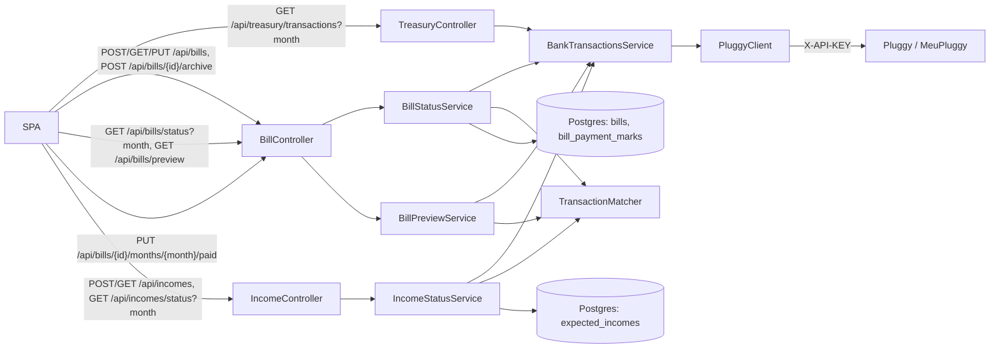

# Bills Checklist

## Problem

HomeTreasury shows a Home's balance and growth (`plans/dashboard/treasury-dashboard.md`) but cannot answer the two questions that matter month to month in a shared household: **"has every recurring bill been paid on time?"** and **"did the money to cover them arrive?"**. The Home funds its bills from one shared bank account (members send money into it), so both answers live in that account's transactions — but nothing in the app knows which transactions are "the electricity bill" or "Ana's contribution". This epic lets the OWNER declare the bills and incomes the Home expects each month, matches them against live bank transactions, and shows a month-by-month checklist with an alert when a bill is overdue.

## Decisions already made (from the planning interview)

These are settled; slices must not re-open them.

- **Money flow:** shared pot. Members send money into the one connected account; bills are paid from it.
- **"Planned" = declared.** The OWNER declares bills and expected incomes. No inference from history in v1.
- **Matching = keyword + direction + calendar month.** Amount never blocks a match; it only raises an "amount differs" hint (>15%).
- **Manual override** ("mark as paid") exists for payments the app cannot see.
- **Storage:** only declarations and manual marks are stored. Paid/unpaid is always computed live from Pluggy (same live-proxy approach as the dashboard). No transaction table.
- **Month = calendar month.** Browsable back ~12 months (Pluggy's history limit).
- **Bills are monthly only**, with a "pay by day X" (clamped to month end). `OVERDUE` starts the day **after** the pay-by day; a `PENDING` transaction counts as paid; `DUE_SOON` = pay-by day within 5 days.
- **Bill lifetime:** each bill has a `startMonth` (default: current month) and an `endMonth` (set automatically on archive; archive keeps past months). No hard delete.
- **Visibility:** everyone in the Home sees everything. **Editing** (create/edit/archive/mark paid) is OWNER-only.
- **Passive v1:** on-screen alerts only. No email, push or reminders.
- **Credit cards:** out of scope — only `BANK` accounts are read, which matches the dashboard's existing BANK/CREDIT split.
- **MeuPluggy (free tier) constraints:** `category` and `merchant` are not reliable (Pro-only), so matching never uses them. `paymentData` (sender/receiver name) may or may not be present depending on the bank; matching also looks at it when it exists, but never requires it. Slice 01 exists to find out what real data looks like before the matching rules are built.

## Domain terms

Use these words, and only these words, for these concepts in every slice.

- **Bill** (Java `Bill`, table `bills`): a recurring monthly payment the Home owes, declared by the OWNER — name, expected amount, pay-by day, keyword, start/end month. _Avoid_: "expense", "invoice" (credit card invoices are a different, out-of-scope thing).
- **Expected Income** (Java `ExpectedIncome`, table `expected_incomes`): a recurring monthly deposit the Home expects into the account — same shape as a Bill, matched against CREDIT transactions. _Avoid_: "contribution" (that is a member-specific idea reserved for the later member-shares epic).
- **Keyword**: the text the OWNER chooses (e.g. `ENEL`) that must appear (case- and accent-insensitive) in a transaction's description or counterpart name for it to match.
- **Month**: a calendar month, written `YYYY-MM` in URLs/JSON (`java.time.YearMonth`). _Avoid_: "cycle", "period" (the dashboard's `periodDays` is a rolling window, not this).
- **Pay-by date**: the Bill's pay-by day resolved inside a Month (day 31 in a 30-day month → the 30th).
- **Match**: the earliest bank transaction in the Month that satisfies a Bill's/Income's keyword and direction (DEBIT for bills, CREDIT for incomes).
- **Bill Status**: `PAID` (a Match exists, or a Manual Paid Mark), `OVERDUE` (not paid and today is after the pay-by date), `DUE_SOON` (not paid, pay-by date within 5 days), `UPCOMING` (otherwise).
- **Manual Paid Mark** (Java `BillPaymentMark`): an OWNER's statement that a Bill was paid in a given Month even though no Match exists.
- **Bank Transaction** (Java `BankTransaction`): HomeTreasury's view of one Pluggy transaction on a `BANK` account — dates as `LocalDate`, plus the counterpart's name when Pluggy provides it. _Avoid_: reusing `PluggyTransaction` outside the `pluggy` package.

## System data flow

## UI reference

The Bills screen (`/bills`) is one page, top to bottom: month picker, a summary strip (bills paid X of Y, expected bills total, money in vs expected incomes), the bills table (status chip, name, pay-by day, expected amount, amount found in bank, "mark paid" toggle), and an "Expected incomes" panel. An "Add bill" form with a live "matches found in the last 3 months" preview sits next to the table. A red banner for overdue bills appears at the top of **every** page (not only the Dashboard), so it is visible without opening Bills.

## Slices

Ordered by dependency, not by layer — every slice is one request path end to end (backend + the SPA piece that uses it).

1. **[Bank transactions of a month](01-month-transactions.md)** — `GET /api/treasury/transactions?month=`, plus a read-only Transactions page. First because every later slice reads this data, and because it is the quickest way to see what MeuPluggy really returns (descriptions, signs, counterpart names) before keywords are chosen.
2. **[Declare a bill](02-declare-bill.md)** — `POST /api/bills` + `GET /api/bills`, the `Bill` entity, and the first version of the Bills page. Needs nothing from slice 01 at runtime; ordered here so the entity exists before anything computes status.
3. **[Monthly bill status](03-monthly-bill-status.md)** — `GET /api/bills/status?month=`. The core feature: matching and `PAID/DUE_SOON/OVERDUE/UPCOMING`. Needs slice 01's `BankTransactionsService` and slice 02's `Bill`.
4. **[Manual paid mark](04-manual-paid-mark.md)** — `PUT /api/bills/{id}/months/{month}/paid`. Needs slice 03's status to flip.
5. **[Overdue banner](05-overdue-banner.md)** — SPA-only: global red banner from slice 03's status. Needs slice 03 (slice 04 only changes what counts as paid).
6. **[Add-bill preview](06-add-bill-preview.md)** — `GET /api/bills/preview?keyword=`. Helps pick keyword and expected amount; reuses slice 01's data and slice 03's matcher. Ordered after the status feature works so the preview and the real status use the same matching rule.
7. **[Edit and archive a bill](07-edit-archive-bill.md)** — `PUT /api/bills/{id}`, `POST /api/bills/{id}/archive`. Needs slice 02's entity and slice 03's `isActiveIn` rule (which honors `endMonth`).
8. **[Declare an expected income](08-declare-expected-income.md)** — `POST/GET /api/incomes`. Same shape as slice 02, different entity.
9. **[Monthly income status](09-monthly-income-status.md)** — `GET /api/incomes/status?month=`. Reuses slice 03's `TransactionMatcher` with CREDIT.
10. **[Coverage card](10-coverage-card.md)** — SPA-only summary: received vs expected incomes, and whether received money covers the month's bills. Needs both slice 03 and slice 09.

## Out of scope (epic-wide)

- **Per-member shares** ("did Carla pay her part?"), contribution models (fixed average vs. pass-through), reminders: separate epic, built on `ExpectedIncome`.
- **Charts and "unexpected expense" detection** (the cash-flow analytics screen): separate epic; needs the "planned" definition from this one plus history storage decisions.
- **Credit card invoices**, yearly/quarterly bills, splitting a bill across several transactions.
- **Editing/archiving Expected Incomes** — mirrors slice 07 for incomes; deliberately left as a follow-up slice so this epic stays small. Until then, a wrong income can only be fixed in the DB.
- **Push/email alerts, notification preferences.**
- **Caching.** The Bills page makes two status calls (bills, incomes), each re-fetching the month's transactions from Pluggy (`1 + N` calls each). If that becomes slow or hits rate limits, add a short (≈60 s) per-`(home, from, to)` cache inside `BankTransactionsService.forRange` — no other code needs to change.
- **Pluggy pagination beyond the first page** (500 per account). `BankTransactionsService` reports `truncated: true` when Pluggy says there is a next page; the SPA warns instead of silently undercounting.
- **Overdue alerts for earlier months.** The banner only looks at the current month.
- **Two bills with the same keyword.** Each bill matches independently, so a shared keyword could match the same transaction twice. Keep keywords distinct.
- **Automated tests.** Each slice has curl/UI verify steps; add `BillStatusCalculatorTest`/`TransactionMatcherTest` (pure functions, no Spring) as a follow-up once the rules stop moving.
