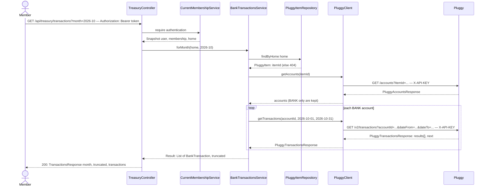

# Bank transactions of a month

**Prerequisite:** `pluggy-connection` slices 01–03 and `plans/dashboard/treasury-dashboard.md` are implemented (the Home has a linked `PluggyItem`; `PluggyClient.getAccounts(itemId)` / `getTransactions(accountId, from, to)` exist).

## What it does

Shows any member of a Home the bank transactions of one calendar month, across the Home's bank (`BANK`) accounts, newest first.

## Why

Every other slice in this epic decides "was this bill paid?" by looking at transactions, but nothing in the app displays them today — `TreasuryService.dashboard` only sums `amount`. On MeuPluggy's free tier we do not know in advance what a real descriptor looks like (is it `PAGAMENTO CONVENIO ENEL SP`? is the sender's name present on an incoming Pix?), and `category`/`merchant` are Pro-only so we cannot lean on them. Building this screen first removes the biggest unknown before any matching rule exists, and it becomes the debugging tool for every later slice.

Design choices tied to the code:

- **A new `BankTransactionsService`, not more code in `TreasuryService`.** `TreasuryService` already mixes balances, credit-card bills and growth. The bills/incomes slices need "this month's BANK transactions" as a reusable unit. The service exposes `forRange` (slice 06's preview needs more than one month) and `forMonth` (a thin wrapper).
- **`BankTransaction` instead of `PluggyTransaction` outside the `pluggy` package.** Pluggy's `date` is an ISO timestamp string (`2026-10-08T00:00:00.000Z`); callers shouldn't each re-parse it. `TreasuryService.billDueDate` already does `substring(0, 10)` for the same reason. Slicing the first 10 characters keeps Pluggy's calendar date as-is rather than shifting it through UTC→local conversion.
- **`truncated` flag.** `PluggyClient.getTransactions` reads only the first page, and `PluggyTransactionsResponse` already carries `next`. Instead of silently undercounting a very busy month, the response says so.
- **Frontend date formatting.** `new Date("2026-10-08")` is parsed as UTC midnight, so in Brazil (UTC-3) `toLocaleDateString` shows Oct 7. The existing `formatDate` in `lib/format.ts` is fine for timestamps (`linkedAt`) but wrong for calendar dates, so this slice adds `formatDay` for `YYYY-MM-DD` strings.

## Data flow



## Today → after

**Today** in [`PluggyTransaction.java`](../../src/main/java/com/glpalma/HomeTreasury/pluggy/PluggyTransaction.java): `record PluggyTransaction(id, description, amount, date, type, category)` — no `status`, `operationType` or `paymentData`.

**Today** in [`TreasuryController.java`](../../src/main/java/com/glpalma/HomeTreasury/treasury/TreasuryController.java): only `GET /api/treasury/dashboard`.

**Today** in [`App.tsx`](../../frontend/src/App.tsx) / [`Layout.tsx`](../../frontend/src/components/Layout.tsx): two routes (`/dashboard`, `/settings`) and two nav links.

**After:** `PluggyTransaction` also deserializes `status` (`PENDING`/`POSTED`), `operationType` (`PIX`, `BOLETO`, `CONVENIO_ARRECADACAO`, …) and `paymentData.payer/receiver.name`. `TreasuryController` gains `GET /api/treasury/transactions`. The SPA gets a `/transactions` page and nav link.

## Exact changes

Order: Pluggy records → domain record → service → response → controller → frontend helpers → api/hook → page → routing/nav.

- [x] **New** [`src/main/java/com/glpalma/HomeTreasury/pluggy/PluggyPaymentParty.java`](../../src/main/java/com/glpalma/HomeTreasury/pluggy/PluggyPaymentParty.java)
  ```java
  package com.glpalma.HomeTreasury.pluggy;

  /** One side (payer or receiver) of a Pluggy {@code paymentData}. Only the name is used. */
  public record PluggyPaymentParty(String name) {
  }
  ```

- [x] **New** [`src/main/java/com/glpalma/HomeTreasury/pluggy/PluggyPaymentData.java`](../../src/main/java/com/glpalma/HomeTreasury/pluggy/PluggyPaymentData.java)
  ```java
  package com.glpalma.HomeTreasury.pluggy;

  /**
   * Who sent/received a Pix, TED or boleto payment. Pluggy only fills this in for some
   * connectors, so every field here may be null.
   */
  public record PluggyPaymentData(PluggyPaymentParty payer, PluggyPaymentParty receiver) {
  }
  ```

- [x] **Edit** [`src/main/java/com/glpalma/HomeTreasury/pluggy/PluggyTransaction.java`](../../src/main/java/com/glpalma/HomeTreasury/pluggy/PluggyTransaction.java) — add `status`, `operationType`, `paymentData`
  ```java
  package com.glpalma.HomeTreasury.pluggy;

  import java.math.BigDecimal;

  public record PluggyTransaction(
          String id,
          String description,
          BigDecimal amount,
          String date,
          String type,
          String category,
          String status,
          String operationType,
          PluggyPaymentData paymentData
  ) {
  }
  ```

- [x] **New** [`src/main/java/com/glpalma/HomeTreasury/treasury/BankTransaction.java`](../../src/main/java/com/glpalma/HomeTreasury/treasury/BankTransaction.java)
  ```java
  package com.glpalma.HomeTreasury.treasury;

  import java.math.BigDecimal;
  import java.time.LocalDate;

  /**
   * One movement on a BANK account, in the shape the rest of HomeTreasury uses.
   *
   * @param type            Pluggy's {@code DEBIT} (money out) or {@code CREDIT} (money in).
   * @param status          {@code POSTED} or {@code PENDING}.
   * @param counterpartName For a CREDIT the payer's name, for a DEBIT the receiver's name; null
   *                        when Pluggy does not provide payment data for this transaction.
   */
  public record BankTransaction(
          String id,
          String accountId,
          String accountName,
          LocalDate date,
          String description,
          String counterpartName,
          BigDecimal amount,
          String type,
          String status,
          String operationType
  ) {
  }
  ```

- [x] **New** [`src/main/java/com/glpalma/HomeTreasury/treasury/BankTransactionsService.java`](../../src/main/java/com/glpalma/HomeTreasury/treasury/BankTransactionsService.java)
  ```java
  package com.glpalma.HomeTreasury.treasury;

  import com.glpalma.HomeTreasury.home.Home;
  import com.glpalma.HomeTreasury.home.PluggyItem;
  import com.glpalma.HomeTreasury.home.PluggyItemRepository;
  import com.glpalma.HomeTreasury.pluggy.PluggyAccount;
  import com.glpalma.HomeTreasury.pluggy.PluggyClient;
  import com.glpalma.HomeTreasury.pluggy.PluggyPaymentData;
  import com.glpalma.HomeTreasury.pluggy.PluggyTransaction;
  import com.glpalma.HomeTreasury.pluggy.PluggyTransactionsResponse;
  import org.springframework.http.HttpStatus;
  import org.springframework.stereotype.Service;
  import org.springframework.web.server.ResponseStatusException;

  import java.time.LocalDate;
  import java.time.YearMonth;
  import java.util.ArrayList;
  import java.util.Comparator;
  import java.util.List;

  /**
   * Reads a Home's BANK-account transactions live from Pluggy. Credit card accounts are skipped on
   * purpose: their transactions are purchases on an invoice, not movements of cash.
   */
  @Service
  public class BankTransactionsService {

      private static final String BANK_ACCOUNT_TYPE = "BANK";

      /**
       * @param truncated true when Pluggy reported another page for at least one account, i.e.
       *                  {@code transactions} is incomplete. Only the first page is read.
       */
      public record Result(List<BankTransaction> transactions, boolean truncated) {
      }

      private final PluggyClient pluggyClient;
      private final PluggyItemRepository pluggyItems;

      public BankTransactionsService(PluggyClient pluggyClient, PluggyItemRepository pluggyItems) {
          this.pluggyClient = pluggyClient;
          this.pluggyItems = pluggyItems;
      }

      public Result forMonth(Home home, YearMonth month) {
          return forRange(home, month.atDay(1), month.atEndOfMonth());
      }

      /** Both bounds inclusive. */
      public Result forRange(Home home, LocalDate from, LocalDate to) {
          PluggyItem item = pluggyItems.findByHome(home)
                  .orElseThrow(() -> new ResponseStatusException(
                          HttpStatus.NOT_FOUND, "No Pluggy item linked to this home"));

          var accountsResponse = pluggyClient.getAccounts(item.getItemId());
          List<PluggyAccount> accounts = accountsResponse == null || accountsResponse.results() == null
                  ? List.of()
                  : accountsResponse.results();

          List<BankTransaction> all = new ArrayList<>();
          boolean truncated = false;
          for (PluggyAccount account : accounts) {
              if (!BANK_ACCOUNT_TYPE.equals(account.type())) {
                  continue;
              }
              PluggyTransactionsResponse response = pluggyClient.getTransactions(account.id(), from, to);
              if (response == null || response.results() == null) {
                  continue;
              }
              if (response.next() != null) {
                  truncated = true;
              }
              for (PluggyTransaction tx : response.results()) {
                  BankTransaction mapped = toBankTransaction(account, tx);
                  // Pluggy's from/to filtering is by timestamp; re-check the calendar date ourselves
                  // so a transaction on the boundary day can never leak into the neighbouring month.
                  if (mapped != null && !mapped.date().isBefore(from) && !mapped.date().isAfter(to)) {
                      all.add(mapped);
                  }
              }
          }

          all.sort(Comparator.comparing(BankTransaction::date).reversed()
                  .thenComparing(tx -> tx.description() == null ? "" : tx.description()));
          return new Result(List.copyOf(all), truncated);
      }

      private static BankTransaction toBankTransaction(PluggyAccount account, PluggyTransaction tx) {
          if (tx.date() == null || tx.date().length() < 10) {
              return null;
          }
          return new BankTransaction(
                  tx.id(),
                  account.id(),
                  account.name(),
                  LocalDate.parse(tx.date().substring(0, 10)),
                  tx.description(),
                  counterpartName(tx),
                  tx.amount(),
                  tx.type(),
                  tx.status(),
                  tx.operationType()
          );
      }

      private static String counterpartName(PluggyTransaction tx) {
          PluggyPaymentData data = tx.paymentData();
          if (data == null) {
              return null;
          }
          var party = "CREDIT".equals(tx.type()) ? data.payer() : data.receiver();
          return party == null ? null : party.name();
      }
  }
  ```

- [x] **New** [`src/main/java/com/glpalma/HomeTreasury/treasury/TransactionsResponse.java`](../../src/main/java/com/glpalma/HomeTreasury/treasury/TransactionsResponse.java)
  ```java
  package com.glpalma.HomeTreasury.treasury;

  import java.time.YearMonth;
  import java.util.List;

  public record TransactionsResponse(
          YearMonth month,
          boolean truncated,
          List<BankTransaction> transactions
  ) {
  }
  ```

- [x] **Edit** [`src/main/java/com/glpalma/HomeTreasury/treasury/TreasuryController.java`](../../src/main/java/com/glpalma/HomeTreasury/treasury/TreasuryController.java) — add `GET /api/treasury/transactions`
  ```java
  package com.glpalma.HomeTreasury.treasury;

  import com.glpalma.HomeTreasury.user.CurrentMembershipService;
  import org.springframework.security.core.Authentication;
  import org.springframework.web.bind.annotation.GetMapping;
  import org.springframework.web.bind.annotation.RequestMapping;
  import org.springframework.web.bind.annotation.RequestParam;
  import org.springframework.web.bind.annotation.RestController;

  import java.time.YearMonth;

  @RestController
  @RequestMapping("/api/treasury")
  public class TreasuryController {

      private final TreasuryService treasuryService;
      private final BankTransactionsService bankTransactions;
      private final CurrentMembershipService memberships;

      public TreasuryController(
              TreasuryService treasuryService,
              BankTransactionsService bankTransactions,
              CurrentMembershipService memberships
      ) {
          this.treasuryService = treasuryService;
          this.bankTransactions = bankTransactions;
          this.memberships = memberships;
      }

      @GetMapping("/dashboard")
      public DashboardResponse dashboard(
              @RequestParam(defaultValue = "30") int periodDays,
              Authentication authentication
      ) {
          var home = memberships.require(authentication).home();
          return treasuryService.dashboard(home, periodDays);
      }

      @GetMapping("/transactions")
      public TransactionsResponse transactions(
              @RequestParam YearMonth month,
              Authentication authentication
      ) {
          var home = memberships.require(authentication).home();
          var result = bankTransactions.forMonth(home, month);
          return new TransactionsResponse(month, result.truncated(), result.transactions());
      }
  }
  ```

- [x] **New** [`frontend/src/lib/months.ts`](../../frontend/src/lib/months.ts) — month helpers shared by every page in this epic
  ```ts
  /** "YYYY-MM" for the current month in the browser's local time. */
  export function currentMonth(): string {
    const now = new Date();
    return `${now.getFullYear()}-${String(now.getMonth() + 1).padStart(2, "0")}`;
  }

  /** Moves a "YYYY-MM" string by `delta` months (negative = back). */
  export function shiftMonth(month: string, delta: number): string {
    const [year, mon] = month.split("-").map(Number);
    const shifted = new Date(year, mon - 1 + delta, 1);
    return `${shifted.getFullYear()}-${String(shifted.getMonth() + 1).padStart(2, "0")}`;
  }

  /** "October 2026" for "2026-10". */
  export function formatMonth(month: string): string {
    const [year, mon] = month.split("-").map(Number);
    return new Date(year, mon - 1, 1).toLocaleDateString(undefined, {
      month: "long",
      year: "numeric",
    });
  }

  /**
   * Formats a calendar date ("YYYY-MM-DD"). Do NOT use `new Date("2026-10-08")` for this: that is
   * parsed as UTC midnight and renders as Oct 7 in Brazil. Build the Date from its parts instead.
   */
  export function formatDay(isoDate: string): string {
    const [year, mon, day] = isoDate.slice(0, 10).split("-").map(Number);
    return new Date(year, mon - 1, day).toLocaleDateString(undefined, {
      month: "short",
      day: "numeric",
    });
  }
  ```

- [x] **New** [`frontend/src/lib/errors.ts`](../../frontend/src/lib/errors.ts)
  ```ts
  /** Turns an axios error from any HomeTreasury endpoint into a sentence for the user. */
  export function apiErrorMessage(error: unknown, fallback = "Something went wrong. Please try again."): string {
    const status = (error as any)?.response?.status;
    const detail = (error as any)?.response?.data?.detail;

    if (status === 404) {
      return detail ?? "No bank account is linked yet.";
    }
    if (status === 502) {
      return (
        detail ??
        "The bank data provider is unavailable. If you just connected an account, it may still be syncing — try again in a minute."
      );
    }
    return detail ?? fallback;
  }
  ```

- [x] **New** [`frontend/src/components/MonthPicker.tsx`](../../frontend/src/components/MonthPicker.tsx)
  ```tsx
  import { currentMonth, formatMonth, shiftMonth } from "../lib/months";

  // Pluggy only keeps ~12 months of history, so browsing further back would just show empty months.
  const MAX_MONTHS_BACK = 12;

  interface Props {
    value: string;
    onChange: (month: string) => void;
  }

  export function MonthPicker({ value, onChange }: Props) {
    const oldest = shiftMonth(currentMonth(), -MAX_MONTHS_BACK);
    const buttonClass =
      "rounded-md border border-slate-300 px-3 py-1.5 text-sm font-medium text-slate-700 hover:bg-slate-100 disabled:opacity-40";

    return (
      <div className="flex items-center gap-2">
        <button
          type="button"
          className={buttonClass}
          disabled={value <= oldest}
          onClick={() => onChange(shiftMonth(value, -1))}
          aria-label="Previous month"
        >
          ←
        </button>
        <span className="min-w-36 text-center text-sm font-medium text-slate-800">{formatMonth(value)}</span>
        <button
          type="button"
          className={buttonClass}
          onClick={() => onChange(shiftMonth(value, 1))}
          aria-label="Next month"
        >
          →
        </button>
      </div>
    );
  }
  ```

- [x] **New** [`frontend/src/api/transactions.ts`](../../frontend/src/api/transactions.ts)
  ```ts
  import { apiClient } from "./client";

  export interface BankTransaction {
    id: string;
    accountId: string;
    accountName: string;
    /** Calendar date, "YYYY-MM-DD". */
    date: string;
    description: string | null;
    counterpartName: string | null;
    /** Negative = money out, positive = money in. */
    amount: number;
    type: "DEBIT" | "CREDIT";
    status: "POSTED" | "PENDING" | null;
    operationType: string | null;
  }

  export interface TransactionsResponse {
    month: string;
    /** True when Pluggy has more transactions than the first page we read. */
    truncated: boolean;
    transactions: BankTransaction[];
  }

  export async function getTransactions(month: string): Promise<TransactionsResponse> {
    const { data } = await apiClient.get<TransactionsResponse>("/api/treasury/transactions", {
      params: { month },
    });
    return data;
  }
  ```

- [x] **New** [`frontend/src/hooks/useTransactions.ts`](../../frontend/src/hooks/useTransactions.ts)
  ```ts
  import { useQuery } from "@tanstack/react-query";
  import { getTransactions } from "../api/transactions";

  export function useTransactions(month: string) {
    return useQuery({
      queryKey: ["transactions", month],
      queryFn: () => getTransactions(month),
    });
  }
  ```

- [x] **New** [`frontend/src/pages/Transactions.tsx`](../../frontend/src/pages/Transactions.tsx)
  ```tsx
  import { useState } from "react";
  import { MonthPicker } from "../components/MonthPicker";
  import { useTransactions } from "../hooks/useTransactions";
  import { apiErrorMessage } from "../lib/errors";
  import { formatCurrency } from "../lib/format";
  import { currentMonth, formatDay } from "../lib/months";

  export function Transactions() {
    const [month, setMonth] = useState(currentMonth());
    const transactions = useTransactions(month);

    return (
      <div className="mx-auto max-w-4xl space-y-6 p-6">
        <div className="flex items-center justify-between">
          <h1 className="text-2xl font-semibold">Transactions</h1>
          <MonthPicker value={month} onChange={setMonth} />
        </div>

        {transactions.isLoading && <p className="text-slate-500">Loading transactions…</p>}

        {transactions.isError && (
          <div className="rounded-md border border-amber-300 bg-amber-50 p-4 text-sm text-amber-800">
            {apiErrorMessage(transactions.error, "Could not load transactions.")}
          </div>
        )}

        {transactions.data?.truncated && (
          <div className="rounded-md border border-amber-300 bg-amber-50 p-4 text-sm text-amber-800">
            This month has more transactions than we can load at once, so the list below is incomplete.
          </div>
        )}

        {transactions.data && (
          <div className="rounded-lg border border-slate-200 bg-white p-5 shadow-sm">
            {transactions.data.transactions.length === 0 ? (
              <p className="text-sm text-slate-500">No transactions in this month.</p>
            ) : (
              <table className="w-full text-left text-sm">
                <thead className="text-xs uppercase text-slate-400">
                  <tr>
                    <th className="pb-2 font-medium">Date</th>
                    <th className="pb-2 font-medium">Description</th>
                    <th className="pb-2 font-medium">Type</th>
                    <th className="pb-2 text-right font-medium">Amount</th>
                  </tr>
                </thead>
                <tbody className="divide-y divide-slate-100">
                  {transactions.data.transactions.map((tx) => (
                    <tr key={tx.id}>
                      <td className="py-2 pr-3 text-slate-600">{formatDay(tx.date)}</td>
                      <td className="py-2 pr-3">
                        <p className="font-medium text-slate-800">{tx.description ?? "—"}</p>
                        {tx.counterpartName && (
                          <p className="text-xs text-slate-400">
                            {tx.type === "CREDIT" ? "from" : "to"} {tx.counterpartName}
                          </p>
                        )}
                      </td>
                      <td className="py-2 pr-3 text-xs text-slate-500">
                        {tx.operationType ?? "—"}
                        {tx.status === "PENDING" && (
                          <span className="ml-2 rounded-full bg-amber-100 px-2 py-0.5 text-amber-800">pending</span>
                        )}
                      </td>
                      <td
                        className={`py-2 text-right font-medium ${
                          tx.amount < 0 ? "text-red-600" : "text-emerald-600"
                        }`}
                      >
                        {formatCurrency(tx.amount)}
                      </td>
                    </tr>
                  ))}
                </tbody>
              </table>
            )}
          </div>
        )}
      </div>
    );
  }
  ```

- [x] **Edit** [`frontend/src/App.tsx`](../../frontend/src/App.tsx) — add the `/transactions` route
  ```tsx
  import { Navigate, Route, Routes } from "react-router-dom";
  import { ProtectedRoute } from "./components/ProtectedRoute";
  import { Layout } from "./components/Layout";
  import { Login } from "./pages/Login";
  import { Register } from "./pages/Register";
  import { ForgotPassword } from "./pages/ForgotPassword";
  import { ResetPassword } from "./pages/ResetPassword";
  import { Dashboard } from "./pages/Dashboard";
  import { Settings } from "./pages/Settings";
  import { Transactions } from "./pages/Transactions";

  export default function App() {
    return (
      <Routes>
        <Route path="/login" element={<Login />} />
        <Route path="/register" element={<Register />} />
        <Route path="/forgot-password" element={<ForgotPassword />} />
        <Route path="/reset-password" element={<ResetPassword />} />

        <Route element={<ProtectedRoute />}>
          <Route element={<Layout />}>
            <Route path="/dashboard" element={<Dashboard />} />
            <Route path="/transactions" element={<Transactions />} />
            <Route path="/settings" element={<Settings />} />
          </Route>
        </Route>

        <Route path="/" element={<Navigate to="/dashboard" replace />} />
        <Route path="*" element={<Navigate to="/dashboard" replace />} />
      </Routes>
    );
  }
  ```

- [x] **Edit** [`frontend/src/components/Layout.tsx`](../../frontend/src/components/Layout.tsx) — add the "Transactions" nav link
  ```tsx
  import { NavLink, Outlet, useNavigate } from "react-router-dom";
  import { useAuth } from "../context/AuthContext";
  import { useMe } from "../hooks/useMe";

  export function Layout() {
    const { user, logout } = useAuth();
    const me = useMe();
    const navigate = useNavigate();

    const handleLogout = () => {
      logout();
      navigate("/login");
    };

    const navLinkClass = ({ isActive }: { isActive: boolean }) =>
      `text-sm font-medium ${isActive ? "text-slate-900" : "text-slate-500 hover:text-slate-700"}`;

    return (
      <div className="min-h-screen bg-slate-50">
        <header className="border-b border-slate-200 bg-white">
          <div className="mx-auto flex max-w-4xl items-center justify-between px-6 py-4">
            <div className="flex items-center gap-6">
              <span className="text-lg font-semibold">HomeTreasury</span>
              <nav className="flex gap-4">
                <NavLink to="/dashboard" className={navLinkClass}>
                  Dashboard
                </NavLink>
                <NavLink to="/transactions" className={navLinkClass}>
                  Transactions
                </NavLink>
                <NavLink to="/settings" className={navLinkClass}>
                  Settings
                </NavLink>
              </nav>
            </div>
            <div className="flex items-center gap-3 text-sm">
              <div className="text-right">
                <p className="font-medium text-slate-800">{me.data?.home.name ?? "—"}</p>
                <p className="text-slate-500">
                  {user?.email} · {user?.role}
                </p>
              </div>
              <button
                onClick={handleLogout}
                className="rounded-md border border-slate-300 px-3 py-1.5 text-sm font-medium text-slate-700 hover:bg-slate-100"
              >
                Log out
              </button>
            </div>
          </div>
        </header>
        <main>
          <Outlet />
        </main>
      </div>
    );
  }
  ```

## Verify

1. Backend: `./mvnw spring-boot:run` (or `mvnw.cmd spring-boot:run` on Windows). Frontend: `cd frontend && npm run dev`. The app must compile with no errors.
2. Log in as a member of a Home that has a linked Pluggy Item, then call:
   ```
   curl -i "http://localhost:8080/api/treasury/transactions?month=2026-10" \
     -H "Authorization: Bearer $TOKEN"
   ```
3. Expect `200 OK` with a body shaped like:
   ```json
   {
     "month": "2026-10",
     "truncated": false,
     "transactions": [
       { "id": "…", "accountId": "…", "accountName": "…", "date": "2026-10-08",
         "description": "…", "counterpartName": null, "amount": -212.40,
         "type": "DEBIT", "status": "POSTED", "operationType": "BOLETO" }
     ]
   }
   ```
   Every `date` starts with `2026-10`; none from September or November.
4. Boundary check: pick a transaction you know happened on the last day of a month. Confirm it appears in that month and not in the next one.
5. `curl -i "http://localhost:8080/api/treasury/transactions?month=banana" -H "Authorization: Bearer $TOKEN"` → expect `400`.
6. For a Home with no linked Pluggy Item → expect `404` with `"No Pluggy item linked to this home"`.
7. In the browser, open `/transactions`. Confirm the month picker moves back up to 12 months, outgoing amounts are red and incoming green, and a PENDING transaction shows the "pending" tag.
8. **Learn from your real data (this is the point of the slice):** write down, for your electricity, water, internet and rent payments, the exact `description` text and `operationType`, and — for an incoming Pix from another member — whether `counterpartName` is filled. You'll pick keywords from this in slice 02.

## Out of scope

- Filtering/searching, exporting, or editing transactions.
- Following Pluggy's `next` cursor; the response only reports that more exist (`truncated`).
- Credit card accounts' transactions (only `BANK` accounts are read).
- Caching (see the epic's out-of-scope list).
