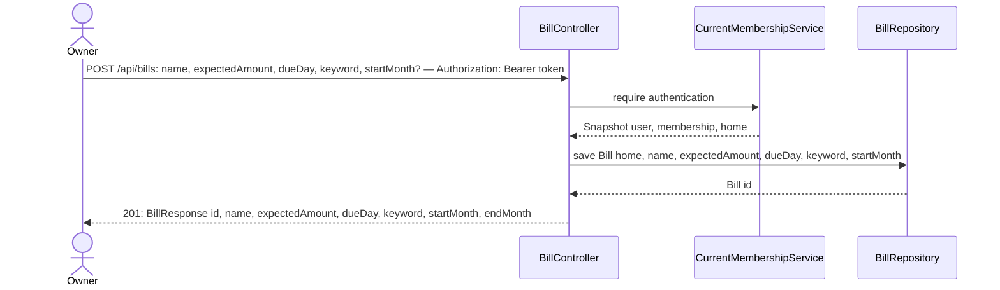
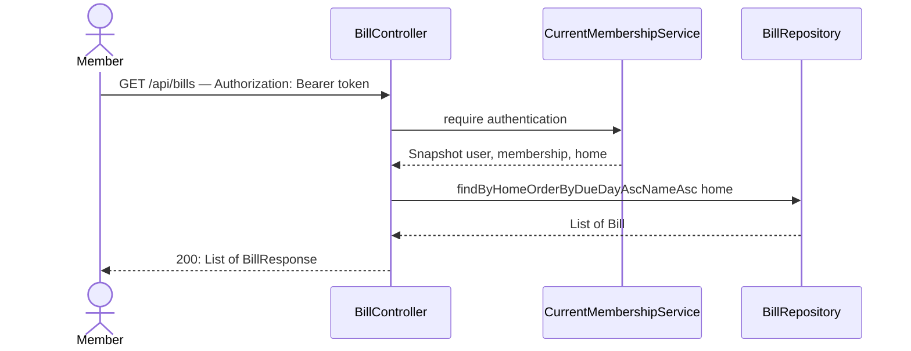

# Declare a bill

## What it does

Lets the OWNER declare a recurring monthly bill (name, expected amount, pay-by day, keyword, first month it applies) and lets every member see the list of declared bills.

## Why

The app can never discover "what should have been paid" by itself: Pluggy has no way to list boletos still owed (no DDA), and inferring recurring payments from history was ruled out for v1. So the OWNER's declaration is the only source of expectation, and it has to be persisted — unlike balances and transactions, which are a live proxy.

Design choices tied to the code:

- **Same ownership rules as the rest of the Home.** Creating a bill is `@PreAuthorize("hasRole('OWNER')")` like `HomeController.setIdealBalance` and `createInvite`; reading is open to any member (`VIEWER` included), like `GET /api/pluggy/item`. The Home comes from `CurrentMembershipService.require(...)`, never from the request body.
- **`startMonth` is stored from day one.** Paid/unpaid is computed live for whichever month is browsed, using the bill as it is defined *today*. Without a start month, a bill created in October would show as OVERDUE for every earlier month the user browses. It defaults to the current month; the OWNER can set an earlier one to see that bill's history. `endMonth` is added now (nullable) so slice 07's archive does not need a schema change; nothing writes it yet.
- **`YearMonth` through a JPA converter.** Hibernate does not map `java.time.YearMonth` to a readable column on its own. `YearMonthConverter` stores it as `"2026-10"` text, which also sorts correctly.
- **`HomeClock` fixes the time zone in one place.** The household is in Brazil; `LocalDate.now()` on a UTC server would flip to "tomorrow" at 21:00 local time and make "overdue" fire early. All "today"/"current month" decisions in this epic go through `HomeClock`.
- **Schema.** `application.properties` has `spring.jpa.hibernate.ddl-auto=update`, so the new `bills` table is created automatically; there is no migration tool in the project.
- **CORS.** `SecurityConfig` only allows `GET/POST/PUT/OPTIONS`. This epic therefore uses `PUT`/`POST` only (e.g. archive is `POST …/archive`, not `DELETE`), so no CORS change is needed.

## Data flow





(The create and the list are two tiny request paths that share one entity; they ship together because the list is the only way to see that the create worked.)

## Exact changes

Order: time helper → converter → entity → repository → request/response → controller → SPA api → hook → form → page → routing/nav.

- [x] **New** [`src/main/java/com/glpalma/HomeTreasury/bills/HomeClock.java`](../../src/main/java/com/glpalma/HomeTreasury/bills/HomeClock.java)
  ```java
  package com.glpalma.HomeTreasury.bills;

  import java.time.LocalDate;
  import java.time.YearMonth;
  import java.time.ZoneId;

  /**
   * The one place that answers "what day is it?" for bill logic. The household lives in Brazil, so
   * "today" must be Brazilian today regardless of the server's own time zone.
   */
  public final class HomeClock {

      private static final ZoneId ZONE = ZoneId.of("America/Sao_Paulo");

      private HomeClock() {
      }

      public static LocalDate today() {
          return LocalDate.now(ZONE);
      }

      public static YearMonth currentMonth() {
          return YearMonth.from(today());
      }
  }
  ```

- [x] **New** [`src/main/java/com/glpalma/HomeTreasury/bills/YearMonthConverter.java`](../../src/main/java/com/glpalma/HomeTreasury/bills/YearMonthConverter.java)
  ```java
  package com.glpalma.HomeTreasury.bills;

  import jakarta.persistence.AttributeConverter;
  import jakarta.persistence.Converter;

  import java.time.YearMonth;

  /** Stores a {@link YearMonth} as text like "2026-10" in every entity that has one. */
  @Converter(autoApply = true)
  public class YearMonthConverter implements AttributeConverter<YearMonth, String> {

      @Override
      public String convertToDatabaseColumn(YearMonth attribute) {
          return attribute == null ? null : attribute.toString();
      }

      @Override
      public YearMonth convertToEntityAttribute(String dbData) {
          return dbData == null ? null : YearMonth.parse(dbData);
      }
  }
  ```

- [x] **New** [`src/main/java/com/glpalma/HomeTreasury/bills/Bill.java`](../../src/main/java/com/glpalma/HomeTreasury/bills/Bill.java)
  ```java
  package com.glpalma.HomeTreasury.bills;

  import com.glpalma.HomeTreasury.home.Home;
  import jakarta.persistence.*;

  import java.math.BigDecimal;
  import java.time.YearMonth;

  @Entity
  @Table(name = "bills")
  public class Bill {

      @Id
      @GeneratedValue(strategy = GenerationType.IDENTITY)
      private Long id;

      @ManyToOne(optional = false)
      @JoinColumn(name = "home_id")
      private Home home;

      @Column(nullable = false)
      private String name;

      @Column(nullable = false, precision = 12, scale = 2)
      private BigDecimal expectedAmount;

      /** 1–31. In shorter months the pay-by date is clamped to the last day of the month. */
      @Column(nullable = false)
      private int dueDay;

      /** Matched case- and accent-insensitively against a transaction's description. */
      @Column(nullable = false)
      private String keyword;

      /** First month this bill applies to (inclusive). */
      @Column(nullable = false)
      private YearMonth startMonth;

      /** Last month this bill applies to (inclusive); null = still active. Set by archiving. */
      private YearMonth endMonth;

      protected Bill() {
      }

      public Bill(Home home, String name, BigDecimal expectedAmount, int dueDay, String keyword, YearMonth startMonth) {
          this.home = home;
          this.name = name;
          this.expectedAmount = expectedAmount;
          this.dueDay = dueDay;
          this.keyword = keyword;
          this.startMonth = startMonth;
      }

      public Long getId() {
          return id;
      }

      public Home getHome() {
          return home;
      }

      public String getName() {
          return name;
      }

      public BigDecimal getExpectedAmount() {
          return expectedAmount;
      }

      public int getDueDay() {
          return dueDay;
      }

      public String getKeyword() {
          return keyword;
      }

      public YearMonth getStartMonth() {
          return startMonth;
      }

      public YearMonth getEndMonth() {
          return endMonth;
      }
  }
  ```

- [x] **New** [`src/main/java/com/glpalma/HomeTreasury/bills/BillRepository.java`](../../src/main/java/com/glpalma/HomeTreasury/bills/BillRepository.java)
  ```java
  package com.glpalma.HomeTreasury.bills;

  import com.glpalma.HomeTreasury.home.Home;
  import org.springframework.data.jpa.repository.JpaRepository;

  import java.util.List;

  public interface BillRepository extends JpaRepository<Bill, Long> {

      List<Bill> findByHomeOrderByDueDayAscNameAsc(Home home);
  }
  ```

- [x] **New** [`src/main/java/com/glpalma/HomeTreasury/bills/CreateBillRequest.java`](../../src/main/java/com/glpalma/HomeTreasury/bills/CreateBillRequest.java)
  ```java
  package com.glpalma.HomeTreasury.bills;

  import jakarta.validation.constraints.DecimalMin;
  import jakarta.validation.constraints.Max;
  import jakarta.validation.constraints.Min;
  import jakarta.validation.constraints.NotBlank;
  import jakarta.validation.constraints.NotNull;

  import java.math.BigDecimal;
  import java.time.YearMonth;

  /** {@code startMonth} may be omitted; it then defaults to the current month. */
  public record CreateBillRequest(
          @NotBlank String name,
          @NotNull @DecimalMin("0.01") BigDecimal expectedAmount,
          @Min(1) @Max(31) int dueDay,
          @NotBlank String keyword,
          YearMonth startMonth
  ) {
  }
  ```

- [x] **New** [`src/main/java/com/glpalma/HomeTreasury/bills/BillResponse.java`](../../src/main/java/com/glpalma/HomeTreasury/bills/BillResponse.java)
  ```java
  package com.glpalma.HomeTreasury.bills;

  import java.math.BigDecimal;
  import java.time.YearMonth;

  public record BillResponse(
          Long id,
          String name,
          BigDecimal expectedAmount,
          int dueDay,
          String keyword,
          YearMonth startMonth,
          YearMonth endMonth
  ) {
      public static BillResponse from(Bill bill) {
          return new BillResponse(
                  bill.getId(),
                  bill.getName(),
                  bill.getExpectedAmount(),
                  bill.getDueDay(),
                  bill.getKeyword(),
                  bill.getStartMonth(),
                  bill.getEndMonth()
          );
      }
  }
  ```

- [x] **New** [`src/main/java/com/glpalma/HomeTreasury/bills/BillController.java`](../../src/main/java/com/glpalma/HomeTreasury/bills/BillController.java)
  ```java
  package com.glpalma.HomeTreasury.bills;

  import com.glpalma.HomeTreasury.home.Home;
  import com.glpalma.HomeTreasury.user.CurrentMembershipService;
  import jakarta.validation.Valid;
  import org.springframework.http.HttpStatus;
  import org.springframework.security.access.prepost.PreAuthorize;
  import org.springframework.security.core.Authentication;
  import org.springframework.web.bind.annotation.*;

  import java.time.YearMonth;
  import java.util.List;

  @RestController
  @RequestMapping("/api/bills")
  public class BillController {

      private final CurrentMembershipService memberships;
      private final BillRepository bills;

      public BillController(CurrentMembershipService memberships, BillRepository bills) {
          this.memberships = memberships;
          this.bills = bills;
      }

      @PreAuthorize("hasRole('OWNER')")
      @PostMapping
      @ResponseStatus(HttpStatus.CREATED)
      public BillResponse create(
              @Valid @RequestBody CreateBillRequest request,
              Authentication authentication
      ) {
          Home home = memberships.require(authentication).home();
          YearMonth startMonth = request.startMonth() == null ? HomeClock.currentMonth() : request.startMonth();
          Bill saved = bills.save(new Bill(
                  home,
                  request.name().trim(),
                  request.expectedAmount(),
                  request.dueDay(),
                  request.keyword().trim(),
                  startMonth
          ));
          return BillResponse.from(saved);
      }

      @GetMapping
      public List<BillResponse> list(Authentication authentication) {
          Home home = memberships.require(authentication).home();
          return bills.findByHomeOrderByDueDayAscNameAsc(home).stream()
                  .map(BillResponse::from)
                  .toList();
      }
  }
  ```

- [x] **New** [`frontend/src/api/bills.ts`](../../frontend/src/api/bills.ts)
  ```ts
  import { apiClient } from "./client";

  export interface Bill {
    id: number;
    name: string;
    expectedAmount: number;
    /** Pay-by day of the month, 1–31. */
    dueDay: number;
    keyword: string;
    /** "YYYY-MM", first month this bill applies to. */
    startMonth: string;
    /** "YYYY-MM", last month it applies to; null while active. */
    endMonth: string | null;
  }

  export interface BillInput {
    name: string;
    expectedAmount: number;
    dueDay: number;
    keyword: string;
    startMonth: string;
  }

  export async function listBills(): Promise<Bill[]> {
    const { data } = await apiClient.get<Bill[]>("/api/bills");
    return data;
  }

  export async function createBill(input: BillInput): Promise<Bill> {
    const { data } = await apiClient.post<Bill>("/api/bills", input);
    return data;
  }
  ```

- [x] **New** [`frontend/src/hooks/useBills.ts`](../../frontend/src/hooks/useBills.ts)
  ```ts
  import { useMutation, useQuery, useQueryClient } from "@tanstack/react-query";
  import { createBill, listBills } from "../api/bills";

  export function useBills() {
    return useQuery({
      queryKey: ["bills"],
      queryFn: listBills,
    });
  }

  export function useCreateBill() {
    const queryClient = useQueryClient();
    return useMutation({
      mutationFn: createBill,
      onSuccess: () => {
        queryClient.invalidateQueries({ queryKey: ["bills"] });
        queryClient.invalidateQueries({ queryKey: ["bill-status"] });
      },
    });
  }
  ```

- [x] **New** [`frontend/src/components/bills/BillForm.tsx`](../../frontend/src/components/bills/BillForm.tsx) — used for creating now, and for editing in slice 07
  ```tsx
  import { useState, type FormEvent } from "react";
  import type { BillInput } from "../../api/bills";
  import { currentMonth } from "../../lib/months";

  interface Props {
    /** Pre-fills the form (edit mode). Omit for a blank "add" form. */
    initial?: BillInput;
    submitLabel: string;
    /** Resolves when saved; rejects (axios error) when the server refuses. */
    onSubmit: (input: BillInput) => Promise<unknown>;
    onCancel?: () => void;
    /** Clear the fields after a successful save (add mode). */
    resetOnSuccess?: boolean;
  }

  const inputClass =
    "w-full rounded-md border border-slate-300 px-3 py-2 text-sm focus:border-slate-500 focus:outline-none";

  export function BillForm({ initial, submitLabel, onSubmit, onCancel, resetOnSuccess }: Props) {
    const [name, setName] = useState(initial?.name ?? "");
    const [expectedAmount, setExpectedAmount] = useState(initial ? String(initial.expectedAmount) : "");
    const [dueDay, setDueDay] = useState(initial ? String(initial.dueDay) : "");
    const [keyword, setKeyword] = useState(initial?.keyword ?? "");
    const [startMonth, setStartMonth] = useState(initial?.startMonth ?? currentMonth());
    const [saving, setSaving] = useState(false);
    const [error, setError] = useState<string | null>(null);

    const handleSubmit = async (event: FormEvent) => {
      event.preventDefault();
      setSaving(true);
      setError(null);
      try {
        await onSubmit({
          name: name.trim(),
          expectedAmount: Number(expectedAmount),
          dueDay: Number(dueDay),
          keyword: keyword.trim(),
          startMonth,
        });
        if (resetOnSuccess) {
          setName("");
          setExpectedAmount("");
          setDueDay("");
          setKeyword("");
          setStartMonth(currentMonth());
        }
      } catch (err) {
        const detail = (err as any)?.response?.data?.detail;
        setError(detail ?? "Could not save the bill.");
      } finally {
        setSaving(false);
      }
    };

    return (
      <form onSubmit={handleSubmit} className="space-y-3">
        <div>
          <label className="mb-1 block text-sm font-medium text-slate-700">Name</label>
          <input required className={inputClass} value={name} onChange={(e) => setName(e.target.value)} />
        </div>
        <div className="grid grid-cols-2 gap-3">
          <div>
            <label className="mb-1 block text-sm font-medium text-slate-700">Expected amount</label>
            <input
              required
              type="number"
              step="0.01"
              min="0.01"
              className={inputClass}
              value={expectedAmount}
              onChange={(e) => setExpectedAmount(e.target.value)}
            />
          </div>
          <div>
            <label className="mb-1 block text-sm font-medium text-slate-700">Pay by day of month</label>
            <input
              required
              type="number"
              min="1"
              max="31"
              className={inputClass}
              value={dueDay}
              onChange={(e) => setDueDay(e.target.value)}
            />
          </div>
        </div>
        <div>
          <label className="mb-1 block text-sm font-medium text-slate-700">
            Keyword to find in the bank description
          </label>
          <input
            required
            className={inputClass}
            value={keyword}
            onChange={(e) => setKeyword(e.target.value)}
            placeholder="e.g. ENEL"
          />
          <p className="mt-1 text-xs text-slate-400">
            Use text you saw on the Transactions page. Case and accents are ignored.
          </p>
        </div>
        <div>
          <label className="mb-1 block text-sm font-medium text-slate-700">Starts in</label>
          <input
            required
            type="month"
            className={inputClass}
            value={startMonth}
            onChange={(e) => setStartMonth(e.target.value)}
          />
        </div>
        {error && <p className="text-sm text-red-600">{error}</p>}
        <div className="flex gap-2">
          <button
            type="submit"
            disabled={saving}
            className="rounded-md bg-slate-900 px-3 py-2 text-sm font-medium text-white hover:bg-slate-700 disabled:opacity-50"
          >
            {saving ? "Saving…" : submitLabel}
          </button>
          {onCancel && (
            <button
              type="button"
              onClick={onCancel}
              className="rounded-md border border-slate-300 px-3 py-2 text-sm font-medium text-slate-700 hover:bg-slate-100"
            >
              Cancel
            </button>
          )}
        </div>
      </form>
    );
  }
  ```

- [x] **New** [`frontend/src/pages/Bills.tsx`](../../frontend/src/pages/Bills.tsx) — first version: just the declared bills and the add form (slice 03 turns this into the monthly checklist)
  ```tsx
  import { BillForm } from "../components/bills/BillForm";
  import { useAuth } from "../context/AuthContext";
  import { useBills, useCreateBill } from "../hooks/useBills";
  import { apiErrorMessage } from "../lib/errors";
  import { formatCurrency } from "../lib/format";
  import { formatMonth } from "../lib/months";

  export function Bills() {
    const { user } = useAuth();
    const isOwner = user?.role === "OWNER";
    const bills = useBills();
    const createBill = useCreateBill();

    return (
      <div className="mx-auto max-w-4xl space-y-6 p-6">
        <h1 className="text-2xl font-semibold">Bills</h1>

        {bills.isError && (
          <div className="rounded-md border border-amber-300 bg-amber-50 p-4 text-sm text-amber-800">
            {apiErrorMessage(bills.error, "Could not load bills.")}
          </div>
        )}

        <div className="rounded-lg border border-slate-200 bg-white p-5 shadow-sm">
          <h2 className="mb-3 text-sm font-medium text-slate-500">Declared bills</h2>
          {bills.isLoading && <p className="text-sm text-slate-500">Loading…</p>}
          {bills.data && bills.data.length === 0 && (
            <p className="text-sm text-slate-500">No bills declared yet.</p>
          )}
          {bills.data && bills.data.length > 0 && (
            <ul className="divide-y divide-slate-100">
              {bills.data.map((bill) => (
                <li key={bill.id} className="flex items-center justify-between py-2 text-sm">
                  <div>
                    <p className="font-medium text-slate-800">{bill.name}</p>
                    <p className="text-xs text-slate-400">
                      Pay by day {bill.dueDay} · keyword “{bill.keyword}” · from {formatMonth(bill.startMonth)}
                    </p>
                  </div>
                  <p className="font-medium text-slate-700">{formatCurrency(bill.expectedAmount)}</p>
                </li>
              ))}
            </ul>
          )}
        </div>

        {isOwner && (
          <div className="rounded-lg border border-slate-200 bg-white p-5 shadow-sm">
            <h2 className="mb-3 text-sm font-medium text-slate-500">Add a bill</h2>
            <BillForm
              submitLabel="Add bill"
              resetOnSuccess
              onSubmit={(input) => createBill.mutateAsync(input)}
            />
          </div>
        )}
      </div>
    );
  }
  ```

- [x] **Edit** [`frontend/src/App.tsx`](../../frontend/src/App.tsx) — add the `/bills` route (keeps slice 01's `/transactions`)
  ```tsx
  import { Navigate, Route, Routes } from "react-router-dom";
  import { ProtectedRoute } from "./components/ProtectedRoute";
  import { Layout } from "./components/Layout";
  import { Login } from "./pages/Login";
  import { Register } from "./pages/Register";
  import { ForgotPassword } from "./pages/ForgotPassword";
  import { ResetPassword } from "./pages/ResetPassword";
  import { Dashboard } from "./pages/Dashboard";
  import { Bills } from "./pages/Bills";
  import { Settings } from "./pages/Settings";
  import { Transactions } from "./pages/Transactions";

  export default function App() {
    return (
      <Routes>
        <Route path="/login" element={<Login />} />
        <Route path="/register" element={<Register />} />
        <Route path="/forgot-password" element={<ForgotPassword />} />
        <Route path="/reset-password" element={<ResetPassword />} />

        <Route element={<ProtectedRoute />}>
          <Route element={<Layout />}>
            <Route path="/dashboard" element={<Dashboard />} />
            <Route path="/bills" element={<Bills />} />
            <Route path="/transactions" element={<Transactions />} />
            <Route path="/settings" element={<Settings />} />
          </Route>
        </Route>

        <Route path="/" element={<Navigate to="/dashboard" replace />} />
        <Route path="*" element={<Navigate to="/dashboard" replace />} />
      </Routes>
    );
  }
  ```

- [x] **Edit** [`frontend/src/components/Layout.tsx`](../../frontend/src/components/Layout.tsx) — add the "Bills" nav link
  ```tsx
  import { NavLink, Outlet, useNavigate } from "react-router-dom";
  import { useAuth } from "../context/AuthContext";
  import { useMe } from "../hooks/useMe";

  export function Layout() {
    const { user, logout } = useAuth();
    const me = useMe();
    const navigate = useNavigate();

    const handleLogout = () => {
      logout();
      navigate("/login");
    };

    const navLinkClass = ({ isActive }: { isActive: boolean }) =>
      `text-sm font-medium ${isActive ? "text-slate-900" : "text-slate-500 hover:text-slate-700"}`;

    return (
      <div className="min-h-screen bg-slate-50">
        <header className="border-b border-slate-200 bg-white">
          <div className="mx-auto flex max-w-4xl items-center justify-between px-6 py-4">
            <div className="flex items-center gap-6">
              <span className="text-lg font-semibold">HomeTreasury</span>
              <nav className="flex gap-4">
                <NavLink to="/dashboard" className={navLinkClass}>
                  Dashboard
                </NavLink>
                <NavLink to="/bills" className={navLinkClass}>
                  Bills
                </NavLink>
                <NavLink to="/transactions" className={navLinkClass}>
                  Transactions
                </NavLink>
                <NavLink to="/settings" className={navLinkClass}>
                  Settings
                </NavLink>
              </nav>
            </div>
            <div className="flex items-center gap-3 text-sm">
              <div className="text-right">
                <p className="font-medium text-slate-800">{me.data?.home.name ?? "—"}</p>
                <p className="text-slate-500">
                  {user?.email} · {user?.role}
                </p>
              </div>
              <button
                onClick={handleLogout}
                className="rounded-md border border-slate-300 px-3 py-1.5 text-sm font-medium text-slate-700 hover:bg-slate-100"
              >
                Log out
              </button>
            </div>
          </div>
        </header>
        <main>
          <Outlet />
        </main>
      </div>
    );
  }
  ```

## Verify

1. Start the backend and frontend. On startup Hibernate logs `create table bills` (the project has `show-sql=true`).
2. As OWNER, create a bill (use a keyword you noted in slice 01's verify step 8):
   ```
   curl -i -X POST http://localhost:8080/api/bills \
     -H "Authorization: Bearer $OWNER_TOKEN" \
     -H "Content-Type: application/json" \
     -d '{"name":"Electricity","expectedAmount":210.00,"dueDay":8,"keyword":"ENEL"}'
   ```
3. Expect `201 Created` with `"startMonth":"<current month>"`, `"endMonth":null` and a numeric `id`.
4. `curl -i http://localhost:8080/api/bills -H "Authorization: Bearer $VIEWER_TOKEN"` (a VIEWER of the same Home) → `200 OK`, a list containing Electricity.
5. Same `POST` as a VIEWER → `403`.
6. Invalid bodies → `400` with an `errors` array: `"dueDay":32`, `"expectedAmount":0`, `"keyword":"  "`.
7. A second Home's OWNER calling `GET /api/bills` must **not** see Electricity.
8. In the browser: open `/bills` as OWNER, add a bill with the form; it appears in "Declared bills". As VIEWER the form is not shown.

## Out of scope

- Whether the bill was paid (slice 03), editing or archiving (slice 07), preview of matches while typing the keyword (slice 06).
- Duplicate-name or duplicate-keyword checks.
- Setting `endMonth` — the column exists but nothing writes it yet.
