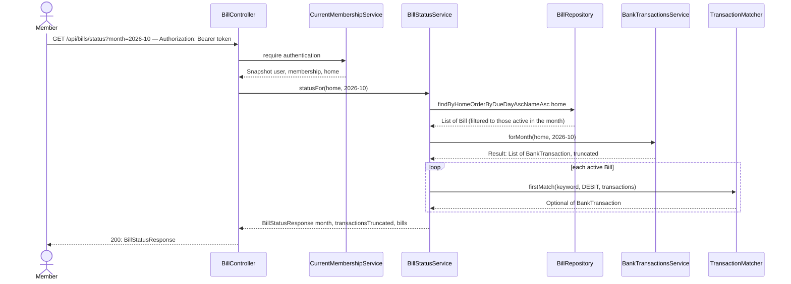

# Monthly bill status

**Prerequisites:** slice 01 (`BankTransactionsService`, `BankTransaction`, `MonthPicker`, `lib/months.ts`) and slice 02 (`Bill`, `BillRepository`, `HomeClock`, `BillController`, `BillForm`, the Bills page).

## What it does

For a chosen month, tells every member which declared bills are paid, due soon, overdue or still upcoming, and which bank transaction proved each payment.

## Why

This is the feature the whole epic exists for: "has everything been paid?". It follows the settled rules (see the epic overview): a bill is `PAID` when a DEBIT bank transaction in that calendar month contains the bill's keyword; amount never blocks a match, it only raises an `amountDiffers` hint; `OVERDUE` starts the day *after* the pay-by date (so paying on the deadline day is on time); `DUE_SOON` is within 5 days.

Design choices tied to the code:

- **Computed, not stored.** Nothing about "paid" is persisted — the status is derived on every call from `bills` + live Pluggy transactions via `BankTransactionsService`. That matches the dashboard's live-proxy design, and means browsing back a month needs no job or backfill.
- **Pure rules in two small classes.** `TransactionMatcher` (keyword + direction) and `BillStatusCalculator` (dates → status) take plain values and touch neither Spring nor Pluggy. They are the rules most likely to be tuned, and the only code that needs unit tests first. `TransactionMatcher` takes a `Direction` so slice 09 can reuse it unchanged for incomes (CREDIT).
- **Accent-insensitive matching.** Brazilian bank descriptors often come uppercased and with or without accents (`CONDOMÍNIO` vs `CONDOMINIO`). Both sides are normalized (NFD, accents stripped, lowercase) before `contains`.
- **Description *and* counterpart name.** On some banks the biller's name is only in `paymentData.receiver.name`. The matcher looks at both, but never requires the counterpart.
- **No Pluggy call when nothing is active.** If no bill applies in the month, the service returns an empty list without touching Pluggy (so an OWNER who has declared nothing, or a Home without a bank, doesn't get a 404/502 for no reason).
- **`PENDING` counts.** `BankTransaction.status` is not filtered: a pending debit means the money has left, and the data lag between bank and Pluggy is exactly what would otherwise cause false overdue alerts.
- **`isActiveIn` honours `endMonth`.** Slice 07's archive only has to set `endMonth`; this rule already hides the bill from later months while keeping earlier ones.
- **Two bills with the same keyword** match independently (out of scope to de-duplicate).

## Data flow



## Today → after

**Today** in [`BillController.java`](../../src/main/java/com/glpalma/HomeTreasury/bills/BillController.java) (slice 02): `POST /api/bills` and `GET /api/bills` only.

**Today** in [`Bills.tsx`](../../frontend/src/pages/Bills.tsx) (slice 02): a plain list of declared bills plus the add form; no months, no status.

**After:** `GET /api/bills/status?month=` exists and the Bills page becomes the monthly checklist (month picker + status table), keeping the add form below it.

## Exact changes

Order: enum → pure rules → response records → service → controller → SPA api/hook → components → page.

- [x] **New** [`src/main/java/com/glpalma/HomeTreasury/bills/BillStatus.java`](../../src/main/java/com/glpalma/HomeTreasury/bills/BillStatus.java)
  ```java
  package com.glpalma.HomeTreasury.bills;

  public enum BillStatus {
      /** A matching DEBIT exists in the month (or the OWNER marked it paid). */
      PAID,
      /** Not paid, and the pay-by date is today or within the next 5 days. */
      DUE_SOON,
      /** Not paid, and the pay-by date is already behind us. */
      OVERDUE,
      /** Not paid, and the pay-by date is more than 5 days away. */
      UPCOMING
  }
  ```

- [x] **New** [`src/main/java/com/glpalma/HomeTreasury/bills/TransactionMatcher.java`](../../src/main/java/com/glpalma/HomeTreasury/bills/TransactionMatcher.java)
  ```java
  package com.glpalma.HomeTreasury.bills;

  import com.glpalma.HomeTreasury.treasury.BankTransaction;

  import java.text.Normalizer;
  import java.util.Comparator;
  import java.util.List;
  import java.util.Locale;
  import java.util.Optional;

  /**
   * Decides which bank transactions belong to a bill or income. Pure: no Spring, no Pluggy.
   * A transaction matches when its type equals {@code direction} and the keyword appears in its
   * description or counterpart name, ignoring case and accents.
   */
  public final class TransactionMatcher {

      public enum Direction {
          /** Money out of the account (bills). */
          DEBIT,
          /** Money into the account (incomes). */
          CREDIT
      }

      private TransactionMatcher() {
      }

      /** All matches, oldest first. */
      public static List<BankTransaction> matches(String keyword, Direction direction, List<BankTransaction> transactions) {
          String needle = normalize(keyword);
          if (needle.isEmpty()) {
              return List.of();
          }
          return transactions.stream()
                  .filter(tx -> direction.name().equals(tx.type()))
                  .filter(tx -> normalize(tx.description() + " " + nullToEmpty(tx.counterpartName())).contains(needle))
                  .sorted(Comparator.comparing(BankTransaction::date))
                  .toList();
      }

      /** The earliest match, if any. */
      public static Optional<BankTransaction> firstMatch(String keyword, Direction direction, List<BankTransaction> transactions) {
          return matches(keyword, direction, transactions).stream().findFirst();
      }

      static String normalize(String text) {
          if (text == null) {
              return "";
          }
          return Normalizer.normalize(text, Normalizer.Form.NFD)
                  .replaceAll("\\p{M}+", "")
                  .toLowerCase(Locale.ROOT)
                  .trim();
      }

      private static String nullToEmpty(String text) {
          return text == null ? "" : text;
      }
  }
  ```
  Note: `tx.description() + " " + …` yields the text `"null …"` when the description is null, which could only match a keyword containing "null". Acceptable; if it ever matters, guard it the same way `counterpartName` is.

- [x] **New** [`src/main/java/com/glpalma/HomeTreasury/bills/BillStatusCalculator.java`](../../src/main/java/com/glpalma/HomeTreasury/bills/BillStatusCalculator.java)
  ```java
  package com.glpalma.HomeTreasury.bills;

  import java.time.LocalDate;
  import java.time.YearMonth;

  /** The date rules for bill status. Pure: pass "today" in, get a status out. */
  public final class BillStatusCalculator {

      /** How many days before the pay-by date a bill starts to count as "due soon". */
      static final int DUE_SOON_DAYS = 5;

      private BillStatusCalculator() {
      }

      /** The bill's pay-by day inside {@code month}; day 31 in a 30-day month becomes the 30th. */
      public static LocalDate payByDate(YearMonth month, int dueDay) {
          return month.atDay(Math.min(dueDay, month.lengthOfMonth()));
      }

      public static BillStatus statusOf(LocalDate payBy, boolean paid, LocalDate today) {
          if (paid) {
              return BillStatus.PAID;
          }
          // Paying on the pay-by day itself is on time, so overdue starts the day after.
          if (today.isAfter(payBy)) {
              return BillStatus.OVERDUE;
          }
          if (!payBy.isAfter(today.plusDays(DUE_SOON_DAYS))) {
              return BillStatus.DUE_SOON;
          }
          return BillStatus.UPCOMING;
      }
  }
  ```

- [x] **New** [`src/main/java/com/glpalma/HomeTreasury/bills/BillMatch.java`](../../src/main/java/com/glpalma/HomeTreasury/bills/BillMatch.java)
  ```java
  package com.glpalma.HomeTreasury.bills;

  import com.glpalma.HomeTreasury.treasury.BankTransaction;

  import java.math.BigDecimal;
  import java.math.RoundingMode;
  import java.time.LocalDate;

  /**
   * The bank transaction that proves a payment (or receipt, for incomes).
   *
   * @param amount         Absolute value: how much actually moved.
   * @param amountDiffers  True when {@code amount} is more than 15% away from the expected amount.
   */
  public record BillMatch(
          String transactionId,
          LocalDate date,
          String description,
          BigDecimal amount,
          boolean amountDiffers
  ) {
      private static final BigDecimal TOLERANCE = new BigDecimal("0.15");

      public static BillMatch of(BankTransaction tx, BigDecimal expectedAmount) {
          BigDecimal actual = tx.amount() == null ? BigDecimal.ZERO : tx.amount().abs();
          BigDecimal allowedGap = expectedAmount.multiply(TOLERANCE).setScale(2, RoundingMode.HALF_UP);
          boolean differs = actual.subtract(expectedAmount).abs().compareTo(allowedGap) > 0;
          return new BillMatch(tx.id(), tx.date(), tx.description(), actual, differs);
      }
  }
  ```

- [x] **New** [`src/main/java/com/glpalma/HomeTreasury/bills/BillMonthStatus.java`](../../src/main/java/com/glpalma/HomeTreasury/bills/BillMonthStatus.java)
  ```java
  package com.glpalma.HomeTreasury.bills;

  import java.math.BigDecimal;
  import java.time.LocalDate;

  /** One bill's state in one month. {@code match} is null when no transaction was found. */
  public record BillMonthStatus(
          Long billId,
          String name,
          BigDecimal expectedAmount,
          int dueDay,
          LocalDate payBy,
          BillStatus status,
          BillMatch match
  ) {
  }
  ```

- [x] **New** [`src/main/java/com/glpalma/HomeTreasury/bills/BillStatusResponse.java`](../../src/main/java/com/glpalma/HomeTreasury/bills/BillStatusResponse.java)
  ```java
  package com.glpalma.HomeTreasury.bills;

  import java.time.YearMonth;
  import java.util.List;

  public record BillStatusResponse(
          YearMonth month,
          /** True when Pluggy had more transactions than we read, so a bill may look unpaid by mistake. */
          boolean transactionsTruncated,
          List<BillMonthStatus> bills
  ) {
  }
  ```

- [x] **New** [`src/main/java/com/glpalma/HomeTreasury/bills/BillStatusService.java`](../../src/main/java/com/glpalma/HomeTreasury/bills/BillStatusService.java)
  ```java
  package com.glpalma.HomeTreasury.bills;

  import com.glpalma.HomeTreasury.home.Home;
  import com.glpalma.HomeTreasury.treasury.BankTransaction;
  import com.glpalma.HomeTreasury.treasury.BankTransactionsService;
  import org.springframework.stereotype.Service;

  import java.time.LocalDate;
  import java.time.YearMonth;
  import java.util.List;

  @Service
  public class BillStatusService {

      private final BillRepository bills;
      private final BankTransactionsService bankTransactions;

      public BillStatusService(BillRepository bills, BankTransactionsService bankTransactions) {
          this.bills = bills;
          this.bankTransactions = bankTransactions;
      }

      public BillStatusResponse statusFor(Home home, YearMonth month) {
          List<Bill> active = bills.findByHomeOrderByDueDayAscNameAsc(home).stream()
                  .filter(bill -> isActiveIn(bill, month))
                  .toList();
          if (active.isEmpty()) {
              return new BillStatusResponse(month, false, List.of());
          }

          BankTransactionsService.Result result = bankTransactions.forMonth(home, month);
          LocalDate today = HomeClock.today();

          List<BillMonthStatus> statuses = active.stream()
                  .map(bill -> statusOf(bill, month, result.transactions(), today))
                  .toList();
          return new BillStatusResponse(month, result.truncated(), statuses);
      }

      private static BillMonthStatus statusOf(Bill bill, YearMonth month, List<BankTransaction> transactions, LocalDate today) {
          LocalDate payBy = BillStatusCalculator.payByDate(month, bill.getDueDay());
          BillMatch match = TransactionMatcher
                  .firstMatch(bill.getKeyword(), TransactionMatcher.Direction.DEBIT, transactions)
                  .map(tx -> BillMatch.of(tx, bill.getExpectedAmount()))
                  .orElse(null);
          BillStatus status = BillStatusCalculator.statusOf(payBy, match != null, today);
          return new BillMonthStatus(
                  bill.getId(),
                  bill.getName(),
                  bill.getExpectedAmount(),
                  bill.getDueDay(),
                  payBy,
                  status,
                  match
          );
      }

      /** A bill applies from its start month through its end month, both inclusive (no end = forever). */
      static boolean isActiveIn(Bill bill, YearMonth month) {
          if (month.isBefore(bill.getStartMonth())) {
              return false;
          }
          return bill.getEndMonth() == null || !month.isAfter(bill.getEndMonth());
      }
  }
  ```

- [x] **Edit** [`src/main/java/com/glpalma/HomeTreasury/bills/BillController.java`](../../src/main/java/com/glpalma/HomeTreasury/bills/BillController.java) — inject `BillStatusService`, add `GET /api/bills/status`
  ```java
  package com.glpalma.HomeTreasury.bills;

  import com.glpalma.HomeTreasury.home.Home;
  import com.glpalma.HomeTreasury.user.CurrentMembershipService;
  import jakarta.validation.Valid;
  import org.springframework.http.HttpStatus;
  import org.springframework.security.access.prepost.PreAuthorize;
  import org.springframework.security.core.Authentication;
  import org.springframework.web.bind.annotation.*;

  import java.time.YearMonth;
  import java.util.List;

  @RestController
  @RequestMapping("/api/bills")
  public class BillController {

      private final CurrentMembershipService memberships;
      private final BillRepository bills;
      private final BillStatusService billStatus;

      public BillController(
              CurrentMembershipService memberships,
              BillRepository bills,
              BillStatusService billStatus
      ) {
          this.memberships = memberships;
          this.bills = bills;
          this.billStatus = billStatus;
      }

      @PreAuthorize("hasRole('OWNER')")
      @PostMapping
      @ResponseStatus(HttpStatus.CREATED)
      public BillResponse create(
              @Valid @RequestBody CreateBillRequest request,
              Authentication authentication
      ) {
          Home home = memberships.require(authentication).home();
          YearMonth startMonth = request.startMonth() == null ? HomeClock.currentMonth() : request.startMonth();
          Bill saved = bills.save(new Bill(
                  home,
                  request.name().trim(),
                  request.expectedAmount(),
                  request.dueDay(),
                  request.keyword().trim(),
                  startMonth
          ));
          return BillResponse.from(saved);
      }

      @GetMapping
      public List<BillResponse> list(Authentication authentication) {
          Home home = memberships.require(authentication).home();
          return bills.findByHomeOrderByDueDayAscNameAsc(home).stream()
                  .map(BillResponse::from)
                  .toList();
      }

      @GetMapping("/status")
      public BillStatusResponse status(
              @RequestParam YearMonth month,
              Authentication authentication
      ) {
          Home home = memberships.require(authentication).home();
          return billStatus.statusFor(home, month);
      }
  }
  ```

- [x] **Edit** [`frontend/src/api/bills.ts`](../../frontend/src/api/bills.ts) — add the status types and call
  ```ts
  import { apiClient } from "./client";

  export interface Bill {
    id: number;
    name: string;
    expectedAmount: number;
    /** Pay-by day of the month, 1–31. */
    dueDay: number;
    keyword: string;
    /** "YYYY-MM", first month this bill applies to. */
    startMonth: string;
    /** "YYYY-MM", last month it applies to; null while active. */
    endMonth: string | null;
  }

  export interface BillInput {
    name: string;
    expectedAmount: number;
    dueDay: number;
    keyword: string;
    startMonth: string;
  }

  export type BillStatus = "PAID" | "DUE_SOON" | "OVERDUE" | "UPCOMING";

  export interface BillMatch {
    transactionId: string;
    /** "YYYY-MM-DD" */
    date: string;
    description: string | null;
    /** Absolute amount that actually moved. */
    amount: number;
    /** True when `amount` is more than 15% away from the expected amount. */
    amountDiffers: boolean;
  }

  export interface BillMonthStatus {
    billId: number;
    name: string;
    expectedAmount: number;
    dueDay: number;
    /** "YYYY-MM-DD" */
    payBy: string;
    status: BillStatus;
    match: BillMatch | null;
  }

  export interface BillStatusResponse {
    month: string;
    transactionsTruncated: boolean;
    bills: BillMonthStatus[];
  }

  export async function listBills(): Promise<Bill[]> {
    const { data } = await apiClient.get<Bill[]>("/api/bills");
    return data;
  }

  export async function createBill(input: BillInput): Promise<Bill> {
    const { data } = await apiClient.post<Bill>("/api/bills", input);
    return data;
  }

  export async function getBillStatus(month: string): Promise<BillStatusResponse> {
    const { data } = await apiClient.get<BillStatusResponse>("/api/bills/status", {
      params: { month },
    });
    return data;
  }
  ```

- [x] **New** [`frontend/src/hooks/useBillStatus.ts`](../../frontend/src/hooks/useBillStatus.ts)
  ```ts
  import { useQuery } from "@tanstack/react-query";
  import { getBillStatus } from "../api/bills";

  export function useBillStatus(month: string) {
    return useQuery({
      queryKey: ["bill-status", month],
      queryFn: () => getBillStatus(month),
    });
  }
  ```

- [x] **New** [`frontend/src/components/bills/BillStatusChip.tsx`](../../frontend/src/components/bills/BillStatusChip.tsx)
  ```tsx
  import type { BillStatus } from "../../api/bills";

  const STYLES: Record<BillStatus, string> = {
    PAID: "bg-emerald-100 text-emerald-800",
    DUE_SOON: "bg-amber-100 text-amber-800",
    OVERDUE: "bg-red-100 text-red-800",
    UPCOMING: "bg-slate-100 text-slate-600",
  };

  const LABELS: Record<BillStatus, string> = {
    PAID: "Paid",
    DUE_SOON: "Due soon",
    OVERDUE: "Overdue",
    UPCOMING: "Upcoming",
  };

  export function BillStatusChip({ status }: { status: BillStatus }) {
    return (
      <span className={`rounded-full px-3 py-1 text-xs font-semibold ${STYLES[status]}`}>{LABELS[status]}</span>
    );
  }
  ```

- [x] **New** [`frontend/src/components/bills/BillsTable.tsx`](../../frontend/src/components/bills/BillsTable.tsx)
  ```tsx
  import type { BillMonthStatus } from "../../api/bills";
  import { formatCurrency } from "../../lib/format";
  import { formatDay } from "../../lib/months";
  import { BillStatusChip } from "./BillStatusChip";

  interface Props {
    bills: BillMonthStatus[];
  }

  export function BillsTable({ bills }: Props) {
    if (bills.length === 0) {
      return <p className="text-sm text-slate-500">No bills apply to this month.</p>;
    }

    return (
      <table className="w-full text-left text-sm">
        <thead className="text-xs uppercase text-slate-400">
          <tr>
            <th className="pb-2 font-medium">Status</th>
            <th className="pb-2 font-medium">Bill</th>
            <th className="pb-2 font-medium">Pay by</th>
            <th className="pb-2 text-right font-medium">Expected</th>
            <th className="pb-2 pl-4 font-medium">Found in bank</th>
          </tr>
        </thead>
        <tbody className="divide-y divide-slate-100">
          {bills.map((bill) => (
            <tr key={bill.billId}>
              <td className="py-2 pr-3">
                <BillStatusChip status={bill.status} />
              </td>
              <td className="py-2 pr-3 font-medium text-slate-800">{bill.name}</td>
              <td className="py-2 pr-3 text-slate-600">{formatDay(bill.payBy)}</td>
              <td className="py-2 text-right text-slate-700">{formatCurrency(bill.expectedAmount)}</td>
              <td className="py-2 pl-4 text-xs text-slate-500">
                {bill.match ? (
                  <>
                    <span className="text-sm font-medium text-slate-700">{formatCurrency(bill.match.amount)}</span>{" "}
                    on {formatDay(bill.match.date)}
                    {bill.match.amountDiffers && (
                      <span className="ml-2 rounded-full bg-amber-100 px-2 py-0.5 text-amber-800">amount differs</span>
                    )}
                    <p className="text-slate-400">{bill.match.description}</p>
                  </>
                ) : (
                  "—"
                )}
              </td>
            </tr>
          ))}
        </tbody>
      </table>
    );
  }
  ```

- [x] **Edit** [`frontend/src/pages/Bills.tsx`](../../frontend/src/pages/Bills.tsx) — replace the plain list with the monthly checklist
  ```tsx
  import { useState } from "react";
  import { BillForm } from "../components/bills/BillForm";
  import { BillsTable } from "../components/bills/BillsTable";
  import { MonthPicker } from "../components/MonthPicker";
  import { useAuth } from "../context/AuthContext";
  import { useCreateBill } from "../hooks/useBills";
  import { useBillStatus } from "../hooks/useBillStatus";
  import { apiErrorMessage } from "../lib/errors";
  import { formatCurrency } from "../lib/format";
  import { currentMonth } from "../lib/months";

  export function Bills() {
    const { user } = useAuth();
    const isOwner = user?.role === "OWNER";
    const [month, setMonth] = useState(currentMonth());
    const status = useBillStatus(month);
    const createBill = useCreateBill();

    const bills = status.data?.bills ?? [];
    const paidCount = bills.filter((b) => b.status === "PAID").length;
    const expectedTotal = bills.reduce((sum, b) => sum + b.expectedAmount, 0);

    return (
      <div className="mx-auto max-w-4xl space-y-6 p-6">
        <div className="flex items-center justify-between">
          <h1 className="text-2xl font-semibold">Bills</h1>
          <MonthPicker value={month} onChange={setMonth} />
        </div>

        {status.isLoading && <p className="text-slate-500">Checking bills against your bank account…</p>}

        {status.isError && (
          <div className="rounded-md border border-amber-300 bg-amber-50 p-4 text-sm text-amber-800">
            {apiErrorMessage(status.error, "Could not load bills.")}
          </div>
        )}

        {status.data?.transactionsTruncated && (
          <div className="rounded-md border border-amber-300 bg-amber-50 p-4 text-sm text-amber-800">
            This month has more transactions than we can load at once, so some bills may look unpaid by mistake.
          </div>
        )}

        {status.data && (
          <div className="rounded-lg border border-slate-200 bg-white p-5 shadow-sm">
            <div className="mb-3 flex items-center justify-between">
              <h2 className="text-sm font-medium text-slate-500">Bills this month</h2>
              <p className="text-xs text-slate-500">
                {paidCount} of {bills.length} paid · {formatCurrency(expectedTotal)} expected
              </p>
            </div>
            <BillsTable bills={bills} />
          </div>
        )}

        {isOwner && (
          <div className="rounded-lg border border-slate-200 bg-white p-5 shadow-sm">
            <h2 className="mb-3 text-sm font-medium text-slate-500">Add a bill</h2>
            <BillForm
              submitLabel="Add bill"
              resetOnSuccess
              onSubmit={(input) => createBill.mutateAsync(input)}
            />
          </div>
        )}
      </div>
    );
  }
  ```

## Verify

1. Backend and frontend start with no compile errors.
2. Declare a bill whose keyword matches a real **debit** you made this month (see slice 01's verify step 8), with `dueDay` in the past, e.g. `ENEL` / day 8 (slice 02's verify step 2 command).
3. `curl -i "http://localhost:8080/api/bills/status?month=2026-10" -H "Authorization: Bearer $TOKEN"` → `200 OK`:
   ```json
   {
     "month": "2026-10",
     "transactionsTruncated": false,
     "bills": [
       { "billId": 1, "name": "Electricity", "expectedAmount": 210.00, "dueDay": 8,
         "payBy": "2026-10-08", "status": "PAID",
         "match": { "transactionId": "…", "date": "2026-10-07", "description": "…ENEL…",
                    "amount": 205.10, "amountDiffers": false } }
     ]
   }
   ```
4. Declare a second bill with a keyword that does not exist (`ZZZNOPE`), day 3 → in the same month it must be `"status": "OVERDUE"`, `"match": null`. With a day later than today's date (and more than 5 days away) → `UPCOMING`; within 5 days → `DUE_SOON`.
5. Case and accent insensitivity: change a bill's keyword in the DB (or declare a new one) to lowercase / without accents (`condominio` for `CONDOMÍNIO`) → still `PAID`.
6. A bill with an expected amount far from the real amount (e.g. expected 100, real 205.10) → `PAID` with `"amountDiffers": true`.
7. Browse to a month before the bill's `startMonth` → `bills` is empty and **no Pluggy call happens** (check the backend log for absent `GET /accounts`). Browse to the bill's `startMonth` → it appears.
8. `dueDay: 31` in a 30-day month (e.g. `month=2026-11`) → `"payBy": "2026-11-30"`.
9. Home with no linked Pluggy Item, bill declared → `404`; Home with no bills → `200` with `"bills": []`.
10. In the browser at `/bills`: the month picker changes the table; the summary line shows "N of M paid"; the add form still works and the new bill appears in the table after saving (the mutation invalidates `["bill-status"]`).

## Out of scope

- The manual "mark as paid" override (slice 04), the global overdue banner (slice 05), edit/archive (slice 07).
- Flagging *late* payments: a bill paid after its pay-by date is simply `PAID`.
- De-duplicating when two bills' keywords match the same transaction.
- Following Pluggy's `next` page; `transactionsTruncated` only warns.
- Unit tests for `TransactionMatcher` and `BillStatusCalculator` (the first thing to add once the rules settle).
