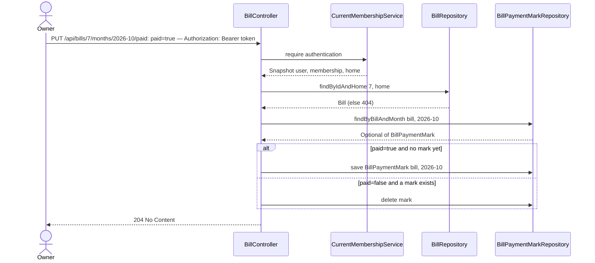

# Manual paid mark

**Prerequisite:** slice 03 (monthly bill status).

## What it does

Lets the OWNER mark a bill as paid for one month (or undo that mark) when the payment cannot be seen in the bank account — paid in cash, from someone's personal account, or with a descriptor the keyword doesn't catch.

## Why

Matching can only see money that moved through the one connected account. A bill paid from outside it would stay `OVERDUE` forever and train everyone to ignore the red. The override is stored per bill **per month** (not per bill), because "paid in cash this October" says nothing about November.

Design choices tied to the code:

- **Separate entity, not a flag on `Bill`.** `Bill` is a definition that repeats every month; the mark is a fact about one month. `BillPaymentMark` has a unique `(bill, month)` pair.
- **`PUT …/paid` with `{ "paid": true|false }`, not `POST` + `DELETE`.** `SecurityConfig`'s CORS only allows `GET/POST/PUT/OPTIONS`, so `DELETE` from the SPA would be blocked. A `PUT` that sets a desired state is also idempotent: marking twice is harmless.
- **The bill must belong to the caller's Home.** The bill id comes from the URL, so the repository lookup is `findByIdAndHome(id, home)`; another Home's id returns 404 rather than leaking that it exists.
- **A real match and a mark can both exist.** `manuallyMarked` is reported separately from `match` so the SPA can show the real transaction and still reflect the toggle's state. Status is `PAID` if either exists.
- **OWNER-only.** Everyone sees everything, but only the OWNER edits (epic decision).

## Data flow



After this, `GET /api/bills/status?month=2026-10` (slice 03) returns that bill as `PAID` with `manuallyMarked: true`.

## Today → after

**Today** in [`BillMonthStatus.java`](../../src/main/java/com/glpalma/HomeTreasury/bills/BillMonthStatus.java) / [`BillStatusService.java`](../../src/main/java/com/glpalma/HomeTreasury/bills/BillStatusService.java) (slice 03): `PAID` means only "a matching transaction exists".

**After:** `PAID` means "a matching transaction exists **or** a `BillPaymentMark` exists for that bill and month", and each row carries `manuallyMarked`.

## Exact changes

Order: entity → repositories → request record → response change → service → controller → SPA api → hook → table.

- [x] **New** [`src/main/java/com/glpalma/HomeTreasury/bills/BillPaymentMark.java`](../../src/main/java/com/glpalma/HomeTreasury/bills/BillPaymentMark.java)
  ```java
  package com.glpalma.HomeTreasury.bills;

  import jakarta.persistence.*;

  import java.time.Instant;
  import java.time.YearMonth;

  /** "This bill was paid in this month", asserted by the OWNER rather than found in the bank. */
  @Entity
  @Table(
          name = "bill_payment_marks",
          uniqueConstraints = @UniqueConstraint(columnNames = {"bill_id", "payment_month"})
  )
  public class BillPaymentMark {

      @Id
      @GeneratedValue(strategy = GenerationType.IDENTITY)
      private Long id;

      @ManyToOne(optional = false)
      @JoinColumn(name = "bill_id")
      private Bill bill;

      // Not plain "month": MONTH is a keyword in some SQL dialects (the test suite runs on H2).
      @Column(name = "payment_month", nullable = false)
      private YearMonth month;

      @Column(nullable = false)
      private Instant markedAt;

      protected BillPaymentMark() {
      }

      public BillPaymentMark(Bill bill, YearMonth month, Instant markedAt) {
          this.bill = bill;
          this.month = month;
          this.markedAt = markedAt;
      }

      public Long getId() {
          return id;
      }

      public Bill getBill() {
          return bill;
      }

      public YearMonth getMonth() {
          return month;
      }

      public Instant getMarkedAt() {
          return markedAt;
      }
  }
  ```

- [x] **New** [`src/main/java/com/glpalma/HomeTreasury/bills/BillPaymentMarkRepository.java`](../../src/main/java/com/glpalma/HomeTreasury/bills/BillPaymentMarkRepository.java)
  ```java
  package com.glpalma.HomeTreasury.bills;

  import org.springframework.data.jpa.repository.JpaRepository;

  import java.time.YearMonth;
  import java.util.Collection;
  import java.util.List;
  import java.util.Optional;

  public interface BillPaymentMarkRepository extends JpaRepository<BillPaymentMark, Long> {

      Optional<BillPaymentMark> findByBillAndMonth(Bill bill, YearMonth month);

      List<BillPaymentMark> findByBillInAndMonth(Collection<Bill> bills, YearMonth month);
  }
  ```

- [x] **Edit** [`src/main/java/com/glpalma/HomeTreasury/bills/BillRepository.java`](../../src/main/java/com/glpalma/HomeTreasury/bills/BillRepository.java) — add a Home-scoped lookup by id
  ```java
  package com.glpalma.HomeTreasury.bills;

  import com.glpalma.HomeTreasury.home.Home;
  import org.springframework.data.jpa.repository.JpaRepository;

  import java.util.List;
  import java.util.Optional;

  public interface BillRepository extends JpaRepository<Bill, Long> {

      List<Bill> findByHomeOrderByDueDayAscNameAsc(Home home);

      Optional<Bill> findByIdAndHome(Long id, Home home);
  }
  ```

- [x] **New** [`src/main/java/com/glpalma/HomeTreasury/bills/MarkPaidRequest.java`](../../src/main/java/com/glpalma/HomeTreasury/bills/MarkPaidRequest.java)
  ```java
  package com.glpalma.HomeTreasury.bills;

  public record MarkPaidRequest(boolean paid) {
  }
  ```

- [x] **Edit** [`src/main/java/com/glpalma/HomeTreasury/bills/BillMonthStatus.java`](../../src/main/java/com/glpalma/HomeTreasury/bills/BillMonthStatus.java) — add `manuallyMarked`
  ```java
  package com.glpalma.HomeTreasury.bills;

  import java.math.BigDecimal;
  import java.time.LocalDate;

  /**
   * One bill's state in one month. {@code match} is null when no transaction was found;
   * {@code manuallyMarked} is true when the OWNER marked it paid by hand.
   */
  public record BillMonthStatus(
          Long billId,
          String name,
          BigDecimal expectedAmount,
          int dueDay,
          LocalDate payBy,
          BillStatus status,
          BillMatch match,
          boolean manuallyMarked
  ) {
  }
  ```

- [x] **Edit** [`src/main/java/com/glpalma/HomeTreasury/bills/BillStatusService.java`](../../src/main/java/com/glpalma/HomeTreasury/bills/BillStatusService.java) — load the month's marks, count them as paid
  ```java
  package com.glpalma.HomeTreasury.bills;

  import com.glpalma.HomeTreasury.home.Home;
  import com.glpalma.HomeTreasury.treasury.BankTransaction;
  import com.glpalma.HomeTreasury.treasury.BankTransactionsService;
  import org.springframework.stereotype.Service;

  import java.time.LocalDate;
  import java.time.YearMonth;
  import java.util.List;
  import java.util.Set;
  import java.util.stream.Collectors;

  @Service
  public class BillStatusService {

      private final BillRepository bills;
      private final BillPaymentMarkRepository marks;
      private final BankTransactionsService bankTransactions;

      public BillStatusService(
              BillRepository bills,
              BillPaymentMarkRepository marks,
              BankTransactionsService bankTransactions
      ) {
          this.bills = bills;
          this.marks = marks;
          this.bankTransactions = bankTransactions;
      }

      public BillStatusResponse statusFor(Home home, YearMonth month) {
          List<Bill> active = bills.findByHomeOrderByDueDayAscNameAsc(home).stream()
                  .filter(bill -> isActiveIn(bill, month))
                  .toList();
          if (active.isEmpty()) {
              return new BillStatusResponse(month, false, List.of());
          }

          Set<Long> markedBillIds = marks.findByBillInAndMonth(active, month).stream()
                  .map(mark -> mark.getBill().getId())
                  .collect(Collectors.toSet());

          BankTransactionsService.Result result = bankTransactions.forMonth(home, month);
          LocalDate today = HomeClock.today();

          List<BillMonthStatus> statuses = active.stream()
                  .map(bill -> statusOf(bill, month, result.transactions(), markedBillIds.contains(bill.getId()), today))
                  .toList();
          return new BillStatusResponse(month, result.truncated(), statuses);
      }

      private static BillMonthStatus statusOf(
              Bill bill,
              YearMonth month,
              List<BankTransaction> transactions,
              boolean manuallyMarked,
              LocalDate today
      ) {
          LocalDate payBy = BillStatusCalculator.payByDate(month, bill.getDueDay());
          BillMatch match = TransactionMatcher
                  .firstMatch(bill.getKeyword(), TransactionMatcher.Direction.DEBIT, transactions)
                  .map(tx -> BillMatch.of(tx, bill.getExpectedAmount()))
                  .orElse(null);
          BillStatus status = BillStatusCalculator.statusOf(payBy, match != null || manuallyMarked, today);
          return new BillMonthStatus(
                  bill.getId(),
                  bill.getName(),
                  bill.getExpectedAmount(),
                  bill.getDueDay(),
                  payBy,
                  status,
                  match,
                  manuallyMarked
          );
      }

      /** A bill applies from its start month through its end month, both inclusive (no end = forever). */
      static boolean isActiveIn(Bill bill, YearMonth month) {
          if (month.isBefore(bill.getStartMonth())) {
              return false;
          }
          return bill.getEndMonth() == null || !month.isAfter(bill.getEndMonth());
      }
  }
  ```

- [x] **Edit** [`src/main/java/com/glpalma/HomeTreasury/bills/BillController.java`](../../src/main/java/com/glpalma/HomeTreasury/bills/BillController.java) — add `PUT /api/bills/{billId}/months/{month}/paid`
  ```java
  package com.glpalma.HomeTreasury.bills;

  import com.glpalma.HomeTreasury.home.Home;
  import com.glpalma.HomeTreasury.user.CurrentMembershipService;
  import jakarta.validation.Valid;
  import org.springframework.http.HttpStatus;
  import org.springframework.security.access.prepost.PreAuthorize;
  import org.springframework.security.core.Authentication;
  import org.springframework.web.bind.annotation.*;
  import org.springframework.web.server.ResponseStatusException;

  import java.time.Instant;
  import java.time.YearMonth;
  import java.util.List;

  @RestController
  @RequestMapping("/api/bills")
  public class BillController {

      private final CurrentMembershipService memberships;
      private final BillRepository bills;
      private final BillPaymentMarkRepository marks;
      private final BillStatusService billStatus;

      public BillController(
              CurrentMembershipService memberships,
              BillRepository bills,
              BillPaymentMarkRepository marks,
              BillStatusService billStatus
      ) {
          this.memberships = memberships;
          this.bills = bills;
          this.marks = marks;
          this.billStatus = billStatus;
      }

      @PreAuthorize("hasRole('OWNER')")
      @PostMapping
      @ResponseStatus(HttpStatus.CREATED)
      public BillResponse create(
              @Valid @RequestBody CreateBillRequest request,
              Authentication authentication
      ) {
          Home home = memberships.require(authentication).home();
          YearMonth startMonth = request.startMonth() == null ? HomeClock.currentMonth() : request.startMonth();
          Bill saved = bills.save(new Bill(
                  home,
                  request.name().trim(),
                  request.expectedAmount(),
                  request.dueDay(),
                  request.keyword().trim(),
                  startMonth
          ));
          return BillResponse.from(saved);
      }

      @GetMapping
      public List<BillResponse> list(Authentication authentication) {
          Home home = memberships.require(authentication).home();
          return bills.findByHomeOrderByDueDayAscNameAsc(home).stream()
                  .map(BillResponse::from)
                  .toList();
      }

      @GetMapping("/status")
      public BillStatusResponse status(
              @RequestParam YearMonth month,
              Authentication authentication
      ) {
          Home home = memberships.require(authentication).home();
          return billStatus.statusFor(home, month);
      }

      @PreAuthorize("hasRole('OWNER')")
      @PutMapping("/{billId}/months/{month}/paid")
      @ResponseStatus(HttpStatus.NO_CONTENT)
      public void setPaid(
              @PathVariable Long billId,
              @PathVariable YearMonth month,
              @RequestBody MarkPaidRequest request,
              Authentication authentication
      ) {
          Home home = memberships.require(authentication).home();
          Bill bill = bills.findByIdAndHome(billId, home)
                  .orElseThrow(() -> new ResponseStatusException(HttpStatus.NOT_FOUND, "Bill not found"));

          var existing = marks.findByBillAndMonth(bill, month);
          if (request.paid() && existing.isEmpty()) {
              marks.save(new BillPaymentMark(bill, month, Instant.now()));
          } else if (!request.paid() && existing.isPresent()) {
              marks.delete(existing.get());
          }
      }
  }
  ```

- [x] **Edit** [`frontend/src/api/bills.ts`](../../frontend/src/api/bills.ts) — add `manuallyMarked` and `setBillPaid`
  ```ts
  import { apiClient } from "./client";

  export interface Bill {
    id: number;
    name: string;
    expectedAmount: number;
    /** Pay-by day of the month, 1–31. */
    dueDay: number;
    keyword: string;
    /** "YYYY-MM", first month this bill applies to. */
    startMonth: string;
    /** "YYYY-MM", last month it applies to; null while active. */
    endMonth: string | null;
  }

  export interface BillInput {
    name: string;
    expectedAmount: number;
    dueDay: number;
    keyword: string;
    startMonth: string;
  }

  export type BillStatus = "PAID" | "DUE_SOON" | "OVERDUE" | "UPCOMING";

  export interface BillMatch {
    transactionId: string;
    /** "YYYY-MM-DD" */
    date: string;
    description: string | null;
    /** Absolute amount that actually moved. */
    amount: number;
    /** True when `amount` is more than 15% away from the expected amount. */
    amountDiffers: boolean;
  }

  export interface BillMonthStatus {
    billId: number;
    name: string;
    expectedAmount: number;
    dueDay: number;
    /** "YYYY-MM-DD" */
    payBy: string;
    status: BillStatus;
    match: BillMatch | null;
    /** The OWNER marked this bill paid by hand for this month. */
    manuallyMarked: boolean;
  }

  export interface BillStatusResponse {
    month: string;
    transactionsTruncated: boolean;
    bills: BillMonthStatus[];
  }

  export async function listBills(): Promise<Bill[]> {
    const { data } = await apiClient.get<Bill[]>("/api/bills");
    return data;
  }

  export async function createBill(input: BillInput): Promise<Bill> {
    const { data } = await apiClient.post<Bill>("/api/bills", input);
    return data;
  }

  export async function getBillStatus(month: string): Promise<BillStatusResponse> {
    const { data } = await apiClient.get<BillStatusResponse>("/api/bills/status", {
      params: { month },
    });
    return data;
  }

  export async function setBillPaid(args: { billId: number; month: string; paid: boolean }): Promise<void> {
    await apiClient.put(`/api/bills/${args.billId}/months/${args.month}/paid`, { paid: args.paid });
  }
  ```

- [x] **Edit** [`frontend/src/hooks/useBills.ts`](../../frontend/src/hooks/useBills.ts) — add `useSetBillPaid`
  ```ts
  import { useMutation, useQuery, useQueryClient } from "@tanstack/react-query";
  import { createBill, listBills, setBillPaid } from "../api/bills";

  export function useBills() {
    return useQuery({
      queryKey: ["bills"],
      queryFn: listBills,
    });
  }

  export function useCreateBill() {
    const queryClient = useQueryClient();
    return useMutation({
      mutationFn: createBill,
      onSuccess: () => {
        queryClient.invalidateQueries({ queryKey: ["bills"] });
        queryClient.invalidateQueries({ queryKey: ["bill-status"] });
      },
    });
  }

  export function useSetBillPaid() {
    const queryClient = useQueryClient();
    return useMutation({
      mutationFn: setBillPaid,
      onSuccess: () => {
        queryClient.invalidateQueries({ queryKey: ["bill-status"] });
      },
    });
  }
  ```

- [x] **Edit** [`frontend/src/components/bills/BillsTable.tsx`](../../frontend/src/components/bills/BillsTable.tsx) — add the "Mark paid" toggle column (OWNER can change it, others see it disabled)
  ```tsx
  import type { BillMonthStatus } from "../../api/bills";
  import { useAuth } from "../../context/AuthContext";
  import { useSetBillPaid } from "../../hooks/useBills";
  import { formatCurrency } from "../../lib/format";
  import { formatDay } from "../../lib/months";
  import { BillStatusChip } from "./BillStatusChip";

  interface Props {
    month: string;
    bills: BillMonthStatus[];
  }

  export function BillsTable({ month, bills }: Props) {
    const { user } = useAuth();
    const isOwner = user?.role === "OWNER";
    const setPaid = useSetBillPaid();

    if (bills.length === 0) {
      return <p className="text-sm text-slate-500">No bills apply to this month.</p>;
    }

    return (
      <table className="w-full text-left text-sm">
        <thead className="text-xs uppercase text-slate-400">
          <tr>
            <th className="pb-2 font-medium">Status</th>
            <th className="pb-2 font-medium">Bill</th>
            <th className="pb-2 font-medium">Pay by</th>
            <th className="pb-2 text-right font-medium">Expected</th>
            <th className="pb-2 pl-4 font-medium">Found in bank</th>
            <th className="pb-2 pl-4 text-center font-medium">Paid manually</th>
          </tr>
        </thead>
        <tbody className="divide-y divide-slate-100">
          {bills.map((bill) => (
            <tr key={bill.billId}>
              <td className="py-2 pr-3">
                <BillStatusChip status={bill.status} />
              </td>
              <td className="py-2 pr-3 font-medium text-slate-800">{bill.name}</td>
              <td className="py-2 pr-3 text-slate-600">{formatDay(bill.payBy)}</td>
              <td className="py-2 text-right text-slate-700">{formatCurrency(bill.expectedAmount)}</td>
              <td className="py-2 pl-4 text-xs text-slate-500">
                {bill.match ? (
                  <>
                    <span className="text-sm font-medium text-slate-700">{formatCurrency(bill.match.amount)}</span>{" "}
                    on {formatDay(bill.match.date)}
                    {bill.match.amountDiffers && (
                      <span className="ml-2 rounded-full bg-amber-100 px-2 py-0.5 text-amber-800">amount differs</span>
                    )}
                    <p className="text-slate-400">{bill.match.description}</p>
                  </>
                ) : (
                  "—"
                )}
              </td>
              <td className="py-2 pl-4 text-center">
                <input
                  type="checkbox"
                  aria-label={`Mark ${bill.name} as paid manually`}
                  checked={bill.manuallyMarked}
                  disabled={!isOwner || setPaid.isPending}
                  onChange={(e) =>
                    setPaid.mutate({ billId: bill.billId, month, paid: e.target.checked })
                  }
                />
              </td>
            </tr>
          ))}
        </tbody>
      </table>
    );
  }
  ```

- [x] **Edit** [`frontend/src/pages/Bills.tsx`](../../frontend/src/pages/Bills.tsx) — pass `month` to the table (one line changes: `<BillsTable month={month} bills={bills} />`)
  ```tsx
  import { useState } from "react";
  import { BillForm } from "../components/bills/BillForm";
  import { BillsTable } from "../components/bills/BillsTable";
  import { MonthPicker } from "../components/MonthPicker";
  import { useAuth } from "../context/AuthContext";
  import { useCreateBill } from "../hooks/useBills";
  import { useBillStatus } from "../hooks/useBillStatus";
  import { apiErrorMessage } from "../lib/errors";
  import { formatCurrency } from "../lib/format";
  import { currentMonth } from "../lib/months";

  export function Bills() {
    const { user } = useAuth();
    const isOwner = user?.role === "OWNER";
    const [month, setMonth] = useState(currentMonth());
    const status = useBillStatus(month);
    const createBill = useCreateBill();

    const bills = status.data?.bills ?? [];
    const paidCount = bills.filter((b) => b.status === "PAID").length;
    const expectedTotal = bills.reduce((sum, b) => sum + b.expectedAmount, 0);

    return (
      <div className="mx-auto max-w-4xl space-y-6 p-6">
        <div className="flex items-center justify-between">
          <h1 className="text-2xl font-semibold">Bills</h1>
          <MonthPicker value={month} onChange={setMonth} />
        </div>

        {status.isLoading && <p className="text-slate-500">Checking bills against your bank account…</p>}

        {status.isError && (
          <div className="rounded-md border border-amber-300 bg-amber-50 p-4 text-sm text-amber-800">
            {apiErrorMessage(status.error, "Could not load bills.")}
          </div>
        )}

        {status.data?.transactionsTruncated && (
          <div className="rounded-md border border-amber-300 bg-amber-50 p-4 text-sm text-amber-800">
            This month has more transactions than we can load at once, so some bills may look unpaid by mistake.
          </div>
        )}

        {status.data && (
          <div className="rounded-lg border border-slate-200 bg-white p-5 shadow-sm">
            <div className="mb-3 flex items-center justify-between">
              <h2 className="text-sm font-medium text-slate-500">Bills this month</h2>
              <p className="text-xs text-slate-500">
                {paidCount} of {bills.length} paid · {formatCurrency(expectedTotal)} expected
              </p>
            </div>
            <BillsTable month={month} bills={bills} />
          </div>
        )}

        {isOwner && (
          <div className="rounded-lg border border-slate-200 bg-white p-5 shadow-sm">
            <h2 className="mb-3 text-sm font-medium text-slate-500">Add a bill</h2>
            <BillForm
              submitLabel="Add bill"
              resetOnSuccess
              onSubmit={(input) => createBill.mutateAsync(input)}
            />
          </div>
        )}
      </div>
    );
  }
  ```

## Verify

1. Backend and frontend start; Hibernate logs `create table bill_payment_marks`.
2. Take an `OVERDUE` bill from slice 03's verify (keyword that matches nothing). As OWNER:
   ```
   curl -i -X PUT http://localhost:8080/api/bills/$BILL_ID/months/2026-10/paid \
     -H "Authorization: Bearer $OWNER_TOKEN" \
     -H "Content-Type: application/json" \
     -d '{"paid": true}'
   ```
3. Expect `204 No Content`. Then `GET /api/bills/status?month=2026-10` → that bill is `"status": "PAID"`, `"manuallyMarked": true`, `"match": null`.
4. Repeat step 2 → still `204`, and still only one mark (idempotent; no duplicate-key error).
5. Send `{"paid": false}` → `204`; the bill is `OVERDUE` again, `manuallyMarked: false`.
6. The same mark for a different month (`2026-09`) must not affect `2026-10`.
7. As a VIEWER → `403`. With another Home's bill id → `404 "Bill not found"`.
8. In the browser: the OWNER can tick/untick "Paid manually" and the chip updates; as VIEWER the checkbox is disabled.

## Out of scope

- Who marked it and when is stored (`markedAt`) but not shown anywhere yet.
- Marking a bill paid for a future month is allowed but has no special handling.
- Marking incomes as received by hand.
