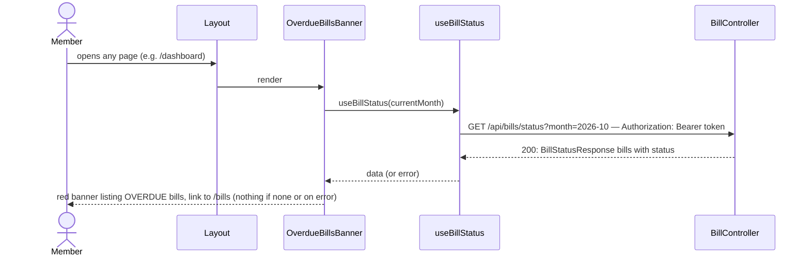

# Overdue banner

**Prerequisite:** slice 03 (`GET /api/bills/status`, `useBillStatus`). Slice 04 only changes what counts as paid; this slice works without it.

## What it does

Shows a red banner at the top of every page when any of this month's bills is overdue, linking to the Bills page, so a missed payment is visible without opening Bills.

## Why

"If the app doesn't detect a debit by the pay-by day, there should be an alert." v1 is passive (no email/push), so the alert is an unmissable on-screen element. It lives in `Layout` rather than only on the Dashboard page so it appears wherever the user lands; this widens your earlier "Dashboard banner" request slightly (the Dashboard is covered, along with every other page).

Design choices tied to the code:

- **No new endpoint.** The banner is just a different view of slice 03's data, filtered to `OVERDUE` for the current month. `useBillStatus(currentMonth())` shares its React Query cache entry with the Bills page when it shows the current month, so opening Bills does not trigger a second Pluggy fetch in that case.
- **Fails quietly.** `Layout` wraps every page, including a Home that has no bank linked yet (slice 03 returns `404`) or a moment when Pluggy is down (`502`). The banner renders nothing on any error; those conditions already have their own messages on Dashboard/Bills. A banner that errors on every page would be worse than no banner.
- **Current month only.** An overdue bill from an earlier month is not surfaced here (epic out-of-scope). Today the only way to find it is browsing back on Bills.
- **False-alarm guards are already in the rules, not here.** Overdue starts the day after the pay-by date and `PENDING` transactions count as paid (slice 03). The banner never re-implements them.

## Data flow



## Today → after

**Today** in [`Layout.tsx`](../../frontend/src/components/Layout.tsx) (after slice 02): header with nav, then `<main><Outlet /></main>`.

**After:** `<OverdueBillsBanner />` is rendered between the header and `<main>`.

## Exact changes

- [x] **New** [`frontend/src/components/bills/OverdueBillsBanner.tsx`](../../frontend/src/components/bills/OverdueBillsBanner.tsx)
  ```tsx
  import { Link } from "react-router-dom";
  import { useBillStatus } from "../../hooks/useBillStatus";
  import { currentMonth, formatDay } from "../../lib/months";

  export function OverdueBillsBanner() {
    const status = useBillStatus(currentMonth());

    // Any error (no bank linked yet, provider down, …) → stay silent; the pages show their own message.
    const overdue = status.data?.bills.filter((bill) => bill.status === "OVERDUE") ?? [];
    if (overdue.length === 0) {
      return null;
    }

    const message =
      overdue.length === 1
        ? `${overdue[0].name} was due ${formatDay(overdue[0].payBy)} and no payment has been detected in the account yet.`
        : `${overdue.length} bills are overdue: ${overdue
            .map((bill) => `${bill.name} (due ${formatDay(bill.payBy)})`)
            .join(", ")}.`;

    return (
      <div className="border-b border-red-200 bg-red-50">
        <div className="mx-auto flex max-w-4xl items-center justify-between gap-4 px-6 py-3 text-sm text-red-800">
          <p className="font-medium">{message}</p>
          <Link to="/bills" className="shrink-0 font-medium underline">
            View bills
          </Link>
        </div>
      </div>
    );
  }
  ```

- [x] **Edit** [`frontend/src/components/Layout.tsx`](../../frontend/src/components/Layout.tsx) — render the banner under the header
  ```tsx
  import { NavLink, Outlet, useNavigate } from "react-router-dom";
  import { OverdueBillsBanner } from "./bills/OverdueBillsBanner";
  import { useAuth } from "../context/AuthContext";
  import { useMe } from "../hooks/useMe";

  export function Layout() {
    const { user, logout } = useAuth();
    const me = useMe();
    const navigate = useNavigate();

    const handleLogout = () => {
      logout();
      navigate("/login");
    };

    const navLinkClass = ({ isActive }: { isActive: boolean }) =>
      `text-sm font-medium ${isActive ? "text-slate-900" : "text-slate-500 hover:text-slate-700"}`;

    return (
      <div className="min-h-screen bg-slate-50">
        <header className="border-b border-slate-200 bg-white">
          <div className="mx-auto flex max-w-4xl items-center justify-between px-6 py-4">
            <div className="flex items-center gap-6">
              <span className="text-lg font-semibold">HomeTreasury</span>
              <nav className="flex gap-4">
                <NavLink to="/dashboard" className={navLinkClass}>
                  Dashboard
                </NavLink>
                <NavLink to="/bills" className={navLinkClass}>
                  Bills
                </NavLink>
                <NavLink to="/transactions" className={navLinkClass}>
                  Transactions
                </NavLink>
                <NavLink to="/settings" className={navLinkClass}>
                  Settings
                </NavLink>
              </nav>
            </div>
            <div className="flex items-center gap-3 text-sm">
              <div className="text-right">
                <p className="font-medium text-slate-800">{me.data?.home.name ?? "—"}</p>
                <p className="text-slate-500">
                  {user?.email} · {user?.role}
                </p>
              </div>
              <button
                onClick={handleLogout}
                className="rounded-md border border-slate-300 px-3 py-1.5 text-sm font-medium text-slate-700 hover:bg-slate-100"
              >
                Log out
              </button>
            </div>
          </div>
        </header>
        <OverdueBillsBanner />
        <main>
          <Outlet />
        </main>
      </div>
    );
  }
  ```

## Verify

1. `cd frontend && npm run build` → no TypeScript errors.
2. Make sure one bill is overdue this month (a keyword that matches nothing, pay-by day already past — slice 03 verify step 4). Open `/dashboard`. Expect a red banner under the header: `Electricity was due Oct 8 and no payment has been detected in the account yet.` with a "View bills" link to `/bills`.
3. Navigate to `/settings`, `/transactions`: the banner stays (one fetch total — check the Network tab shows a single `GET /api/bills/status?month=…` while moving between pages).
4. Mark the bill paid manually (slice 04) or fix its keyword, then open `/bills`: after the table refreshes, reload another page → banner is gone.
5. Create a second overdue bill → the banner reads `2 bills are overdue: …, …`.
6. Log in as a user of a Home with no linked bank → no banner and no error toast; the Dashboard still shows its own "No bank account is linked yet." message.
7. Log in as a Home with no bills → no banner.

## Out of scope

- Overdue bills from earlier months.
- Dismissing/snoozing the banner.
- Email/push reminders.
- Showing *due soon* bills (only `OVERDUE` is alarming enough for a global banner).
