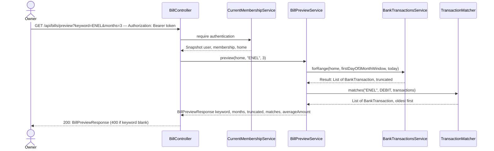

# Add-bill preview

**Prerequisites:** slice 01 (`BankTransactionsService.forRange`), slice 02 (`BillForm`, `BillController`), slice 03 (`TransactionMatcher`).

## What it does

While the OWNER types a keyword in the bill form, shows the debits from the last 3 months that this keyword would match, plus their average amount, with a one-click "use average" for the expected amount.

## Why

Two guesses are needed to declare a bill: the keyword (will it actually match what the bank writes?) and the expected amount (electricity varies; the household pays a fixed amount based on roughly the last 12 months' average). Without a preview, a wrong keyword only shows up a month later as a false OVERDUE. The preview uses **the same `TransactionMatcher`** as the real status, so what the OWNER sees here is exactly what slice 03 will match.

Design choices tied to the code:

- **Reads history we already have.** Pluggy returns up to ~12 months and `BankTransactionsService.forRange` (slice 01) takes arbitrary bounds, so this needs no storage. The window is *N calendar months ending today* (current month included). `months` is clamped to 1–6 to keep one preview at a single page per account in practice; the form asks for 3.
- **Average of matches, not of months.** If a keyword matches two debits in one month, both enter the average. That is the honest "average amount of a transaction matching this keyword"; if it looks off, the visible list shows why.
- **`averageAmount` is `null`, not 0, with no matches.** The SPA must not offer "use average R$ 0,00".
- **Read-only, member-visible.** It leaks nothing the member can't already see on the Transactions page, so it is not OWNER-gated, but it is only reachable from the OWNER's form.
- **Debounced, and not fired for tiny input.** Each preview costs `1 + N` Pluggy calls. The hook waits 500 ms after typing stops and requires ≥ 3 characters. Results are cached for a minute per keyword.
- **Only DEBITs.** Bills are payments out; incomes get their own preview later if needed.

## Data flow



## Today → after

**Today** in [`BillController.java`](../../src/main/java/com/glpalma/HomeTreasury/bills/BillController.java) (slice 04 state): `create`, `list`, `status`, `setPaid`.

**Today** in [`BillForm.tsx`](../../frontend/src/components/bills/BillForm.tsx) (slice 02): a plain form; the keyword field has only a text hint.

**After:** `GET /api/bills/preview` exists; the form shows a "Matches in the last 3 months" panel under the keyword field.

## Exact changes

Order: response records → service → controller → SPA debounce hook → api/hook → panel → form.

- [x] **New** [`src/main/java/com/glpalma/HomeTreasury/bills/BillPreviewMatch.java`](../../src/main/java/com/glpalma/HomeTreasury/bills/BillPreviewMatch.java)
  ```java
  package com.glpalma.HomeTreasury.bills;

  import java.math.BigDecimal;
  import java.time.LocalDate;

  /** One past debit the keyword would have matched. {@code amount} is the absolute value. */
  public record BillPreviewMatch(LocalDate date, String description, BigDecimal amount) {
  }
  ```

- [x] **New** [`src/main/java/com/glpalma/HomeTreasury/bills/BillPreviewResponse.java`](../../src/main/java/com/glpalma/HomeTreasury/bills/BillPreviewResponse.java)
  ```java
  package com.glpalma.HomeTreasury.bills;

  import java.math.BigDecimal;
  import java.util.List;

  /**
   * @param matches       Newest first.
   * @param averageAmount Mean of the matches' amounts, or null when there are none.
   * @param truncated     True when Pluggy had more transactions than we read, so matches may be missing.
   */
  public record BillPreviewResponse(
          String keyword,
          int months,
          boolean truncated,
          List<BillPreviewMatch> matches,
          BigDecimal averageAmount
  ) {
  }
  ```

- [x] **New** [`src/main/java/com/glpalma/HomeTreasury/bills/BillPreviewService.java`](../../src/main/java/com/glpalma/HomeTreasury/bills/BillPreviewService.java)
  ```java
  package com.glpalma.HomeTreasury.bills;

  import com.glpalma.HomeTreasury.home.Home;
  import com.glpalma.HomeTreasury.treasury.BankTransaction;
  import com.glpalma.HomeTreasury.treasury.BankTransactionsService;
  import org.springframework.stereotype.Service;

  import java.math.BigDecimal;
  import java.math.RoundingMode;
  import java.time.LocalDate;
  import java.time.YearMonth;
  import java.util.ArrayList;
  import java.util.Collections;
  import java.util.List;

  @Service
  public class BillPreviewService {

      private static final int MAX_MONTHS = 6;

      private final BankTransactionsService bankTransactions;

      public BillPreviewService(BankTransactionsService bankTransactions) {
          this.bankTransactions = bankTransactions;
      }

      public BillPreviewResponse preview(Home home, String keyword, int months) {
          int window = Math.max(1, Math.min(months, MAX_MONTHS));
          YearMonth current = HomeClock.currentMonth();
          LocalDate from = current.minusMonths(window - 1L).atDay(1);
          LocalDate to = HomeClock.today();

          BankTransactionsService.Result result = bankTransactions.forRange(home, from, to);
          List<BankTransaction> matched = new ArrayList<>(
                  TransactionMatcher.matches(keyword, TransactionMatcher.Direction.DEBIT, result.transactions()));
          Collections.reverse(matched); // newest first for display

          List<BillPreviewMatch> matches = matched.stream()
                  .map(tx -> new BillPreviewMatch(
                          tx.date(),
                          tx.description(),
                          tx.amount() == null ? BigDecimal.ZERO : tx.amount().abs()))
                  .toList();

          BigDecimal average = null;
          if (!matches.isEmpty()) {
              BigDecimal sum = matches.stream()
                      .map(BillPreviewMatch::amount)
                      .reduce(BigDecimal.ZERO, BigDecimal::add);
              average = sum.divide(BigDecimal.valueOf(matches.size()), 2, RoundingMode.HALF_UP);
          }
          return new BillPreviewResponse(keyword, window, result.truncated(), matches, average);
      }
  }
  ```

- [x] **Edit** [`src/main/java/com/glpalma/HomeTreasury/bills/BillController.java`](../../src/main/java/com/glpalma/HomeTreasury/bills/BillController.java) — inject `BillPreviewService`, add `GET /api/bills/preview`
  ```java
  package com.glpalma.HomeTreasury.bills;

  import com.glpalma.HomeTreasury.home.Home;
  import com.glpalma.HomeTreasury.user.CurrentMembershipService;
  import jakarta.validation.Valid;
  import org.springframework.http.HttpStatus;
  import org.springframework.security.access.prepost.PreAuthorize;
  import org.springframework.security.core.Authentication;
  import org.springframework.web.bind.annotation.*;
  import org.springframework.web.server.ResponseStatusException;

  import java.time.Instant;
  import java.time.YearMonth;
  import java.util.List;

  @RestController
  @RequestMapping("/api/bills")
  public class BillController {

      private final CurrentMembershipService memberships;
      private final BillRepository bills;
      private final BillPaymentMarkRepository marks;
      private final BillStatusService billStatus;
      private final BillPreviewService billPreview;

      public BillController(
              CurrentMembershipService memberships,
              BillRepository bills,
              BillPaymentMarkRepository marks,
              BillStatusService billStatus,
              BillPreviewService billPreview
      ) {
          this.memberships = memberships;
          this.bills = bills;
          this.marks = marks;
          this.billStatus = billStatus;
          this.billPreview = billPreview;
      }

      @PreAuthorize("hasRole('OWNER')")
      @PostMapping
      @ResponseStatus(HttpStatus.CREATED)
      public BillResponse create(
              @Valid @RequestBody CreateBillRequest request,
              Authentication authentication
      ) {
          Home home = memberships.require(authentication).home();
          YearMonth startMonth = request.startMonth() == null ? HomeClock.currentMonth() : request.startMonth();
          Bill saved = bills.save(new Bill(
                  home,
                  request.name().trim(),
                  request.expectedAmount(),
                  request.dueDay(),
                  request.keyword().trim(),
                  startMonth
          ));
          return BillResponse.from(saved);
      }

      @GetMapping
      public List<BillResponse> list(Authentication authentication) {
          Home home = memberships.require(authentication).home();
          return bills.findByHomeOrderByDueDayAscNameAsc(home).stream()
                  .map(BillResponse::from)
                  .toList();
      }

      @GetMapping("/status")
      public BillStatusResponse status(
              @RequestParam YearMonth month,
              Authentication authentication
      ) {
          Home home = memberships.require(authentication).home();
          return billStatus.statusFor(home, month);
      }

      @GetMapping("/preview")
      public BillPreviewResponse preview(
              @RequestParam String keyword,
              @RequestParam(defaultValue = "3") int months,
              Authentication authentication
      ) {
          if (keyword.isBlank()) {
              throw new ResponseStatusException(HttpStatus.BAD_REQUEST, "keyword must not be blank");
          }
          Home home = memberships.require(authentication).home();
          return billPreview.preview(home, keyword.trim(), months);
      }

      @PreAuthorize("hasRole('OWNER')")
      @PutMapping("/{billId}/months/{month}/paid")
      @ResponseStatus(HttpStatus.NO_CONTENT)
      public void setPaid(
              @PathVariable Long billId,
              @PathVariable YearMonth month,
              @RequestBody MarkPaidRequest request,
              Authentication authentication
      ) {
          Home home = memberships.require(authentication).home();
          Bill bill = bills.findByIdAndHome(billId, home)
                  .orElseThrow(() -> new ResponseStatusException(HttpStatus.NOT_FOUND, "Bill not found"));

          var existing = marks.findByBillAndMonth(bill, month);
          if (request.paid() && existing.isEmpty()) {
              marks.save(new BillPaymentMark(bill, month, Instant.now()));
          } else if (!request.paid() && existing.isPresent()) {
              marks.delete(existing.get());
          }
      }
  }
  ```

- [x] **New** [`frontend/src/hooks/useDebouncedValue.ts`](../../frontend/src/hooks/useDebouncedValue.ts)
  ```ts
  import { useEffect, useState } from "react";

  /** Returns `value`, but only after it has stopped changing for `delayMs`. */
  export function useDebouncedValue<T>(value: T, delayMs: number): T {
    const [debounced, setDebounced] = useState(value);

    useEffect(() => {
      const handle = setTimeout(() => setDebounced(value), delayMs);
      return () => clearTimeout(handle);
    }, [value, delayMs]);

    return debounced;
  }
  ```

- [x] **Edit** [`frontend/src/api/bills.ts`](../../frontend/src/api/bills.ts) — add the preview types and call
  ```ts
  import { apiClient } from "./client";

  export interface Bill {
    id: number;
    name: string;
    expectedAmount: number;
    /** Pay-by day of the month, 1–31. */
    dueDay: number;
    keyword: string;
    /** "YYYY-MM", first month this bill applies to. */
    startMonth: string;
    /** "YYYY-MM", last month it applies to; null while active. */
    endMonth: string | null;
  }

  export interface BillInput {
    name: string;
    expectedAmount: number;
    dueDay: number;
    keyword: string;
    startMonth: string;
  }

  export type BillStatus = "PAID" | "DUE_SOON" | "OVERDUE" | "UPCOMING";

  export interface BillMatch {
    transactionId: string;
    /** "YYYY-MM-DD" */
    date: string;
    description: string | null;
    /** Absolute amount that actually moved. */
    amount: number;
    /** True when `amount` is more than 15% away from the expected amount. */
    amountDiffers: boolean;
  }

  export interface BillMonthStatus {
    billId: number;
    name: string;
    expectedAmount: number;
    dueDay: number;
    /** "YYYY-MM-DD" */
    payBy: string;
    status: BillStatus;
    match: BillMatch | null;
    /** The OWNER marked this bill paid by hand for this month. */
    manuallyMarked: boolean;
  }

  export interface BillStatusResponse {
    month: string;
    transactionsTruncated: boolean;
    bills: BillMonthStatus[];
  }

  export interface BillPreviewMatch {
    /** "YYYY-MM-DD" */
    date: string;
    description: string | null;
    amount: number;
  }

  export interface BillPreviewResponse {
    keyword: string;
    months: number;
    truncated: boolean;
    /** Newest first. */
    matches: BillPreviewMatch[];
    /** Null when there are no matches. */
    averageAmount: number | null;
  }

  export async function listBills(): Promise<Bill[]> {
    const { data } = await apiClient.get<Bill[]>("/api/bills");
    return data;
  }

  export async function createBill(input: BillInput): Promise<Bill> {
    const { data } = await apiClient.post<Bill>("/api/bills", input);
    return data;
  }

  export async function getBillStatus(month: string): Promise<BillStatusResponse> {
    const { data } = await apiClient.get<BillStatusResponse>("/api/bills/status", {
      params: { month },
    });
    return data;
  }

  export async function setBillPaid(args: { billId: number; month: string; paid: boolean }): Promise<void> {
    await apiClient.put(`/api/bills/${args.billId}/months/${args.month}/paid`, { paid: args.paid });
  }

  export async function previewBill(keyword: string, months = 3): Promise<BillPreviewResponse> {
    const { data } = await apiClient.get<BillPreviewResponse>("/api/bills/preview", {
      params: { keyword, months },
    });
    return data;
  }
  ```

- [x] **New** [`frontend/src/hooks/useBillPreview.ts`](../../frontend/src/hooks/useBillPreview.ts)
  ```ts
  import { useQuery } from "@tanstack/react-query";
  import { previewBill } from "../api/bills";
  import { useDebouncedValue } from "./useDebouncedValue";

  const MIN_KEYWORD_LENGTH = 3;

  /** Previews what `keyword` would match; idle until the user has typed enough and paused. */
  export function useBillPreview(keyword: string) {
    const debounced = useDebouncedValue(keyword.trim(), 500);
    const enabled = debounced.length >= MIN_KEYWORD_LENGTH;

    return useQuery({
      queryKey: ["bill-preview", debounced],
      queryFn: () => previewBill(debounced),
      enabled,
      staleTime: 60_000,
    });
  }
  ```

- [x] **New** [`frontend/src/components/bills/BillPreviewPanel.tsx`](../../frontend/src/components/bills/BillPreviewPanel.tsx)
  ```tsx
  import { useBillPreview } from "../../hooks/useBillPreview";
  import { formatCurrency } from "../../lib/format";
  import { formatDay } from "../../lib/months";

  interface Props {
    keyword: string;
    /** Called with the average so the form can fill in the expected amount. */
    onUseAverage: (average: number) => void;
  }

  export function BillPreviewPanel({ keyword, onUseAverage }: Props) {
    const preview = useBillPreview(keyword);

    if (keyword.trim().length < 3) {
      return null;
    }

    return (
      <div className="rounded-md border border-slate-200 bg-slate-50 p-3 text-sm">
        <p className="mb-2 text-xs font-medium uppercase text-slate-400">
          Matches found in the last 3 months
        </p>

        {(preview.isLoading || preview.isFetching) && <p className="text-slate-500">Looking…</p>}
        {preview.isError && <p className="text-slate-500">Could not check your bank account right now.</p>}

        {preview.data && !preview.isFetching && (
          <>
            {preview.data.matches.length === 0 ? (
              <p className="text-slate-500">
                No debit matched “{preview.data.keyword}”. Check the exact text on the Transactions page.
              </p>
            ) : (
              <ul className="divide-y divide-slate-200">
                {preview.data.matches.map((match, index) => (
                  <li key={`${match.date}-${index}`} className="flex items-center justify-between gap-3 py-1">
                    <span className="text-slate-500">{formatDay(match.date)}</span>
                    <span className="flex-1 truncate text-slate-700">{match.description}</span>
                    <span className="font-medium text-slate-800">{formatCurrency(match.amount)}</span>
                  </li>
                ))}
              </ul>
            )}

            {preview.data.truncated && (
              <p className="mt-2 text-xs text-amber-700">Some transactions could not be loaded, so this list may be incomplete.</p>
            )}

            {preview.data.averageAmount !== null && (
              <div className="mt-2 flex items-center justify-between rounded-md bg-white px-3 py-2">
                <span className="text-slate-600">Average: {formatCurrency(preview.data.averageAmount)}</span>
                <button
                  type="button"
                  onClick={() => onUseAverage(preview.data!.averageAmount!)}
                  className="rounded-md border border-slate-300 px-2 py-1 text-xs font-medium text-slate-700 hover:bg-slate-100"
                >
                  Use average
                </button>
              </div>
            )}
          </>
        )}
      </div>
    );
  }
  ```

- [x] **Edit** [`frontend/src/components/bills/BillForm.tsx`](../../frontend/src/components/bills/BillForm.tsx) — render the preview panel under the keyword field
  ```tsx
  import { useState, type FormEvent } from "react";
  import type { BillInput } from "../../api/bills";
  import { currentMonth } from "../../lib/months";
  import { BillPreviewPanel } from "./BillPreviewPanel";

  interface Props {
    /** Pre-fills the form (edit mode). Omit for a blank "add" form. */
    initial?: BillInput;
    submitLabel: string;
    /** Resolves when saved; rejects (axios error) when the server refuses. */
    onSubmit: (input: BillInput) => Promise<unknown>;
    onCancel?: () => void;
    /** Clear the fields after a successful save (add mode). */
    resetOnSuccess?: boolean;
  }

  const inputClass =
    "w-full rounded-md border border-slate-300 px-3 py-2 text-sm focus:border-slate-500 focus:outline-none";

  export function BillForm({ initial, submitLabel, onSubmit, onCancel, resetOnSuccess }: Props) {
    const [name, setName] = useState(initial?.name ?? "");
    const [expectedAmount, setExpectedAmount] = useState(initial ? String(initial.expectedAmount) : "");
    const [dueDay, setDueDay] = useState(initial ? String(initial.dueDay) : "");
    const [keyword, setKeyword] = useState(initial?.keyword ?? "");
    const [startMonth, setStartMonth] = useState(initial?.startMonth ?? currentMonth());
    const [saving, setSaving] = useState(false);
    const [error, setError] = useState<string | null>(null);

    const handleSubmit = async (event: FormEvent) => {
      event.preventDefault();
      setSaving(true);
      setError(null);
      try {
        await onSubmit({
          name: name.trim(),
          expectedAmount: Number(expectedAmount),
          dueDay: Number(dueDay),
          keyword: keyword.trim(),
          startMonth,
        });
        if (resetOnSuccess) {
          setName("");
          setExpectedAmount("");
          setDueDay("");
          setKeyword("");
          setStartMonth(currentMonth());
        }
      } catch (err) {
        const detail = (err as any)?.response?.data?.detail;
        setError(detail ?? "Could not save the bill.");
      } finally {
        setSaving(false);
      }
    };

    return (
      <form onSubmit={handleSubmit} className="space-y-3">
        <div>
          <label className="mb-1 block text-sm font-medium text-slate-700">Name</label>
          <input required className={inputClass} value={name} onChange={(e) => setName(e.target.value)} />
        </div>
        <div className="grid grid-cols-2 gap-3">
          <div>
            <label className="mb-1 block text-sm font-medium text-slate-700">Expected amount</label>
            <input
              required
              type="number"
              step="0.01"
              min="0.01"
              className={inputClass}
              value={expectedAmount}
              onChange={(e) => setExpectedAmount(e.target.value)}
            />
          </div>
          <div>
            <label className="mb-1 block text-sm font-medium text-slate-700">Pay by day of month</label>
            <input
              required
              type="number"
              min="1"
              max="31"
              className={inputClass}
              value={dueDay}
              onChange={(e) => setDueDay(e.target.value)}
            />
          </div>
        </div>
        <div>
          <label className="mb-1 block text-sm font-medium text-slate-700">
            Keyword to find in the bank description
          </label>
          <input
            required
            className={inputClass}
            value={keyword}
            onChange={(e) => setKeyword(e.target.value)}
            placeholder="e.g. ENEL"
          />
          <p className="mt-1 text-xs text-slate-400">
            Use text you saw on the Transactions page. Case and accents are ignored.
          </p>
        </div>
        <BillPreviewPanel keyword={keyword} onUseAverage={(average) => setExpectedAmount(average.toFixed(2))} />
        <div>
          <label className="mb-1 block text-sm font-medium text-slate-700">Starts in</label>
          <input
            required
            type="month"
            className={inputClass}
            value={startMonth}
            onChange={(e) => setStartMonth(e.target.value)}
          />
        </div>
        {error && <p className="text-sm text-red-600">{error}</p>}
        <div className="flex gap-2">
          <button
            type="submit"
            disabled={saving}
            className="rounded-md bg-slate-900 px-3 py-2 text-sm font-medium text-white hover:bg-slate-700 disabled:opacity-50"
          >
            {saving ? "Saving…" : submitLabel}
          </button>
          {onCancel && (
            <button
              type="button"
              onClick={onCancel}
              className="rounded-md border border-slate-300 px-3 py-2 text-sm font-medium text-slate-700 hover:bg-slate-100"
            >
              Cancel
            </button>
          )}
        </div>
      </form>
    );
  }
  ```

## Verify

1. Backend and frontend start; `npm run build` passes.
2. `curl -i "http://localhost:8080/api/bills/preview?keyword=ENEL&months=3" -H "Authorization: Bearer $TOKEN"` (use a keyword you saw on `/transactions`) → `200 OK`:
   ```json
   { "keyword": "ENEL", "months": 3, "truncated": false,
     "matches": [ { "date": "2026-09-07", "description": "…ENEL SP", "amount": 205.10 } ],
     "averageAmount": 205.10 }
   ```
   `matches` is newest first and `averageAmount` equals the mean of `amount`.
3. `keyword=ZZZNOPE` → `200`, `"matches": []`, `"averageAmount": null`.
4. `keyword=%20` (blank) → `400`. `months=99` → the response says `"months": 6`.
5. The preview's matches for a month must be exactly the ones slice 03's status reports as `match` for the same keyword (same matcher): compare the current-month entry.
6. In the browser, open the add form (OWNER) and type `EN` → no panel; type `ENEL` → after ~0.5 s the panel lists the matches and the average; click "Use average" → "Expected amount" is filled with `207.75`-style two-decimal value; type a keyword that matches nothing → the "No debit matched" message.
7. Network tab: typing quickly sends **one** `GET /api/bills/preview`, not one per keystroke.

## Out of scope

- A preview for expected incomes (CREDIT).
- Averaging over a longer window (the 12-month average the household actually uses) — change `MAX_MONTHS` and the form's request to raise it once Pluggy's page limit stops mattering.
- Per-month grouping of the matches.
