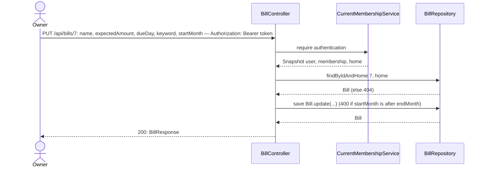
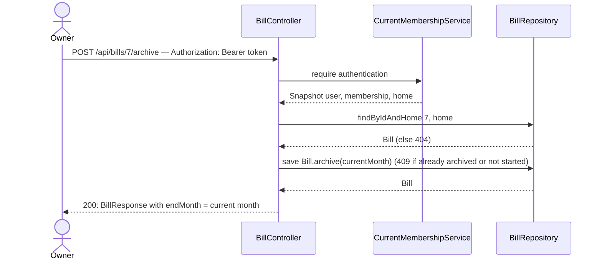

# Edit and archive a bill

**Prerequisites:** slice 02 (`Bill`, `BillForm`), slice 03 (`isActiveIn` already honours `endMonth`), slice 04 (`BillsTable` with the manual toggle).

## What it does

Lets the OWNER correct a bill's details (name, expected amount, pay-by day, keyword, start month) and archive a bill that no longer applies, which stops it appearing from the next month on while keeping past months intact.

## Why

Amounts drift, keywords turn out wrong, services get cancelled. Without edit, every mistake needs a DB edit; without archive, a cancelled streaming service would show OVERDUE forever. There is deliberately **no hard delete**: deleting would erase the bill from past months too, and the "was everything paid in August?" view is the point of the screen.

Design choices tied to the code:

- **Archive = set `endMonth` to the current month.** `BillStatusService.isActiveIn` (slice 03) already treats `endMonth` as inclusive, so the current month still shows the bill (it may still have been paid this month) and every later month hides it. No other status code changes.
- **Edits are retroactive, on purpose.** Status is computed live from the bill's *current* definition, and no per-month history of the definition is stored (epic decision). Changing the expected amount or keyword therefore changes how past months are judged. The form says so.
- **Archive refuses nonsense.** Archiving an already-archived bill, or one whose `startMonth` is still in the future, returns `409 Conflict` — the second would produce an `endMonth` earlier than `startMonth`. The right fix for a not-yet-started bill is editing its start month.
- **`PUT` and `POST …/archive`, no `DELETE`/`PATCH`.** `SecurityConfig`'s CORS allows only `GET/POST/PUT/OPTIONS`.
- **Update validates `startMonth <= endMonth`** so editing an archived bill cannot create an empty lifetime.
- **Home-scoped lookup.** Both endpoints use `findByIdAndHome` (added in slice 04), so another Home's bill id is a `404`.

## Data flow





## Today → after

**Today** in [`Bill.java`](../../src/main/java/com/glpalma/HomeTreasury/bills/Bill.java) (slice 02): immutable apart from the constructor; no setters; `endMonth` is never written.

**Today** in [`BillsTable.tsx`](../../frontend/src/components/bills/BillsTable.tsx) (slice 04): read-only rows plus the manual toggle.

**After:** `Bill` has `update(...)` and `archive(...)`; the controller has the two endpoints; each table row has Edit and Archive buttons for the OWNER.

## Exact changes

Order: entity → request record → controller → SPA api → hooks → table → page.

- [x] **Edit** [`src/main/java/com/glpalma/HomeTreasury/bills/Bill.java`](../../src/main/java/com/glpalma/HomeTreasury/bills/Bill.java) — add `update` and `archive`
  ```java
  package com.glpalma.HomeTreasury.bills;

  import com.glpalma.HomeTreasury.home.Home;
  import jakarta.persistence.*;

  import java.math.BigDecimal;
  import java.time.YearMonth;

  @Entity
  @Table(name = "bills")
  public class Bill {

      @Id
      @GeneratedValue(strategy = GenerationType.IDENTITY)
      private Long id;

      @ManyToOne(optional = false)
      @JoinColumn(name = "home_id")
      private Home home;

      @Column(nullable = false)
      private String name;

      @Column(nullable = false, precision = 12, scale = 2)
      private BigDecimal expectedAmount;

      /** 1–31. In shorter months the pay-by date is clamped to the last day of the month. */
      @Column(nullable = false)
      private int dueDay;

      /** Matched case- and accent-insensitively against a transaction's description. */
      @Column(nullable = false)
      private String keyword;

      /** First month this bill applies to (inclusive). */
      @Column(nullable = false)
      private YearMonth startMonth;

      /** Last month this bill applies to (inclusive); null = still active. Set by archiving. */
      private YearMonth endMonth;

      protected Bill() {
      }

      public Bill(Home home, String name, BigDecimal expectedAmount, int dueDay, String keyword, YearMonth startMonth) {
          this.home = home;
          this.name = name;
          this.expectedAmount = expectedAmount;
          this.dueDay = dueDay;
          this.keyword = keyword;
          this.startMonth = startMonth;
      }

      public void update(String name, BigDecimal expectedAmount, int dueDay, String keyword, YearMonth startMonth) {
          this.name = name;
          this.expectedAmount = expectedAmount;
          this.dueDay = dueDay;
          this.keyword = keyword;
          this.startMonth = startMonth;
      }

      /** Makes the bill stop applying after {@code lastMonth} (inclusive). */
      public void archive(YearMonth lastMonth) {
          this.endMonth = lastMonth;
      }

      public Long getId() {
          return id;
      }

      public Home getHome() {
          return home;
      }

      public String getName() {
          return name;
      }

      public BigDecimal getExpectedAmount() {
          return expectedAmount;
      }

      public int getDueDay() {
          return dueDay;
      }

      public String getKeyword() {
          return keyword;
      }

      public YearMonth getStartMonth() {
          return startMonth;
      }

      public YearMonth getEndMonth() {
          return endMonth;
      }
  }
  ```

- [x] **New** [`src/main/java/com/glpalma/HomeTreasury/bills/UpdateBillRequest.java`](../../src/main/java/com/glpalma/HomeTreasury/bills/UpdateBillRequest.java)
  ```java
  package com.glpalma.HomeTreasury.bills;

  import jakarta.validation.constraints.DecimalMin;
  import jakarta.validation.constraints.Max;
  import jakarta.validation.constraints.Min;
  import jakarta.validation.constraints.NotBlank;
  import jakarta.validation.constraints.NotNull;

  import java.math.BigDecimal;
  import java.time.YearMonth;

  /** Full replacement of the editable fields; unlike creation, {@code startMonth} is required. */
  public record UpdateBillRequest(
          @NotBlank String name,
          @NotNull @DecimalMin("0.01") BigDecimal expectedAmount,
          @Min(1) @Max(31) int dueDay,
          @NotBlank String keyword,
          @NotNull YearMonth startMonth
  ) {
  }
  ```

- [x] **Edit** [`src/main/java/com/glpalma/HomeTreasury/bills/BillController.java`](../../src/main/java/com/glpalma/HomeTreasury/bills/BillController.java) — add `PUT /api/bills/{id}` and `POST /api/bills/{id}/archive`
  ```java
  package com.glpalma.HomeTreasury.bills;

  import com.glpalma.HomeTreasury.home.Home;
  import com.glpalma.HomeTreasury.user.CurrentMembershipService;
  import jakarta.validation.Valid;
  import org.springframework.http.HttpStatus;
  import org.springframework.security.access.prepost.PreAuthorize;
  import org.springframework.security.core.Authentication;
  import org.springframework.web.bind.annotation.*;
  import org.springframework.web.server.ResponseStatusException;

  import java.time.Instant;
  import java.time.YearMonth;
  import java.util.List;

  @RestController
  @RequestMapping("/api/bills")
  public class BillController {

      private final CurrentMembershipService memberships;
      private final BillRepository bills;
      private final BillPaymentMarkRepository marks;
      private final BillStatusService billStatus;
      private final BillPreviewService billPreview;

      public BillController(
              CurrentMembershipService memberships,
              BillRepository bills,
              BillPaymentMarkRepository marks,
              BillStatusService billStatus,
              BillPreviewService billPreview
      ) {
          this.memberships = memberships;
          this.bills = bills;
          this.marks = marks;
          this.billStatus = billStatus;
          this.billPreview = billPreview;
      }

      @PreAuthorize("hasRole('OWNER')")
      @PostMapping
      @ResponseStatus(HttpStatus.CREATED)
      public BillResponse create(
              @Valid @RequestBody CreateBillRequest request,
              Authentication authentication
      ) {
          Home home = memberships.require(authentication).home();
          YearMonth startMonth = request.startMonth() == null ? HomeClock.currentMonth() : request.startMonth();
          Bill saved = bills.save(new Bill(
                  home,
                  request.name().trim(),
                  request.expectedAmount(),
                  request.dueDay(),
                  request.keyword().trim(),
                  startMonth
          ));
          return BillResponse.from(saved);
      }

      @GetMapping
      public List<BillResponse> list(Authentication authentication) {
          Home home = memberships.require(authentication).home();
          return bills.findByHomeOrderByDueDayAscNameAsc(home).stream()
                  .map(BillResponse::from)
                  .toList();
      }

      @GetMapping("/status")
      public BillStatusResponse status(
              @RequestParam YearMonth month,
              Authentication authentication
      ) {
          Home home = memberships.require(authentication).home();
          return billStatus.statusFor(home, month);
      }

      @GetMapping("/preview")
      public BillPreviewResponse preview(
              @RequestParam String keyword,
              @RequestParam(defaultValue = "3") int months,
              Authentication authentication
      ) {
          if (keyword.isBlank()) {
              throw new ResponseStatusException(HttpStatus.BAD_REQUEST, "keyword must not be blank");
          }
          Home home = memberships.require(authentication).home();
          return billPreview.preview(home, keyword.trim(), months);
      }

      @PreAuthorize("hasRole('OWNER')")
      @PutMapping("/{billId}")
      public BillResponse update(
              @PathVariable Long billId,
              @Valid @RequestBody UpdateBillRequest request,
              Authentication authentication
      ) {
          Home home = memberships.require(authentication).home();
          Bill bill = findBill(billId, home);
          if (bill.getEndMonth() != null && request.startMonth().isAfter(bill.getEndMonth())) {
              throw new ResponseStatusException(
                      HttpStatus.BAD_REQUEST, "startMonth must not be after the month the bill was archived");
          }
          bill.update(
                  request.name().trim(),
                  request.expectedAmount(),
                  request.dueDay(),
                  request.keyword().trim(),
                  request.startMonth()
          );
          return BillResponse.from(bills.save(bill));
      }

      @PreAuthorize("hasRole('OWNER')")
      @PostMapping("/{billId}/archive")
      public BillResponse archive(@PathVariable Long billId, Authentication authentication) {
          Home home = memberships.require(authentication).home();
          Bill bill = findBill(billId, home);
          YearMonth thisMonth = HomeClock.currentMonth();
          if (bill.getEndMonth() != null) {
              throw new ResponseStatusException(HttpStatus.CONFLICT, "Bill is already archived");
          }
          if (thisMonth.isBefore(bill.getStartMonth())) {
              throw new ResponseStatusException(
                      HttpStatus.CONFLICT, "Bill has not started yet; change its start month instead");
          }
          bill.archive(thisMonth);
          return BillResponse.from(bills.save(bill));
      }

      @PreAuthorize("hasRole('OWNER')")
      @PutMapping("/{billId}/months/{month}/paid")
      @ResponseStatus(HttpStatus.NO_CONTENT)
      public void setPaid(
              @PathVariable Long billId,
              @PathVariable YearMonth month,
              @RequestBody MarkPaidRequest request,
              Authentication authentication
      ) {
          Home home = memberships.require(authentication).home();
          Bill bill = findBill(billId, home);

          var existing = marks.findByBillAndMonth(bill, month);
          if (request.paid() && existing.isEmpty()) {
              marks.save(new BillPaymentMark(bill, month, Instant.now()));
          } else if (!request.paid() && existing.isPresent()) {
              marks.delete(existing.get());
          }
      }

      private Bill findBill(Long billId, Home home) {
          return bills.findByIdAndHome(billId, home)
                  .orElseThrow(() -> new ResponseStatusException(HttpStatus.NOT_FOUND, "Bill not found"));
      }
  }
  ```

- [x] **Edit** [`frontend/src/api/bills.ts`](../../frontend/src/api/bills.ts) — add `updateBill` and `archiveBill` (everything else unchanged from slice 06)
  ```ts
  import { apiClient } from "./client";

  export interface Bill {
    id: number;
    name: string;
    expectedAmount: number;
    /** Pay-by day of the month, 1–31. */
    dueDay: number;
    keyword: string;
    /** "YYYY-MM", first month this bill applies to. */
    startMonth: string;
    /** "YYYY-MM", last month it applies to; null while active. */
    endMonth: string | null;
  }

  export interface BillInput {
    name: string;
    expectedAmount: number;
    dueDay: number;
    keyword: string;
    startMonth: string;
  }

  export type BillStatus = "PAID" | "DUE_SOON" | "OVERDUE" | "UPCOMING";

  export interface BillMatch {
    transactionId: string;
    /** "YYYY-MM-DD" */
    date: string;
    description: string | null;
    /** Absolute amount that actually moved. */
    amount: number;
    /** True when `amount` is more than 15% away from the expected amount. */
    amountDiffers: boolean;
  }

  export interface BillMonthStatus {
    billId: number;
    name: string;
    expectedAmount: number;
    dueDay: number;
    /** "YYYY-MM-DD" */
    payBy: string;
    status: BillStatus;
    match: BillMatch | null;
    /** The OWNER marked this bill paid by hand for this month. */
    manuallyMarked: boolean;
  }

  export interface BillStatusResponse {
    month: string;
    transactionsTruncated: boolean;
    bills: BillMonthStatus[];
  }

  export interface BillPreviewMatch {
    /** "YYYY-MM-DD" */
    date: string;
    description: string | null;
    amount: number;
  }

  export interface BillPreviewResponse {
    keyword: string;
    months: number;
    truncated: boolean;
    /** Newest first. */
    matches: BillPreviewMatch[];
    /** Null when there are no matches. */
    averageAmount: number | null;
  }

  export async function listBills(): Promise<Bill[]> {
    const { data } = await apiClient.get<Bill[]>("/api/bills");
    return data;
  }

  export async function createBill(input: BillInput): Promise<Bill> {
    const { data } = await apiClient.post<Bill>("/api/bills", input);
    return data;
  }

  export async function updateBill(args: { id: number; input: BillInput }): Promise<Bill> {
    const { data } = await apiClient.put<Bill>(`/api/bills/${args.id}`, args.input);
    return data;
  }

  export async function archiveBill(id: number): Promise<Bill> {
    const { data } = await apiClient.post<Bill>(`/api/bills/${id}/archive`);
    return data;
  }

  export async function getBillStatus(month: string): Promise<BillStatusResponse> {
    const { data } = await apiClient.get<BillStatusResponse>("/api/bills/status", {
      params: { month },
    });
    return data;
  }

  export async function setBillPaid(args: { billId: number; month: string; paid: boolean }): Promise<void> {
    await apiClient.put(`/api/bills/${args.billId}/months/${args.month}/paid`, { paid: args.paid });
  }

  export async function previewBill(keyword: string, months = 3): Promise<BillPreviewResponse> {
    const { data } = await apiClient.get<BillPreviewResponse>("/api/bills/preview", {
      params: { keyword, months },
    });
    return data;
  }
  ```

- [x] **Edit** [`frontend/src/hooks/useBills.ts`](../../frontend/src/hooks/useBills.ts) — add `useUpdateBill` and `useArchiveBill`
  ```ts
  import { useMutation, useQuery, useQueryClient } from "@tanstack/react-query";
  import { archiveBill, createBill, listBills, setBillPaid, updateBill } from "../api/bills";

  export function useBills() {
    return useQuery({
      queryKey: ["bills"],
      queryFn: listBills,
    });
  }

  function useInvalidateBills() {
    const queryClient = useQueryClient();
    return () => {
      queryClient.invalidateQueries({ queryKey: ["bills"] });
      queryClient.invalidateQueries({ queryKey: ["bill-status"] });
    };
  }

  export function useCreateBill() {
    const invalidate = useInvalidateBills();
    return useMutation({ mutationFn: createBill, onSuccess: invalidate });
  }

  export function useUpdateBill() {
    const invalidate = useInvalidateBills();
    return useMutation({ mutationFn: updateBill, onSuccess: invalidate });
  }

  export function useArchiveBill() {
    const invalidate = useInvalidateBills();
    return useMutation({ mutationFn: archiveBill, onSuccess: invalidate });
  }

  export function useSetBillPaid() {
    const queryClient = useQueryClient();
    return useMutation({
      mutationFn: setBillPaid,
      onSuccess: () => {
        queryClient.invalidateQueries({ queryKey: ["bill-status"] });
      },
    });
  }
  ```

- [x] **Edit** [`frontend/src/components/bills/BillsTable.tsx`](../../frontend/src/components/bills/BillsTable.tsx) — Edit/Archive actions with an inline edit form
  ```tsx
  import { useState } from "react";
  import type { Bill, BillMonthStatus } from "../../api/bills";
  import { useAuth } from "../../context/AuthContext";
  import { useArchiveBill, useSetBillPaid, useUpdateBill } from "../../hooks/useBills";
  import { formatCurrency } from "../../lib/format";
  import { formatDay, formatMonth } from "../../lib/months";
  import { BillForm } from "./BillForm";
  import { BillStatusChip } from "./BillStatusChip";

  interface Props {
    month: string;
    bills: BillMonthStatus[];
    /** Full definitions (keyword, start/end month) — needed to pre-fill the edit form. */
    definitions: Bill[];
  }

  export function BillsTable({ month, bills, definitions }: Props) {
    const { user } = useAuth();
    const isOwner = user?.role === "OWNER";
    const setPaid = useSetBillPaid();
    const updateBill = useUpdateBill();
    const archiveBill = useArchiveBill();
    const [editingId, setEditingId] = useState<number | null>(null);

    if (bills.length === 0) {
      return <p className="text-sm text-slate-500">No bills apply to this month.</p>;
    }

    const handleArchive = (bill: BillMonthStatus) => {
      const ok = window.confirm(
        `Archive "${bill.name}"? It will stop appearing from next month on. Past months keep it.`
      );
      if (ok) {
        archiveBill.mutate(bill.billId);
      }
    };

    return (
      <table className="w-full text-left text-sm">
        <thead className="text-xs uppercase text-slate-400">
          <tr>
            <th className="pb-2 font-medium">Status</th>
            <th className="pb-2 font-medium">Bill</th>
            <th className="pb-2 font-medium">Pay by</th>
            <th className="pb-2 text-right font-medium">Expected</th>
            <th className="pb-2 pl-4 font-medium">Found in bank</th>
            <th className="pb-2 pl-4 text-center font-medium">Paid manually</th>
            {isOwner && <th className="pb-2 pl-4 font-medium" />}
          </tr>
        </thead>
        <tbody className="divide-y divide-slate-100">
          {bills.map((bill) => {
            const definition = definitions.find((d) => d.id === bill.billId);

            if (editingId === bill.billId && definition) {
              return (
                <tr key={bill.billId}>
                  <td colSpan={isOwner ? 7 : 6} className="py-3">
                    <p className="mb-2 text-xs text-slate-400">
                      Changes apply to every month, including past ones — status is always judged with the bill as
                      defined now.
                    </p>
                    <BillForm
                      initial={{
                        name: definition.name,
                        expectedAmount: definition.expectedAmount,
                        dueDay: definition.dueDay,
                        keyword: definition.keyword,
                        startMonth: definition.startMonth,
                      }}
                      submitLabel="Save changes"
                      onSubmit={async (input) => {
                        await updateBill.mutateAsync({ id: bill.billId, input });
                        setEditingId(null);
                      }}
                      onCancel={() => setEditingId(null)}
                    />
                  </td>
                </tr>
              );
            }

            return (
              <tr key={bill.billId}>
                <td className="py-2 pr-3">
                  <BillStatusChip status={bill.status} />
                </td>
                <td className="py-2 pr-3 font-medium text-slate-800">
                  {bill.name}
                  {definition?.endMonth && (
                    <p className="text-xs font-normal text-slate-400">archived · ends {formatMonth(definition.endMonth)}</p>
                  )}
                </td>
                <td className="py-2 pr-3 text-slate-600">{formatDay(bill.payBy)}</td>
                <td className="py-2 text-right text-slate-700">{formatCurrency(bill.expectedAmount)}</td>
                <td className="py-2 pl-4 text-xs text-slate-500">
                  {bill.match ? (
                    <>
                      <span className="text-sm font-medium text-slate-700">{formatCurrency(bill.match.amount)}</span>{" "}
                      on {formatDay(bill.match.date)}
                      {bill.match.amountDiffers && (
                        <span className="ml-2 rounded-full bg-amber-100 px-2 py-0.5 text-amber-800">amount differs</span>
                      )}
                      <p className="text-slate-400">{bill.match.description}</p>
                    </>
                  ) : (
                    "—"
                  )}
                </td>
                <td className="py-2 pl-4 text-center">
                  <input
                    type="checkbox"
                    aria-label={`Mark ${bill.name} as paid manually`}
                    checked={bill.manuallyMarked}
                    disabled={!isOwner || setPaid.isPending}
                    onChange={(e) => setPaid.mutate({ billId: bill.billId, month, paid: e.target.checked })}
                  />
                </td>
                {isOwner && (
                  <td className="py-2 pl-4 text-right text-xs">
                    <button
                      type="button"
                      className="font-medium text-slate-600 hover:underline"
                      onClick={() => setEditingId(bill.billId)}
                    >
                      Edit
                    </button>
                    {!definition?.endMonth && (
                      <button
                        type="button"
                        className="ml-3 font-medium text-red-600 hover:underline"
                        disabled={archiveBill.isPending}
                        onClick={() => handleArchive(bill)}
                      >
                        Archive
                      </button>
                    )}
                  </td>
                )}
              </tr>
            );
          })}
        </tbody>
      </table>
    );
  }
  ```

- [x] **Edit** [`frontend/src/pages/Bills.tsx`](../../frontend/src/pages/Bills.tsx) — load the definitions and pass them to the table
  ```tsx
  import { useState } from "react";
  import { BillForm } from "../components/bills/BillForm";
  import { BillsTable } from "../components/bills/BillsTable";
  import { MonthPicker } from "../components/MonthPicker";
  import { useAuth } from "../context/AuthContext";
  import { useBills, useCreateBill } from "../hooks/useBills";
  import { useBillStatus } from "../hooks/useBillStatus";
  import { apiErrorMessage } from "../lib/errors";
  import { formatCurrency } from "../lib/format";
  import { currentMonth } from "../lib/months";

  export function Bills() {
    const { user } = useAuth();
    const isOwner = user?.role === "OWNER";
    const [month, setMonth] = useState(currentMonth());
    const status = useBillStatus(month);
    const definitions = useBills();
    const createBill = useCreateBill();

    const bills = status.data?.bills ?? [];
    const paidCount = bills.filter((b) => b.status === "PAID").length;
    const expectedTotal = bills.reduce((sum, b) => sum + b.expectedAmount, 0);

    return (
      <div className="mx-auto max-w-4xl space-y-6 p-6">
        <div className="flex items-center justify-between">
          <h1 className="text-2xl font-semibold">Bills</h1>
          <MonthPicker value={month} onChange={setMonth} />
        </div>

        {status.isLoading && <p className="text-slate-500">Checking bills against your bank account…</p>}

        {status.isError && (
          <div className="rounded-md border border-amber-300 bg-amber-50 p-4 text-sm text-amber-800">
            {apiErrorMessage(status.error, "Could not load bills.")}
          </div>
        )}

        {status.data?.transactionsTruncated && (
          <div className="rounded-md border border-amber-300 bg-amber-50 p-4 text-sm text-amber-800">
            This month has more transactions than we can load at once, so some bills may look unpaid by mistake.
          </div>
        )}

        {status.data && (
          <div className="rounded-lg border border-slate-200 bg-white p-5 shadow-sm">
            <div className="mb-3 flex items-center justify-between">
              <h2 className="text-sm font-medium text-slate-500">Bills this month</h2>
              <p className="text-xs text-slate-500">
                {paidCount} of {bills.length} paid · {formatCurrency(expectedTotal)} expected
              </p>
            </div>
            <BillsTable month={month} bills={bills} definitions={definitions.data ?? []} />
          </div>
        )}

        {isOwner && (
          <div className="rounded-lg border border-slate-200 bg-white p-5 shadow-sm">
            <h2 className="mb-3 text-sm font-medium text-slate-500">Add a bill</h2>
            <BillForm
              submitLabel="Add bill"
              resetOnSuccess
              onSubmit={(input) => createBill.mutateAsync(input)}
            />
          </div>
        )}
      </div>
    );
  }
  ```

## Verify

1. Backend and frontend start; `npm run build` passes.
2. Edit: 
   ```
   curl -i -X PUT http://localhost:8080/api/bills/$BILL_ID \
     -H "Authorization: Bearer $OWNER_TOKEN" -H "Content-Type: application/json" \
     -d '{"name":"Electricity","expectedAmount":230.00,"dueDay":10,"keyword":"ENEL","startMonth":"2026-10"}'
   ```
   → `200 OK` with the new values. `GET /api/bills/status?month=2026-10` now shows `payBy` on the 10th and expected 230.00.
3. Missing `startMonth` → `400`. As VIEWER → `403`. Another Home's bill → `404`.
4. Archive: `curl -i -X POST http://localhost:8080/api/bills/$BILL_ID/archive -H "Authorization: Bearer $OWNER_TOKEN"` → `200` with `"endMonth":"<current month>"`.
5. Status for the current month still includes the bill; status for **next** month does **not**; status for earlier months (≥ its `startMonth`) still does.
6. Archive again → `409 "Bill is already archived"`. Create a bill with `startMonth` next month and archive it → `409 "Bill has not started yet…"`.
7. Update an archived bill with a `startMonth` after its `endMonth` → `400`.
8. In the browser as OWNER: "Edit" opens the inline form pre-filled (including the preview panel from slice 06); saving updates the row; "Archive" asks for confirmation, and in the next month the bill is gone from the table. As VIEWER no Edit/Archive buttons appear.

## Out of scope

- Un-archiving (to resume a bill, create a new one or edit via DB for now).
- Hard delete.
- A history of definition changes (edits are retroactive by design).
- An "archived bills" list.
