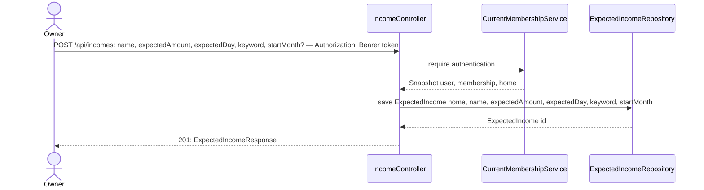
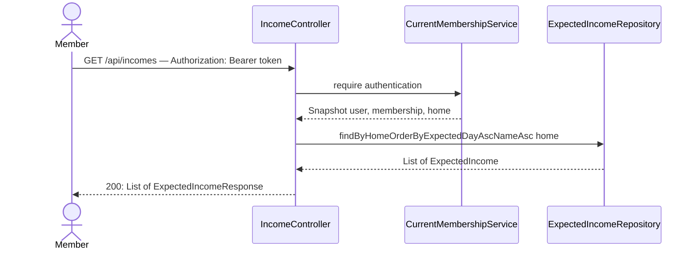

# Declare an expected income

**Prerequisite:** slice 02 (`YearMonthConverter`, `HomeClock`, the Bills page). Independent of slices 03–07 at runtime.

## What it does

Lets the OWNER declare money the Home expects into the shared account each month (e.g. "Ana's contribution, R$ 500, around day 5") and lets every member see the list.

## Why

"Did the money come into the account?" needs the same thing bills needed: an explicit expectation, because there is nothing in Pluggy to infer it from reliably. In the shared-pot model the incoming money is mostly members' monthly transfers, plus anything external (rent, etc.). This slice only stores and lists the declarations; slice 09 checks them against the bank.

Design choices tied to the code:

- **Its own entity, not a `type` column on `Bill`.** A bill and an income share a shape (name, amount, day, keyword, start/end month) but differ in direction (DEBIT vs CREDIT), in vocabulary ("pay by" vs "expected on"), and in where they are headed: incomes will later gain a link to a member (the member-shares epic), bills never will. Two small tables are easier to evolve than one table with a discriminator and nullable columns.
- **Sits in its own `incomes` package** and reuses `HomeClock` and `YearMonthConverter` from `bills` instead of copying them.
- **Domain term "Expected Income", not "contribution".** Contribution implies a member; the epic keeps that word for the later shares epic (see overview).
- **No edit/archive yet.** `endMonth` exists on the table so the follow-up slice (mirroring slice 07) needs no schema change; nothing writes it here.
- **`ddl-auto=update`** creates the `expected_incomes` table automatically, like `bills`.

## Data flow





## Exact changes

Order: entity → repository → request/response → controller → SPA api → hook → form → panel → page.

- [x] **New** [`src/main/java/com/glpalma/HomeTreasury/incomes/ExpectedIncome.java`](../../src/main/java/com/glpalma/HomeTreasury/incomes/ExpectedIncome.java)
  ```java
  package com.glpalma.HomeTreasury.incomes;

  import com.glpalma.HomeTreasury.home.Home;
  import jakarta.persistence.*;

  import java.math.BigDecimal;
  import java.time.YearMonth;

  @Entity
  @Table(name = "expected_incomes")
  public class ExpectedIncome {

      @Id
      @GeneratedValue(strategy = GenerationType.IDENTITY)
      private Long id;

      @ManyToOne(optional = false)
      @JoinColumn(name = "home_id")
      private Home home;

      @Column(nullable = false)
      private String name;

      @Column(nullable = false, precision = 12, scale = 2)
      private BigDecimal expectedAmount;

      /** 1–31: the day the money is expected by. Clamped to the month's last day in shorter months. */
      @Column(nullable = false)
      private int expectedDay;

      /** Matched case- and accent-insensitively against a CREDIT's description / payer name. */
      @Column(nullable = false)
      private String keyword;

      /** First month this income applies to (inclusive). */
      @Column(nullable = false)
      private YearMonth startMonth;

      /** Last month it applies to (inclusive); null = still active. */
      private YearMonth endMonth;

      protected ExpectedIncome() {
      }

      public ExpectedIncome(
              Home home,
              String name,
              BigDecimal expectedAmount,
              int expectedDay,
              String keyword,
              YearMonth startMonth
      ) {
          this.home = home;
          this.name = name;
          this.expectedAmount = expectedAmount;
          this.expectedDay = expectedDay;
          this.keyword = keyword;
          this.startMonth = startMonth;
      }

      public Long getId() {
          return id;
      }

      public Home getHome() {
          return home;
      }

      public String getName() {
          return name;
      }

      public BigDecimal getExpectedAmount() {
          return expectedAmount;
      }

      public int getExpectedDay() {
          return expectedDay;
      }

      public String getKeyword() {
          return keyword;
      }

      public YearMonth getStartMonth() {
          return startMonth;
      }

      public YearMonth getEndMonth() {
          return endMonth;
      }
  }
  ```

- [x] **New** [`src/main/java/com/glpalma/HomeTreasury/incomes/ExpectedIncomeRepository.java`](../../src/main/java/com/glpalma/HomeTreasury/incomes/ExpectedIncomeRepository.java)
  ```java
  package com.glpalma.HomeTreasury.incomes;

  import com.glpalma.HomeTreasury.home.Home;
  import org.springframework.data.jpa.repository.JpaRepository;

  import java.util.List;

  public interface ExpectedIncomeRepository extends JpaRepository<ExpectedIncome, Long> {

      List<ExpectedIncome> findByHomeOrderByExpectedDayAscNameAsc(Home home);
  }
  ```

- [x] **New** [`src/main/java/com/glpalma/HomeTreasury/incomes/CreateExpectedIncomeRequest.java`](../../src/main/java/com/glpalma/HomeTreasury/incomes/CreateExpectedIncomeRequest.java)
  ```java
  package com.glpalma.HomeTreasury.incomes;

  import jakarta.validation.constraints.DecimalMin;
  import jakarta.validation.constraints.Max;
  import jakarta.validation.constraints.Min;
  import jakarta.validation.constraints.NotBlank;
  import jakarta.validation.constraints.NotNull;

  import java.math.BigDecimal;
  import java.time.YearMonth;

  /** {@code startMonth} may be omitted; it then defaults to the current month. */
  public record CreateExpectedIncomeRequest(
          @NotBlank String name,
          @NotNull @DecimalMin("0.01") BigDecimal expectedAmount,
          @Min(1) @Max(31) int expectedDay,
          @NotBlank String keyword,
          YearMonth startMonth
  ) {
  }
  ```

- [x] **New** [`src/main/java/com/glpalma/HomeTreasury/incomes/ExpectedIncomeResponse.java`](../../src/main/java/com/glpalma/HomeTreasury/incomes/ExpectedIncomeResponse.java)
  ```java
  package com.glpalma.HomeTreasury.incomes;

  import java.math.BigDecimal;
  import java.time.YearMonth;

  public record ExpectedIncomeResponse(
          Long id,
          String name,
          BigDecimal expectedAmount,
          int expectedDay,
          String keyword,
          YearMonth startMonth,
          YearMonth endMonth
  ) {
      public static ExpectedIncomeResponse from(ExpectedIncome income) {
          return new ExpectedIncomeResponse(
                  income.getId(),
                  income.getName(),
                  income.getExpectedAmount(),
                  income.getExpectedDay(),
                  income.getKeyword(),
                  income.getStartMonth(),
                  income.getEndMonth()
          );
      }
  }
  ```

- [x] **New** [`src/main/java/com/glpalma/HomeTreasury/incomes/IncomeController.java`](../../src/main/java/com/glpalma/HomeTreasury/incomes/IncomeController.java)
  ```java
  package com.glpalma.HomeTreasury.incomes;

  import com.glpalma.HomeTreasury.bills.HomeClock;
  import com.glpalma.HomeTreasury.home.Home;
  import com.glpalma.HomeTreasury.user.CurrentMembershipService;
  import jakarta.validation.Valid;
  import org.springframework.http.HttpStatus;
  import org.springframework.security.access.prepost.PreAuthorize;
  import org.springframework.security.core.Authentication;
  import org.springframework.web.bind.annotation.*;

  import java.time.YearMonth;
  import java.util.List;

  @RestController
  @RequestMapping("/api/incomes")
  public class IncomeController {

      private final CurrentMembershipService memberships;
      private final ExpectedIncomeRepository incomes;

      public IncomeController(CurrentMembershipService memberships, ExpectedIncomeRepository incomes) {
          this.memberships = memberships;
          this.incomes = incomes;
      }

      @PreAuthorize("hasRole('OWNER')")
      @PostMapping
      @ResponseStatus(HttpStatus.CREATED)
      public ExpectedIncomeResponse create(
              @Valid @RequestBody CreateExpectedIncomeRequest request,
              Authentication authentication
      ) {
          Home home = memberships.require(authentication).home();
          YearMonth startMonth = request.startMonth() == null ? HomeClock.currentMonth() : request.startMonth();
          ExpectedIncome saved = incomes.save(new ExpectedIncome(
                  home,
                  request.name().trim(),
                  request.expectedAmount(),
                  request.expectedDay(),
                  request.keyword().trim(),
                  startMonth
          ));
          return ExpectedIncomeResponse.from(saved);
      }

      @GetMapping
      public List<ExpectedIncomeResponse> list(Authentication authentication) {
          Home home = memberships.require(authentication).home();
          return incomes.findByHomeOrderByExpectedDayAscNameAsc(home).stream()
                  .map(ExpectedIncomeResponse::from)
                  .toList();
      }
  }
  ```

- [x] **New** [`frontend/src/api/incomes.ts`](../../frontend/src/api/incomes.ts)
  ```ts
  import { apiClient } from "./client";

  export interface ExpectedIncome {
    id: number;
    name: string;
    expectedAmount: number;
    /** Day of the month the money is expected by, 1–31. */
    expectedDay: number;
    keyword: string;
    /** "YYYY-MM" */
    startMonth: string;
    /** "YYYY-MM" or null while active. */
    endMonth: string | null;
  }

  export interface ExpectedIncomeInput {
    name: string;
    expectedAmount: number;
    expectedDay: number;
    keyword: string;
    startMonth: string;
  }

  export async function listIncomes(): Promise<ExpectedIncome[]> {
    const { data } = await apiClient.get<ExpectedIncome[]>("/api/incomes");
    return data;
  }

  export async function createIncome(input: ExpectedIncomeInput): Promise<ExpectedIncome> {
    const { data } = await apiClient.post<ExpectedIncome>("/api/incomes", input);
    return data;
  }
  ```

- [x] **New** [`frontend/src/hooks/useIncomes.ts`](../../frontend/src/hooks/useIncomes.ts)
  ```ts
  import { useMutation, useQuery, useQueryClient } from "@tanstack/react-query";
  import { createIncome, listIncomes } from "../api/incomes";

  export function useIncomes() {
    return useQuery({
      queryKey: ["incomes"],
      queryFn: listIncomes,
    });
  }

  export function useCreateIncome() {
    const queryClient = useQueryClient();
    return useMutation({
      mutationFn: createIncome,
      onSuccess: () => {
        queryClient.invalidateQueries({ queryKey: ["incomes"] });
        queryClient.invalidateQueries({ queryKey: ["income-status"] });
      },
    });
  }
  ```

- [x] **New** [`frontend/src/components/incomes/IncomeForm.tsx`](../../frontend/src/components/incomes/IncomeForm.tsx)
  ```tsx
  import { useState, type FormEvent } from "react";
  import type { ExpectedIncomeInput } from "../../api/incomes";
  import { currentMonth } from "../../lib/months";

  interface Props {
    submitLabel: string;
    /** Resolves when saved; rejects (axios error) when the server refuses. */
    onSubmit: (input: ExpectedIncomeInput) => Promise<unknown>;
  }

  const inputClass =
    "w-full rounded-md border border-slate-300 px-3 py-2 text-sm focus:border-slate-500 focus:outline-none";

  export function IncomeForm({ submitLabel, onSubmit }: Props) {
    const [name, setName] = useState("");
    const [expectedAmount, setExpectedAmount] = useState("");
    const [expectedDay, setExpectedDay] = useState("");
    const [keyword, setKeyword] = useState("");
    const [startMonth, setStartMonth] = useState(currentMonth());
    const [saving, setSaving] = useState(false);
    const [error, setError] = useState<string | null>(null);

    const handleSubmit = async (event: FormEvent) => {
      event.preventDefault();
      setSaving(true);
      setError(null);
      try {
        await onSubmit({
          name: name.trim(),
          expectedAmount: Number(expectedAmount),
          expectedDay: Number(expectedDay),
          keyword: keyword.trim(),
          startMonth,
        });
        setName("");
        setExpectedAmount("");
        setExpectedDay("");
        setKeyword("");
        setStartMonth(currentMonth());
      } catch (err) {
        setError((err as any)?.response?.data?.detail ?? "Could not save the income.");
      } finally {
        setSaving(false);
      }
    };

    return (
      <form onSubmit={handleSubmit} className="space-y-3">
        <div>
          <label className="mb-1 block text-sm font-medium text-slate-700">Name</label>
          <input
            required
            className={inputClass}
            value={name}
            onChange={(e) => setName(e.target.value)}
            placeholder="e.g. Ana's contribution"
          />
        </div>
        <div className="grid grid-cols-2 gap-3">
          <div>
            <label className="mb-1 block text-sm font-medium text-slate-700">Expected amount</label>
            <input
              required
              type="number"
              step="0.01"
              min="0.01"
              className={inputClass}
              value={expectedAmount}
              onChange={(e) => setExpectedAmount(e.target.value)}
            />
          </div>
          <div>
            <label className="mb-1 block text-sm font-medium text-slate-700">Expected by day</label>
            <input
              required
              type="number"
              min="1"
              max="31"
              className={inputClass}
              value={expectedDay}
              onChange={(e) => setExpectedDay(e.target.value)}
            />
          </div>
        </div>
        <div>
          <label className="mb-1 block text-sm font-medium text-slate-700">
            Keyword to find in the bank description or sender name
          </label>
          <input
            required
            className={inputClass}
            value={keyword}
            onChange={(e) => setKeyword(e.target.value)}
            placeholder="e.g. ANA SILVA"
          />
          <p className="mt-1 text-xs text-slate-400">
            Use text you saw on an incoming transfer on the Transactions page. Case and accents are ignored.
          </p>
        </div>
        <div>
          <label className="mb-1 block text-sm font-medium text-slate-700">Starts in</label>
          <input
            required
            type="month"
            className={inputClass}
            value={startMonth}
            onChange={(e) => setStartMonth(e.target.value)}
          />
        </div>
        {error && <p className="text-sm text-red-600">{error}</p>}
        <button
          type="submit"
          disabled={saving}
          className="rounded-md bg-slate-900 px-3 py-2 text-sm font-medium text-white hover:bg-slate-700 disabled:opacity-50"
        >
          {saving ? "Saving…" : submitLabel}
        </button>
      </form>
    );
  }
  ```

- [x] **New** [`frontend/src/components/incomes/IncomesPanel.tsx`](../../frontend/src/components/incomes/IncomesPanel.tsx) — declared incomes + add form (slice 09 turns the list into a monthly status)
  ```tsx
  import { useAuth } from "../../context/AuthContext";
  import { useCreateIncome, useIncomes } from "../../hooks/useIncomes";
  import { apiErrorMessage } from "../../lib/errors";
  import { formatCurrency } from "../../lib/format";
  import { formatMonth } from "../../lib/months";
  import { IncomeForm } from "./IncomeForm";

  export function IncomesPanel() {
    const { user } = useAuth();
    const isOwner = user?.role === "OWNER";
    const incomes = useIncomes();
    const createIncome = useCreateIncome();

    return (
      <div className="space-y-4 rounded-lg border border-slate-200 bg-white p-5 shadow-sm">
        <h2 className="text-sm font-medium text-slate-500">Expected incomes</h2>

        {incomes.isError && (
          <p className="text-sm text-amber-800">{apiErrorMessage(incomes.error, "Could not load incomes.")}</p>
        )}
        {incomes.isLoading && <p className="text-sm text-slate-500">Loading…</p>}
        {incomes.data && incomes.data.length === 0 && (
          <p className="text-sm text-slate-500">No expected incomes declared yet.</p>
        )}
        {incomes.data && incomes.data.length > 0 && (
          <ul className="divide-y divide-slate-100">
            {incomes.data.map((income) => (
              <li key={income.id} className="flex items-center justify-between py-2 text-sm">
                <div>
                  <p className="font-medium text-slate-800">{income.name}</p>
                  <p className="text-xs text-slate-400">
                    Expected by day {income.expectedDay} · keyword “{income.keyword}” · from{" "}
                    {formatMonth(income.startMonth)}
                  </p>
                </div>
                <p className="font-medium text-slate-700">{formatCurrency(income.expectedAmount)}</p>
              </li>
            ))}
          </ul>
        )}

        {isOwner && (
          <div className="border-t border-slate-100 pt-4">
            <h3 className="mb-3 text-sm font-medium text-slate-500">Add an expected income</h3>
            <IncomeForm submitLabel="Add income" onSubmit={(input) => createIncome.mutateAsync(input)} />
          </div>
        )}
      </div>
    );
  }
  ```

- [x] **Edit** [`frontend/src/pages/Bills.tsx`](../../frontend/src/pages/Bills.tsx) — render `IncomesPanel` after the bills table (state of the page after slice 07, plus one import and one element)
  ```tsx
  import { useState } from "react";
  import { BillForm } from "../components/bills/BillForm";
  import { BillsTable } from "../components/bills/BillsTable";
  import { IncomesPanel } from "../components/incomes/IncomesPanel";
  import { MonthPicker } from "../components/MonthPicker";
  import { useAuth } from "../context/AuthContext";
  import { useBills, useCreateBill } from "../hooks/useBills";
  import { useBillStatus } from "../hooks/useBillStatus";
  import { apiErrorMessage } from "../lib/errors";
  import { formatCurrency } from "../lib/format";
  import { currentMonth } from "../lib/months";

  export function Bills() {
    const { user } = useAuth();
    const isOwner = user?.role === "OWNER";
    const [month, setMonth] = useState(currentMonth());
    const status = useBillStatus(month);
    const definitions = useBills();
    const createBill = useCreateBill();

    const bills = status.data?.bills ?? [];
    const paidCount = bills.filter((b) => b.status === "PAID").length;
    const expectedTotal = bills.reduce((sum, b) => sum + b.expectedAmount, 0);

    return (
      <div className="mx-auto max-w-4xl space-y-6 p-6">
        <div className="flex items-center justify-between">
          <h1 className="text-2xl font-semibold">Bills</h1>
          <MonthPicker value={month} onChange={setMonth} />
        </div>

        {status.isLoading && <p className="text-slate-500">Checking bills against your bank account…</p>}

        {status.isError && (
          <div className="rounded-md border border-amber-300 bg-amber-50 p-4 text-sm text-amber-800">
            {apiErrorMessage(status.error, "Could not load bills.")}
          </div>
        )}

        {status.data?.transactionsTruncated && (
          <div className="rounded-md border border-amber-300 bg-amber-50 p-4 text-sm text-amber-800">
            This month has more transactions than we can load at once, so some bills may look unpaid by mistake.
          </div>
        )}

        {status.data && (
          <div className="rounded-lg border border-slate-200 bg-white p-5 shadow-sm">
            <div className="mb-3 flex items-center justify-between">
              <h2 className="text-sm font-medium text-slate-500">Bills this month</h2>
              <p className="text-xs text-slate-500">
                {paidCount} of {bills.length} paid · {formatCurrency(expectedTotal)} expected
              </p>
            </div>
            <BillsTable month={month} bills={bills} definitions={definitions.data ?? []} />
          </div>
        )}

        {isOwner && (
          <div className="rounded-lg border border-slate-200 bg-white p-5 shadow-sm">
            <h2 className="mb-3 text-sm font-medium text-slate-500">Add a bill</h2>
            <BillForm
              submitLabel="Add bill"
              resetOnSuccess
              onSubmit={(input) => createBill.mutateAsync(input)}
            />
          </div>
        )}

        <IncomesPanel />
      </div>
    );
  }
  ```

## Verify

1. Backend and frontend start; Hibernate logs `create table expected_incomes`; `npm run build` passes.
2. As OWNER:
   ```
   curl -i -X POST http://localhost:8080/api/incomes \
     -H "Authorization: Bearer $OWNER_TOKEN" -H "Content-Type: application/json" \
     -d '{"name":"Ana contribution","expectedAmount":500.00,"expectedDay":5,"keyword":"ANA SILVA"}'
   ```
   → `201 Created` with `"startMonth":"<current month>"`, `"endMonth":null`.
3. `GET /api/incomes` as a VIEWER of the same Home → `200` with the list; as a VIEWER `POST` → `403`.
4. Invalid: `"expectedDay":0`, `"expectedAmount":-1`, blank keyword → `400` with an `errors` array.
5. A second Home must not see it.
6. Browser: `/bills` shows the "Expected incomes" panel under the bills; the OWNER can add one and it appears in the list; a VIEWER sees no form.

## Out of scope

- Whether the money arrived (slice 09), editing/archiving incomes, linking an income to a member.
- Duplicate-name/keyword checks.
