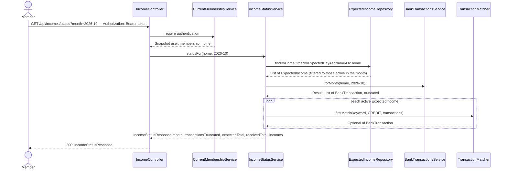

# Monthly income status

**Prerequisites:** slice 08 (`ExpectedIncome`), slice 03 (`TransactionMatcher`, `BillMatch`, `BillStatusCalculator.payByDate`, `HomeClock`), slice 01 (`BankTransactionsService`).

## What it does

For a chosen month, tells every member which expected incomes have arrived in the account (and which transaction proved it), which are still expected, and which are missing.

## Why

The second half of "is everything OK this month": did the money come in? It is the mirror of slice 03 with the direction flipped (CREDIT instead of DEBIT) and different words: an income is `RECEIVED`, `EXPECTED` (not yet due) or `MISSING` (due day passed, nothing found).

Design choices tied to the code:

- **Reuses the same matcher and match record.** `TransactionMatcher.firstMatch(keyword, CREDIT, …)` is exactly why slice 03 made `Direction` a parameter, and the matcher already looks at the payer name when MeuPluggy provides it (`BankTransaction.counterpartName`), which is how "ANA SILVA" can match an incoming Pix whose description only says "PIX RECEBIDO". `BillMatch` is reused as-is even though the name says "Bill": its fields (date, description, absolute amount, 15% hint) are the same, and renaming it would touch slices 03–07 for no behavioural gain. Rename it to `PaymentMatch` in a later cleanup.
- **Same lateness rule as bills.** `MISSING` starts the day *after* the expected day, so a transfer arriving on the expected day is on time, and `PENDING` transactions count as received (data-lag guard).
- **Totals computed on the server.** `expectedTotal` and `receivedTotal` (sum of matched amounts, absolute value) come back with the list so slice 10's coverage card, the Bills page and any future client agree on one definition of "money in".
- **No Pluggy call when nothing applies**, same as slice 03.
- **Read access for every member**; there is nothing to mutate here.

## Data flow



## Today → after

**Today** in [`IncomeController.java`](../../src/main/java/com/glpalma/HomeTreasury/incomes/IncomeController.java) (slice 08): `POST /api/incomes`, `GET /api/incomes`.

**Today** in [`IncomesPanel.tsx`](../../frontend/src/components/incomes/IncomesPanel.tsx) (slice 08): lists declared incomes regardless of month.

**After:** `GET /api/incomes/status?month=` exists; the panel takes the page's `month` and shows each income's status for it.

## Exact changes

Order: enum → response records → service → controller → SPA api/hook → panel → page.

- [x] **New** [`src/main/java/com/glpalma/HomeTreasury/incomes/IncomeStatus.java`](../../src/main/java/com/glpalma/HomeTreasury/incomes/IncomeStatus.java)
  ```java
  package com.glpalma.HomeTreasury.incomes;

  public enum IncomeStatus {
      /** A matching CREDIT exists in the month. */
      RECEIVED,
      /** Nothing found yet, and the expected day has not passed. */
      EXPECTED,
      /** Nothing found, and the expected day is already behind us. */
      MISSING
  }
  ```

- [x] **New** [`src/main/java/com/glpalma/HomeTreasury/incomes/IncomeMonthStatus.java`](../../src/main/java/com/glpalma/HomeTreasury/incomes/IncomeMonthStatus.java)
  ```java
  package com.glpalma.HomeTreasury.incomes;

  import com.glpalma.HomeTreasury.bills.BillMatch;

  import java.math.BigDecimal;
  import java.time.LocalDate;

  /** One expected income's state in one month. {@code match} is null when nothing was found. */
  public record IncomeMonthStatus(
          Long incomeId,
          String name,
          BigDecimal expectedAmount,
          int expectedDay,
          LocalDate expectedBy,
          IncomeStatus status,
          BillMatch match
  ) {
  }
  ```

- [x] **New** [`src/main/java/com/glpalma/HomeTreasury/incomes/IncomeStatusResponse.java`](../../src/main/java/com/glpalma/HomeTreasury/incomes/IncomeStatusResponse.java)
  ```java
  package com.glpalma.HomeTreasury.incomes;

  import java.math.BigDecimal;
  import java.time.YearMonth;
  import java.util.List;

  /**
   * @param expectedTotal Sum of the expected amounts of every income active in the month.
   * @param receivedTotal Sum of the amounts actually found (absolute values) for the matched ones.
   */
  public record IncomeStatusResponse(
          YearMonth month,
          boolean transactionsTruncated,
          BigDecimal expectedTotal,
          BigDecimal receivedTotal,
          List<IncomeMonthStatus> incomes
  ) {
  }
  ```

- [x] **New** [`src/main/java/com/glpalma/HomeTreasury/incomes/IncomeStatusService.java`](../../src/main/java/com/glpalma/HomeTreasury/incomes/IncomeStatusService.java)
  ```java
  package com.glpalma.HomeTreasury.incomes;

  import com.glpalma.HomeTreasury.bills.BillMatch;
  import com.glpalma.HomeTreasury.bills.BillStatusCalculator;
  import com.glpalma.HomeTreasury.bills.HomeClock;
  import com.glpalma.HomeTreasury.bills.TransactionMatcher;
  import com.glpalma.HomeTreasury.home.Home;
  import com.glpalma.HomeTreasury.treasury.BankTransaction;
  import com.glpalma.HomeTreasury.treasury.BankTransactionsService;
  import org.springframework.stereotype.Service;

  import java.math.BigDecimal;
  import java.time.LocalDate;
  import java.time.YearMonth;
  import java.util.List;

  @Service
  public class IncomeStatusService {

      private final ExpectedIncomeRepository incomes;
      private final BankTransactionsService bankTransactions;

      public IncomeStatusService(ExpectedIncomeRepository incomes, BankTransactionsService bankTransactions) {
          this.incomes = incomes;
          this.bankTransactions = bankTransactions;
      }

      public IncomeStatusResponse statusFor(Home home, YearMonth month) {
          List<ExpectedIncome> active = incomes.findByHomeOrderByExpectedDayAscNameAsc(home).stream()
                  .filter(income -> isActiveIn(income, month))
                  .toList();
          if (active.isEmpty()) {
              return new IncomeStatusResponse(month, false, BigDecimal.ZERO, BigDecimal.ZERO, List.of());
          }

          BankTransactionsService.Result result = bankTransactions.forMonth(home, month);
          LocalDate today = HomeClock.today();

          List<IncomeMonthStatus> statuses = active.stream()
                  .map(income -> statusOf(income, month, result.transactions(), today))
                  .toList();

          BigDecimal expectedTotal = active.stream()
                  .map(ExpectedIncome::getExpectedAmount)
                  .reduce(BigDecimal.ZERO, BigDecimal::add);
          BigDecimal receivedTotal = statuses.stream()
                  .filter(status -> status.match() != null)
                  .map(status -> status.match().amount())
                  .reduce(BigDecimal.ZERO, BigDecimal::add);

          return new IncomeStatusResponse(month, result.truncated(), expectedTotal, receivedTotal, statuses);
      }

      private static IncomeMonthStatus statusOf(
              ExpectedIncome income,
              YearMonth month,
              List<BankTransaction> transactions,
              LocalDate today
      ) {
          LocalDate expectedBy = BillStatusCalculator.payByDate(month, income.getExpectedDay());
          BillMatch match = TransactionMatcher
                  .firstMatch(income.getKeyword(), TransactionMatcher.Direction.CREDIT, transactions)
                  .map(tx -> BillMatch.of(tx, income.getExpectedAmount()))
                  .orElse(null);

          IncomeStatus status;
          if (match != null) {
              status = IncomeStatus.RECEIVED;
          } else if (today.isAfter(expectedBy)) {
              // Same rule as bills: arriving on the expected day itself is still on time.
              status = IncomeStatus.MISSING;
          } else {
              status = IncomeStatus.EXPECTED;
          }

          return new IncomeMonthStatus(
                  income.getId(),
                  income.getName(),
                  income.getExpectedAmount(),
                  income.getExpectedDay(),
                  expectedBy,
                  status,
                  match
          );
      }

      /** An income applies from its start month through its end month, both inclusive (no end = forever). */
      private static boolean isActiveIn(ExpectedIncome income, YearMonth month) {
          if (month.isBefore(income.getStartMonth())) {
              return false;
          }
          return income.getEndMonth() == null || !month.isAfter(income.getEndMonth());
      }
  }
  ```

- [x] **Edit** [`src/main/java/com/glpalma/HomeTreasury/incomes/IncomeController.java`](../../src/main/java/com/glpalma/HomeTreasury/incomes/IncomeController.java) — inject `IncomeStatusService`, add `GET /api/incomes/status`
  ```java
  package com.glpalma.HomeTreasury.incomes;

  import com.glpalma.HomeTreasury.bills.HomeClock;
  import com.glpalma.HomeTreasury.home.Home;
  import com.glpalma.HomeTreasury.user.CurrentMembershipService;
  import jakarta.validation.Valid;
  import org.springframework.http.HttpStatus;
  import org.springframework.security.access.prepost.PreAuthorize;
  import org.springframework.security.core.Authentication;
  import org.springframework.web.bind.annotation.*;

  import java.time.YearMonth;
  import java.util.List;

  @RestController
  @RequestMapping("/api/incomes")
  public class IncomeController {

      private final CurrentMembershipService memberships;
      private final ExpectedIncomeRepository incomes;
      private final IncomeStatusService incomeStatus;

      public IncomeController(
              CurrentMembershipService memberships,
              ExpectedIncomeRepository incomes,
              IncomeStatusService incomeStatus
      ) {
          this.memberships = memberships;
          this.incomes = incomes;
          this.incomeStatus = incomeStatus;
      }

      @PreAuthorize("hasRole('OWNER')")
      @PostMapping
      @ResponseStatus(HttpStatus.CREATED)
      public ExpectedIncomeResponse create(
              @Valid @RequestBody CreateExpectedIncomeRequest request,
              Authentication authentication
      ) {
          Home home = memberships.require(authentication).home();
          YearMonth startMonth = request.startMonth() == null ? HomeClock.currentMonth() : request.startMonth();
          ExpectedIncome saved = incomes.save(new ExpectedIncome(
                  home,
                  request.name().trim(),
                  request.expectedAmount(),
                  request.expectedDay(),
                  request.keyword().trim(),
                  startMonth
          ));
          return ExpectedIncomeResponse.from(saved);
      }

      @GetMapping
      public List<ExpectedIncomeResponse> list(Authentication authentication) {
          Home home = memberships.require(authentication).home();
          return incomes.findByHomeOrderByExpectedDayAscNameAsc(home).stream()
                  .map(ExpectedIncomeResponse::from)
                  .toList();
      }

      @GetMapping("/status")
      public IncomeStatusResponse status(
              @RequestParam YearMonth month,
              Authentication authentication
      ) {
          Home home = memberships.require(authentication).home();
          return incomeStatus.statusFor(home, month);
      }
  }
  ```

- [x] **Edit** [`frontend/src/api/incomes.ts`](../../frontend/src/api/incomes.ts) — add the status types and call
  ```ts
  import { apiClient } from "./client";
  import type { BillMatch } from "./bills";

  export interface ExpectedIncome {
    id: number;
    name: string;
    expectedAmount: number;
    /** Day of the month the money is expected by, 1–31. */
    expectedDay: number;
    keyword: string;
    /** "YYYY-MM" */
    startMonth: string;
    /** "YYYY-MM" or null while active. */
    endMonth: string | null;
  }

  export interface ExpectedIncomeInput {
    name: string;
    expectedAmount: number;
    expectedDay: number;
    keyword: string;
    startMonth: string;
  }

  export type IncomeStatus = "RECEIVED" | "EXPECTED" | "MISSING";

  export interface IncomeMonthStatus {
    incomeId: number;
    name: string;
    expectedAmount: number;
    expectedDay: number;
    /** "YYYY-MM-DD" */
    expectedBy: string;
    status: IncomeStatus;
    /** Same shape as a bill match: the CREDIT transaction found, or null. */
    match: BillMatch | null;
  }

  export interface IncomeStatusResponse {
    month: string;
    transactionsTruncated: boolean;
    /** Sum of the expected amounts of every income active in the month. */
    expectedTotal: number;
    /** Sum of the amounts actually found. */
    receivedTotal: number;
    incomes: IncomeMonthStatus[];
  }

  export async function listIncomes(): Promise<ExpectedIncome[]> {
    const { data } = await apiClient.get<ExpectedIncome[]>("/api/incomes");
    return data;
  }

  export async function createIncome(input: ExpectedIncomeInput): Promise<ExpectedIncome> {
    const { data } = await apiClient.post<ExpectedIncome>("/api/incomes", input);
    return data;
  }

  export async function getIncomeStatus(month: string): Promise<IncomeStatusResponse> {
    const { data } = await apiClient.get<IncomeStatusResponse>("/api/incomes/status", {
      params: { month },
    });
    return data;
  }
  ```

- [x] **Edit** [`frontend/src/hooks/useIncomes.ts`](../../frontend/src/hooks/useIncomes.ts) — add `useIncomeStatus`
  ```ts
  import { useMutation, useQuery, useQueryClient } from "@tanstack/react-query";
  import { createIncome, getIncomeStatus, listIncomes } from "../api/incomes";

  export function useIncomes() {
    return useQuery({
      queryKey: ["incomes"],
      queryFn: listIncomes,
    });
  }

  export function useIncomeStatus(month: string) {
    return useQuery({
      queryKey: ["income-status", month],
      queryFn: () => getIncomeStatus(month),
    });
  }

  export function useCreateIncome() {
    const queryClient = useQueryClient();
    return useMutation({
      mutationFn: createIncome,
      onSuccess: () => {
        queryClient.invalidateQueries({ queryKey: ["incomes"] });
        queryClient.invalidateQueries({ queryKey: ["income-status"] });
      },
    });
  }
  ```

- [x] **Edit** [`frontend/src/components/incomes/IncomesPanel.tsx`](../../frontend/src/components/incomes/IncomesPanel.tsx) — show each income's status for the selected month
  ```tsx
  import type { IncomeStatus } from "../../api/incomes";
  import { useAuth } from "../../context/AuthContext";
  import { useCreateIncome, useIncomeStatus } from "../../hooks/useIncomes";
  import { apiErrorMessage } from "../../lib/errors";
  import { formatCurrency } from "../../lib/format";
  import { formatDay } from "../../lib/months";
  import { IncomeForm } from "./IncomeForm";

  const STATUS_STYLES: Record<IncomeStatus, string> = {
    RECEIVED: "bg-emerald-100 text-emerald-800",
    EXPECTED: "bg-slate-100 text-slate-600",
    MISSING: "bg-red-100 text-red-800",
  };

  const STATUS_LABELS: Record<IncomeStatus, string> = {
    RECEIVED: "Received",
    EXPECTED: "Expected",
    MISSING: "Missing",
  };

  interface Props {
    month: string;
  }

  export function IncomesPanel({ month }: Props) {
    const { user } = useAuth();
    const isOwner = user?.role === "OWNER";
    const status = useIncomeStatus(month);
    const createIncome = useCreateIncome();

    const incomes = status.data?.incomes ?? [];

    return (
      <div className="space-y-4 rounded-lg border border-slate-200 bg-white p-5 shadow-sm">
        <div className="flex items-center justify-between">
          <h2 className="text-sm font-medium text-slate-500">Expected incomes this month</h2>
          {status.data && incomes.length > 0 && (
            <p className="text-xs text-slate-500">
              {formatCurrency(status.data.receivedTotal)} of {formatCurrency(status.data.expectedTotal)} received
            </p>
          )}
        </div>

        {status.isError && (
          <p className="text-sm text-amber-800">{apiErrorMessage(status.error, "Could not load incomes.")}</p>
        )}
        {status.isLoading && <p className="text-sm text-slate-500">Checking incoming money…</p>}
        {status.data?.transactionsTruncated && (
          <p className="text-xs text-amber-700">
            Some transactions could not be loaded, so an income may look missing by mistake.
          </p>
        )}
        {status.data && incomes.length === 0 && (
          <p className="text-sm text-slate-500">No expected incomes apply to this month.</p>
        )}

        {incomes.length > 0 && (
          <ul className="divide-y divide-slate-100">
            {incomes.map((income) => (
              <li key={income.incomeId} className="flex items-center justify-between gap-3 py-2 text-sm">
                <div>
                  <p className="font-medium text-slate-800">{income.name}</p>
                  <p className="text-xs text-slate-400">
                    {income.match
                      ? `Arrived ${formatDay(income.match.date)} · ${formatCurrency(income.match.amount)}`
                      : `Expected by ${formatDay(income.expectedBy)}`}
                    {income.match?.amountDiffers && (
                      <span className="ml-2 rounded-full bg-amber-100 px-2 py-0.5 text-amber-800">amount differs</span>
                    )}
                  </p>
                </div>
                <div className="flex items-center gap-3">
                  <span className="text-slate-600">{formatCurrency(income.expectedAmount)}</span>
                  <span className={`rounded-full px-3 py-1 text-xs font-semibold ${STATUS_STYLES[income.status]}`}>
                    {STATUS_LABELS[income.status]}
                  </span>
                </div>
              </li>
            ))}
          </ul>
        )}

        {isOwner && (
          <div className="border-t border-slate-100 pt-4">
            <h3 className="mb-3 text-sm font-medium text-slate-500">Add an expected income</h3>
            <IncomeForm submitLabel="Add income" onSubmit={(input) => createIncome.mutateAsync(input)} />
          </div>
        )}
      </div>
    );
  }
  ```

- [x] **Edit** [`frontend/src/pages/Bills.tsx`](../../frontend/src/pages/Bills.tsx) — pass the selected month to the panel (the only change is `<IncomesPanel month={month} />`)
  ```tsx
  import { useState } from "react";
  import { BillForm } from "../components/bills/BillForm";
  import { BillsTable } from "../components/bills/BillsTable";
  import { IncomesPanel } from "../components/incomes/IncomesPanel";
  import { MonthPicker } from "../components/MonthPicker";
  import { useAuth } from "../context/AuthContext";
  import { useBills, useCreateBill } from "../hooks/useBills";
  import { useBillStatus } from "../hooks/useBillStatus";
  import { apiErrorMessage } from "../lib/errors";
  import { formatCurrency } from "../lib/format";
  import { currentMonth } from "../lib/months";

  export function Bills() {
    const { user } = useAuth();
    const isOwner = user?.role === "OWNER";
    const [month, setMonth] = useState(currentMonth());
    const status = useBillStatus(month);
    const definitions = useBills();
    const createBill = useCreateBill();

    const bills = status.data?.bills ?? [];
    const paidCount = bills.filter((b) => b.status === "PAID").length;
    const expectedTotal = bills.reduce((sum, b) => sum + b.expectedAmount, 0);

    return (
      <div className="mx-auto max-w-4xl space-y-6 p-6">
        <div className="flex items-center justify-between">
          <h1 className="text-2xl font-semibold">Bills</h1>
          <MonthPicker value={month} onChange={setMonth} />
        </div>

        {status.isLoading && <p className="text-slate-500">Checking bills against your bank account…</p>}

        {status.isError && (
          <div className="rounded-md border border-amber-300 bg-amber-50 p-4 text-sm text-amber-800">
            {apiErrorMessage(status.error, "Could not load bills.")}
          </div>
        )}

        {status.data?.transactionsTruncated && (
          <div className="rounded-md border border-amber-300 bg-amber-50 p-4 text-sm text-amber-800">
            This month has more transactions than we can load at once, so some bills may look unpaid by mistake.
          </div>
        )}

        {status.data && (
          <div className="rounded-lg border border-slate-200 bg-white p-5 shadow-sm">
            <div className="mb-3 flex items-center justify-between">
              <h2 className="text-sm font-medium text-slate-500">Bills this month</h2>
              <p className="text-xs text-slate-500">
                {paidCount} of {bills.length} paid · {formatCurrency(expectedTotal)} expected
              </p>
            </div>
            <BillsTable month={month} bills={bills} definitions={definitions.data ?? []} />
          </div>
        )}

        {isOwner && (
          <div className="rounded-lg border border-slate-200 bg-white p-5 shadow-sm">
            <h2 className="mb-3 text-sm font-medium text-slate-500">Add a bill</h2>
            <BillForm
              submitLabel="Add bill"
              resetOnSuccess
              onSubmit={(input) => createBill.mutateAsync(input)}
            />
          </div>
        )}

        <IncomesPanel month={month} />
      </div>
    );
  }
  ```

## Verify

1. Backend and frontend start; `npm run build` passes.
2. Declare an income whose keyword matches a real **incoming** transfer this month (see slice 01's verify step 8: description or `counterpartName`), expected day in the past (slice 08 verify step 2 command).
3. `curl -i "http://localhost:8080/api/incomes/status?month=2026-10" -H "Authorization: Bearer $TOKEN"` → `200 OK`:
   ```json
   { "month": "2026-10", "transactionsTruncated": false,
     "expectedTotal": 500.00, "receivedTotal": 500.00,
     "incomes": [ { "incomeId": 1, "name": "Ana contribution", "expectedAmount": 500.00,
                    "expectedDay": 5, "expectedBy": "2026-10-05", "status": "RECEIVED",
                    "match": { "transactionId": "…", "date": "2026-10-03", "description": "…",
                               "amount": 500.00, "amountDiffers": false } } ] }
   ```
4. A keyword that matches nothing + expected day already past → `"status": "MISSING"`, `"match": null`, and `receivedTotal` excludes it. Expected day later than today → `"EXPECTED"`.
5. A keyword that only appears on a **debit** (e.g. `ENEL`) must **not** match an income — direction is CREDIT only.
6. Browse to a month before the income's `startMonth` → `"incomes": []`, `expectedTotal` and `receivedTotal` both `0`, and no Pluggy call in the backend log.
7. Home without a linked Pluggy Item but with an income declared → `404`.
8. Browser: `/bills` shows each income with a Received / Expected / Missing chip that follows the month picker; the totals line reads "R$ 500,00 of R$ 500,00 received".

## Out of scope

- Per-member attribution of incoming money (separate epic).
- Marking an income as received by hand.
- The coverage verdict "does the money cover the bills?" (slice 10).
- Editing or archiving incomes (follow-up slice mirroring slice 07).
