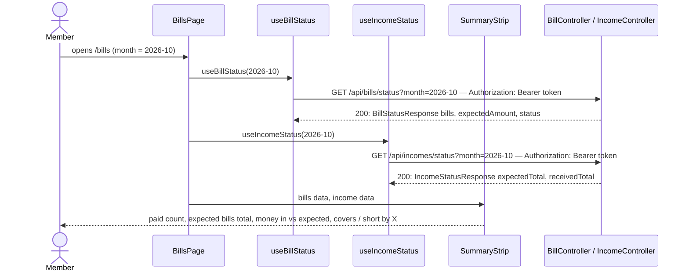

# Coverage card

**Prerequisites:** slice 03 (`useBillStatus`, bill statuses) and slice 09 (`useIncomeStatus`, `receivedTotal`). No backend change.

## What it does

Adds a summary strip at the top of the Bills page — bills paid, expected bills total, and money in versus expected incomes — with one plain verdict: whether the money that has arrived so far covers the month's bills.

## Why

This is the "app sees that the money has come in *and that it covers the bill*" request. Slices 03 and 09 each answer half; neither tells you whether the two add up. The verdict is a pure subtraction over data both endpoints already return (`expected` amounts of the active bills vs. `receivedTotal` from the income status), so it is computed in the SPA rather than as a third backend endpoint that would re-fetch the same Pluggy transactions a third time.

Design choices tied to the data:

- **"Covers" compares received money to the bills' expected amounts.** Bills' actual amounts are unknown until paid (electricity varies), and the household funds them with a fixed contribution based on past averages — the expected amount is the planning number. Once a bill is matched, its *real* amount is shown in the table; the strip stays on the plan.
- **Not-yet-covered is amber, not red.** Early in the month the money legitimately hasn't all arrived; a red alarm there would teach people to ignore it. Overdue bills and missing incomes already have red states of their own.
- **Cents, not floats.** Amounts are summed and compared in integer cents so `0.1 + 0.2`-style errors cannot flip "covers" to "short by R$ 0,00".
- **Degrades per card.** If the income status fails (e.g. the bank provider hiccups for that call), the bills cards still render and the money card shows an unavailable state.
- **Replaces slice 03's one-line summary.** The "N of M paid · R$ X expected" line in the table header becomes redundant and is removed.
- **No incomes declared** → the money card says so instead of showing a meaningless 0 of 0, and there is no verdict.

## Data flow



## Today → after

**Today** in [`Bills.tsx`](../../frontend/src/pages/Bills.tsx) (slice 09 state): the bills card header shows `N of M paid · R$ X expected`; nothing relates income to bills.

**After:** a `SummaryStrip` sits between the month picker and the bills card; the header line is gone.

## Exact changes

Order: pure calculation → component → page.

- [x] **New** [`frontend/src/lib/coverage.ts`](../../frontend/src/lib/coverage.ts)
  ```ts
  import type { BillMonthStatus } from "../api/bills";
  import type { IncomeStatusResponse } from "../api/incomes";

  export interface Coverage {
    /** Sum of the expected amounts of the bills that apply this month. */
    billsExpectedTotal: number;
    /** Sum of the expected amounts of the incomes that apply this month. */
    incomesExpectedTotal: number;
    /** Money found for those incomes so far. */
    incomesReceivedTotal: number;
    /** False when the money received so far is less than the bills' expected total. */
    covers: boolean;
    /** How much more is needed to cover the bills; 0 when it covers. */
    shortBy: number;
  }

  const toCents = (value: number) => Math.round(value * 100);
  const fromCents = (cents: number) => cents / 100;

  /** Pure: compares in integer cents so rounding noise never flips the verdict. */
  export function computeCoverage(bills: BillMonthStatus[], incomes: IncomeStatusResponse): Coverage {
    const billsCents = bills.reduce((sum, bill) => sum + toCents(bill.expectedAmount), 0);
    const receivedCents = toCents(incomes.receivedTotal);
    const shortCents = Math.max(0, billsCents - receivedCents);

    return {
      billsExpectedTotal: fromCents(billsCents),
      incomesExpectedTotal: incomes.expectedTotal,
      incomesReceivedTotal: incomes.receivedTotal,
      covers: shortCents === 0,
      shortBy: fromCents(shortCents),
    };
  }
  ```

- [x] **New** [`frontend/src/components/bills/SummaryStrip.tsx`](../../frontend/src/components/bills/SummaryStrip.tsx)
  ```tsx
  import type { BillStatusResponse } from "../../api/bills";
  import type { IncomeStatusResponse } from "../../api/incomes";
  import { computeCoverage } from "../../lib/coverage";
  import { formatCurrency } from "../../lib/format";

  interface Props {
    bills: BillStatusResponse | undefined;
    /** Undefined while loading or when the income request failed. */
    incomes: IncomeStatusResponse | undefined;
  }

  const cardClass = "rounded-lg border border-slate-200 bg-white p-5 shadow-sm";

  export function SummaryStrip({ bills, incomes }: Props) {
    if (!bills) {
      return null;
    }

    const paidCount = bills.bills.filter((b) => b.status === "PAID").length;
    const coverage = incomes ? computeCoverage(bills.bills, incomes) : null;
    const hasIncomes = incomes ? incomes.incomes.length > 0 : false;

    return (
      <div className="grid gap-4 sm:grid-cols-3">
        <div className={cardClass}>
          <p className="text-sm font-medium text-slate-500">Bills paid</p>
          <p className="mt-1 text-3xl font-semibold">
            {paidCount} <span className="text-lg font-normal text-slate-400">of {bills.bills.length}</span>
          </p>
        </div>

        <div className={cardClass}>
          <p className="text-sm font-medium text-slate-500">Expected bills total</p>
          <p className="mt-1 text-3xl font-semibold">
            {formatCurrency(coverage?.billsExpectedTotal ?? bills.bills.reduce((s, b) => s + b.expectedAmount, 0))}
          </p>
        </div>

        <div className={cardClass}>
          <p className="text-sm font-medium text-slate-500">Money in this month</p>
          {!incomes && <p className="mt-2 text-sm text-slate-500">Unavailable right now.</p>}
          {incomes && !hasIncomes && (
            <p className="mt-2 text-sm text-slate-500">No expected incomes apply to this month.</p>
          )}
          {incomes && hasIncomes && coverage && (
            <>
              <p className="mt-1 text-3xl font-semibold">
                {formatCurrency(coverage.incomesReceivedTotal)}{" "}
                <span className="text-lg font-normal text-slate-400">
                  of {formatCurrency(coverage.incomesExpectedTotal)}
                </span>
              </p>
              <div className="mt-2 h-2 overflow-hidden rounded-full bg-slate-100">
                <div
                  className="h-full bg-emerald-500"
                  style={{
                    width: `${Math.min(
                      100,
                      coverage.incomesExpectedTotal > 0
                        ? (coverage.incomesReceivedTotal / coverage.incomesExpectedTotal) * 100
                        : 0
                    )}%`,
                  }}
                />
              </div>
              <p className={`mt-2 text-xs font-medium ${coverage.covers ? "text-emerald-700" : "text-amber-700"}`}>
                {coverage.covers
                  ? "Covers this month's bills."
                  : `${formatCurrency(coverage.shortBy)} still needed to cover this month's bills.`}
              </p>
            </>
          )}
        </div>
      </div>
    );
  }
  ```

- [x] **Edit** [`frontend/src/pages/Bills.tsx`](../../frontend/src/pages/Bills.tsx) — add the strip, drop the old header summary
  ```tsx
  import { useState } from "react";
  import { BillForm } from "../components/bills/BillForm";
  import { BillsTable } from "../components/bills/BillsTable";
  import { SummaryStrip } from "../components/bills/SummaryStrip";
  import { IncomesPanel } from "../components/incomes/IncomesPanel";
  import { MonthPicker } from "../components/MonthPicker";
  import { useAuth } from "../context/AuthContext";
  import { useBills, useCreateBill } from "../hooks/useBills";
  import { useBillStatus } from "../hooks/useBillStatus";
  import { useIncomeStatus } from "../hooks/useIncomes";
  import { apiErrorMessage } from "../lib/errors";
  import { currentMonth } from "../lib/months";

  export function Bills() {
    const { user } = useAuth();
    const isOwner = user?.role === "OWNER";
    const [month, setMonth] = useState(currentMonth());
    const status = useBillStatus(month);
    const incomeStatus = useIncomeStatus(month);
    const definitions = useBills();
    const createBill = useCreateBill();

    return (
      <div className="mx-auto max-w-4xl space-y-6 p-6">
        <div className="flex items-center justify-between">
          <h1 className="text-2xl font-semibold">Bills</h1>
          <MonthPicker value={month} onChange={setMonth} />
        </div>

        {status.isLoading && <p className="text-slate-500">Checking bills against your bank account…</p>}

        {status.isError && (
          <div className="rounded-md border border-amber-300 bg-amber-50 p-4 text-sm text-amber-800">
            {apiErrorMessage(status.error, "Could not load bills.")}
          </div>
        )}

        {status.data?.transactionsTruncated && (
          <div className="rounded-md border border-amber-300 bg-amber-50 p-4 text-sm text-amber-800">
            This month has more transactions than we can load at once, so some bills may look unpaid by mistake.
          </div>
        )}

        <SummaryStrip bills={status.data} incomes={incomeStatus.data} />

        {status.data && (
          <div className="rounded-lg border border-slate-200 bg-white p-5 shadow-sm">
            <h2 className="mb-3 text-sm font-medium text-slate-500">Bills this month</h2>
            <BillsTable month={month} bills={status.data.bills} definitions={definitions.data ?? []} />
          </div>
        )}

        {isOwner && (
          <div className="rounded-lg border border-slate-200 bg-white p-5 shadow-sm">
            <h2 className="mb-3 text-sm font-medium text-slate-500">Add a bill</h2>
            <BillForm
              submitLabel="Add bill"
              resetOnSuccess
              onSubmit={(input) => createBill.mutateAsync(input)}
            />
          </div>
        )}

        <IncomesPanel month={month} />
      </div>
    );
  }
  ```

## Verify

1. `cd frontend && npm run build` → no TypeScript errors.
2. Set up the October example: bills Electricity 210 + Water 95 + Internet 120 + Rent 650 + Gas 75 (expected total 1,150) — any set works; and incomes whose keywords match real incoming transfers totalling at least that much.
3. Open `/bills`. The strip shows: `Bills paid N of M`, the expected bills total, and `Money in this month  R$ X of R$ Y` with a progress bar and **"Covers this month's bills."** in green.
4. Make the received money smaller than the bills' expected total (use a month where an income is `MISSING`, or declare a high-amount bill): the card shows an amber `R$ … still needed to cover this month's bills.` and the number equals `billsExpectedTotal − receivedTotal`.
5. Rounding check: declare bills of 0.10 and 0.20 and an income received of exactly 0.30 → "Covers", never "R$ 0,00 still needed".
6. A month with no incomes declared → the third card says "No expected incomes apply to this month." with no verdict. A month with no bills → `0 of 0`, expected total R$ 0,00.
7. Stop the backend from reaching Pluggy for one call only (not easy to simulate; or temporarily make `GET /api/incomes/status` return 502) → bills cards still render and the money card says "Unavailable right now."
8. Switch months with the picker: all three cards update together.

## Out of scope

- A backend `GET /api/bills/summary` endpoint (would triple-fetch transactions; revisit once `BankTransactionsService.forRange` has a cache).
- Using *actual* paid amounts in the coverage verdict.
- Forecasting (e.g. "money still expected later this month will cover it").
- Per-member breakdown of the money in — the member-shares epic.
